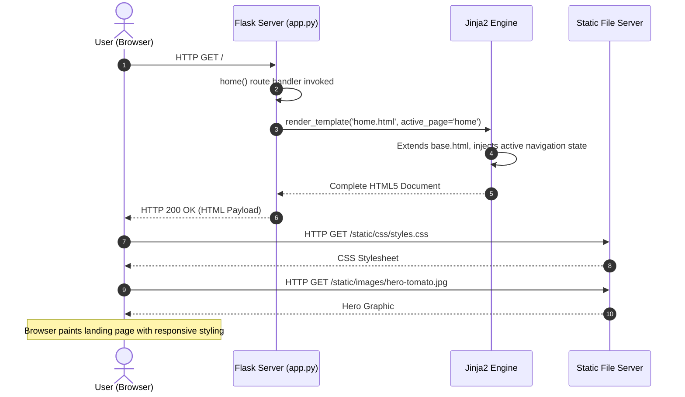
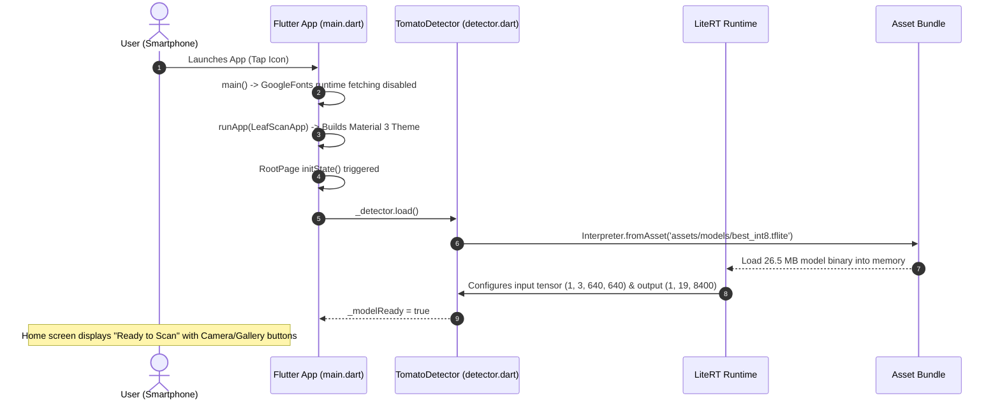
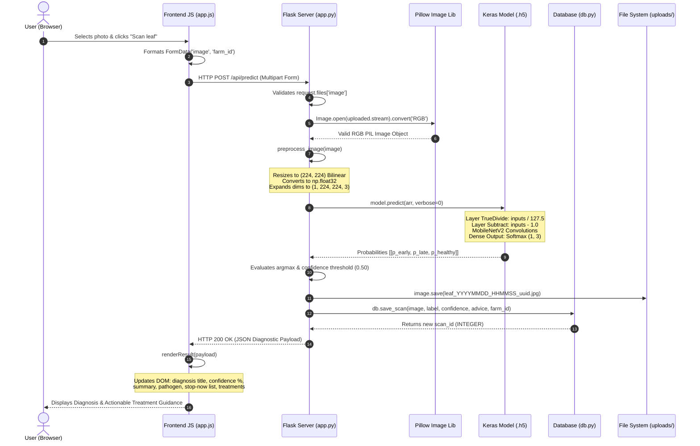
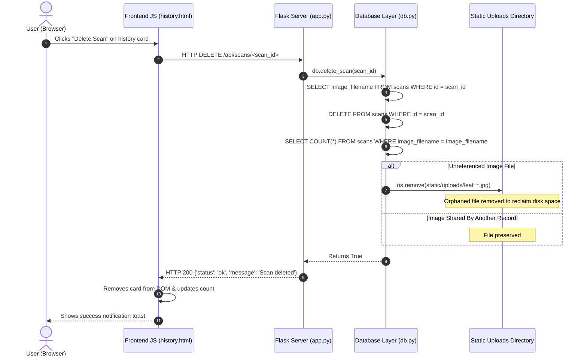
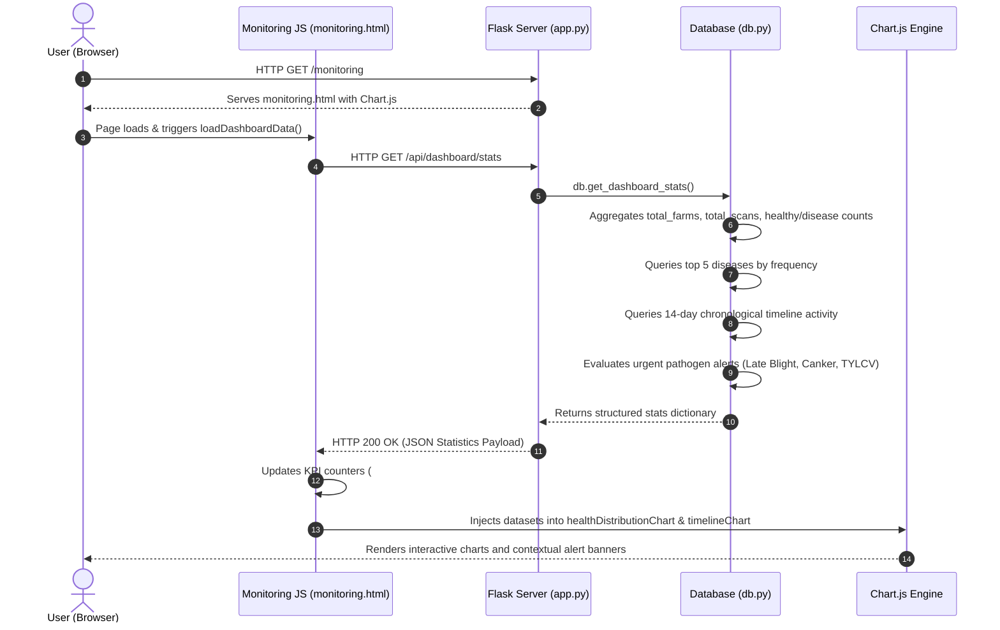

# Phase Two: Complete System Architecture & End-to-End Workflows

**Document:** `docs/02_system_architecture.md`  
**System:** LeafScan (Tomato Leaf Scan) AI Crop Health Platform  
**Target Audience:** Beginner to Intermediate Software & ML Engineers  

---

## 1. Architectural Reality: What Actually Exists in LeafScan

Before drawing diagrams, we must distinguish between what is present and what is absent in the repository:

1. **Web Frontend:** **PRESENT**. Built with HTML5, Jinja2 templates, Vanilla CSS design system, and Vanilla JavaScript (ES6). No Node.js build step, React, or Vue is required.
2. **Mobile Frontend:** **PRESENT**. Built with Google Flutter (Dart 3.3+). Features an offline-first camera and gallery image picker, local TFLite execution, and an AI chat interface.
3. **Backend API & Server:** **PRESENT**. A Python Flask application server running locally at `127.0.0.1:5000`. Exposes REST JSON endpoints for inference, farm plot CRUD, and scan history.
4. **AI Inference Services:**
   - **Web Inference:** Embedded directly into the Flask process via TensorFlow CPU/Keras, executing `tomato_disease_model.h5` (3 classes: Early Blight, Late Blight, Healthy Leaf).
   - **Mobile Inference:** Embedded directly on the mobile device via `tflite_flutter`, executing `best_int8.tflite` (15 classes, YOLOv8).
   - **Divergence Note:** There is NO central AI microservice. Inference is performed in-process on both platforms.
5. **Database & Persistence:** **PRESENT**. Embedded SQLite relational database at `web-app/database/leafscan.db` with two tables (`farms` and `scans`).
6. **Image Storage:** **PRESENT**. File-system storage located at `web-app/frontend/static/uploads/`.
7. **Authentication & Authorization:** **ABSENT**. The application has no user registration, login, passwords, session tokens, or API keys. Anyone with network access to the port can perform all operations.
8. **External APIs & Services:**
   - **Web App:** Uses CDN-hosted Google Fonts, FontAwesome icons, and Chart.js.
   - **Mobile App:** Makes optional outbound HTTPS requests to the DeepSeek Chat API (`https://api.deepseek.com/chat/completions`) for conversational agronomic advice.
9. **Platform Interconnection:** **STANDALONE / DISCONNECTED**. The Flutter mobile app does NOT communicate with the Flask web server or the SQLite database. They are two independent client applications.

---

## 2. Master System Architecture Diagram

```mermaid
graph TB
    subgraph Client Layer
        WebBrowser["Desktop / Mobile Web Browser\n(HTML5, CSS, JS, Chart.js)"]
        MobileDevice["Android / iOS Smartphone\n(Flutter / Dart Native App)"]
    end

    subgraph External Cloud Services
        DeepSeekCloud["DeepSeek AI Cloud\napi.deepseek.com\n(Optional Agronomist Chat)"]
        CDN["Static CDNs\n(Google Fonts, FontAwesome, Chart.js)"]
    end

    subgraph Web Application Boundary (localhost:5000)
        Flask["Flask Web Server (Python 3.11)\nweb-app/backend/app.py"]
        
        subgraph In-Process Web AI Engine
            KerasEngine["TensorFlow / Keras Runtime\n(Custom TrueDivide & Subtract Layers)"]
            H5Weights["tomato_disease_model.h5\n(23.26 MB, 3 Classes)"]
        end

        subgraph Data Access Layer
            DBShim["Database Module (db.py)\nContext Manager & Foreign Keys"]
            SQLiteFile[("SQLite Database\nweb-app/database/leafscan.db\n(farms & scans tables)")]
            DiskStorage[("Static Uploads Directory\nweb-app/frontend/static/uploads/\n(leaf_*.jpg images)")]
        end
    end

    subgraph Mobile Device Boundary (Offline Edge)
        FlutterUI["Flutter UI Layer\n(IndexedStack: Home, Scan, Analysis, Chat)"]
        
        subgraph On-Device Mobile AI Engine
            TFLiteRuntime["LiteRT / TFLite Flutter Engine\n(4 CPU Threads)"]
            TFLiteWeights["best_int8.tflite Asset\n(26.5 MB, 15 Classes YOLOv8)"]
            NMSProcessor["Anchor Parser & NMS Engine\n(8400 Anchors -> Bounding Boxes)"]
        end

        MobileKnowledge["Offline Disease DB\n(disease_info.dart)"]
    end

    %% Web Interactions
    WebBrowser -->|HTTP GET Page Views & Assets| Flask
    WebBrowser -->|HTTP POST /api/predict (Multipart Form)| Flask
    WebBrowser -->|HTTP REST /api/farms & /api/scans| Flask
    CDN -.->|Styles & Scripts| WebBrowser

    Flask -->|Image Array (1, 224, 224, 3)| KerasEngine
    KerasEngine -->|Read Weights| H5Weights
    KerasEngine -->|Raw Probabilities (1, 3)| Flask

    Flask -->|Save Scan & Farm Records| DBShim
    DBShim -->|Read / Write SQL| SQLiteFile
    Flask -->|Write Image Bytes| DiskStorage

    %% Mobile Interactions
    MobileDevice -->|User Interaction| FlutterUI
    FlutterUI -->|Image Bytes (640x640)| TFLiteRuntime
    TFLiteRuntime -->|Read Bundled Asset| TFLiteWeights
    TFLiteRuntime -->|Tensor [1, 19, 8400]| NMSProcessor
    NMSProcessor -->|Filtered Detections| FlutterUI
    FlutterUI -->|Lookup Disease Advice| MobileKnowledge
    FlutterUI -.->|HTTPS Query (Optional with API Key)| DeepSeekCloud
```

---

## 3. Component Deep Dive & Plain-English Explanations

### Component 1: The Web Presentation Layer (`web-app/frontend/`)
- **What it is:** The visual interface running inside the user's web browser.
- **How it works:** When the user visits `http://127.0.0.1:5000`, Flask delivers HTML rendered with Jinja2. The page loads `styles.css` for aesthetic styling and `app.js` for dynamic interactions.
- **Why it matters:** It provides a zero-install experience. Farmers and managers can inspect leaves, manage multiple farm plots, and view analytics directly in Chrome, Firefox, or Safari.

### Component 2: The Flask Application Server (`web-app/backend/app.py`)
- **What it is:** A lightweight Python web server that coordinates all web requests.
- **How it works:** It listens for incoming HTTP requests on port 5000. It routes requests to specific Python functions based on the URL path and HTTP method (`GET`, `POST`, `PUT`, `DELETE`).
- **Why it matters:** It acts as the central hub of the web tier. It receives uploaded leaf files, feeds them to the machine learning model, coordinates with the database module, and formats the output into clean JSON.

### Component 3: The Web Machine Learning Model (`tomato_disease_model.h5`)
- **What it is:** A trained deep learning convolutional neural network (MobileNetV2 backbone) stored as a binary HDF5 file.
- **How it works:** Loaded into server memory when the first scan request arrives (lazy loading via `ensure_model_loaded()`). It accepts a numerical array of shape `(1, 224, 224, 3)` containing normalized pixel values and outputs 3 probability numbers that sum to 1.0 (softmax).
- **Why it matters:** It classifies the leaf into one of three critical agronomic states: Early Blight, Late Blight, or Healthy Leaf.

### Component 4: The Database Layer (`web-app/backend/db.py` & `leafscan.db`)
- **What it is:** An embedded SQLite relational database requiring zero external server configuration.
- **How it works:** Managed through a Python context manager (`get_db_connection()`) that automatically opens connections with foreign keys enabled, commits transactions, and closes file handles.
- **Why it matters:** It preserves longitudinal crop health records. When a leaf is scanned, its diagnosis, confidence, and timestamp are saved permanently, enabling historical trend tracking.

### Component 5: The Mobile Application (`mobile-app/`)
- **What it is:** A native mobile application built with Flutter, compiled for Android and iOS.
- **How it works:** It runs entirely on the smartphone hardware. It accesses the device camera via `image_picker`, passes photos to an embedded TensorFlow Lite interpreter, and displays bounding boxes and treatment guidance without requiring an active Internet connection.
- **Why it matters:** Rural agricultural fields often have weak or non-existent cellular coverage. The mobile app allows farmers to diagnose crops offline at the edge.

---

## 4. End-to-End Workflow Tracing

Here we trace the exact step-by-step path of data through the codebase for all major workflows.

---

### Workflow A: A User Opens the Website



1. **User Action:** The user types `http://127.0.0.1:5000/` into their browser.
2. **Route Match:** Flask matches the request to `@app.route('/')` in [app.py](file:///d:/projects/blight/Leafscan-main/web-app/backend/app.py#L223-L225).
3. **Template Rendering:** `home()` executes `render_template('home.html', active_page='home')`. Jinja2 reads `base.html`, injects the `active_page` CSS class to highlight the "Home" navigation item, and embeds the hero section and feature cards.
4. **Asset Retrieval:** The browser parses the HTML and issues secondary `GET` requests for `/static/css/styles.css`, FontAwesome icons, and `/static/images/hero-tomato.jpg`.
5. **Display:** The browser renders the responsive landing page.

---

### Workflow B: A User Opens the Mobile Application



1. **User Action:** The user taps the LeafScan icon on their mobile device.
2. **Initialization:** In [mobile-app/lib/main.dart](file:///d:/projects/blight/Leafscan-main/mobile-app/lib/main.dart#L12-L16), `main()` runs. `GoogleFonts.config.allowRuntimeFetching = false` ensures all fonts load from local assets.
3. **Widget Construction:** `LeafScanApp` initializes the root widget with a custom teal palette (`#0B8379`).
4. **Model Loading:** `RootPage.initState()` calls `_loadModel()`, which invokes `TomatoDetector.load()` in [detector.dart](file:///d:/projects/blight/Leafscan-main/mobile-app/lib/models/detector.dart#L83-L90).
5. **Tensor Configuration:** `Interpreter.fromAsset('assets/models/best_int8.tflite')` allocates 4 CPU threads, inspects the quantization parameters (`scale`, `zeroPoint`), and stores input dimensions ($640 \times 640$).
6. **UI Ready:** The state variable `_modelReady` becomes `true`, and the Home tab is displayed.

---

### Workflows C, D, E, F, G: End-to-End Web Scan & Prediction

This is the primary workflow of the system: uploading a photo, running AI inference, displaying the diagnosis, and receiving treatment advice.



#### Detailed Code Step-by-Step Breakdown:
1. **File Selection & Preview:**
   - In `scan.html`, the user drops an image into `<input id="image-input" type="file">`.
   - [app.js](file:///d:/projects/blight/Leafscan-main/web-app/frontend/static/js/app.js#L58-L77) catches the `change` event, validates the MIME type (`image/jpeg`, `image/png`, `image/webp`), and invokes `updatePreview()`.
   - `URL.createObjectURL(file)` generates an in-memory blob URL, instantly rendering the leaf preview without uploading to the server yet.
2. **Form Submission:**
   - The user clicks `#analyze-btn`. [app.js](file:///d:/projects/blight/Leafscan-main/web-app/frontend/static/js/app.js#L120-L145) disables the button, adds a spinning spinner icon, and packages the binary image and optional `#farm-select` value into a `FormData` object.
   - It issues an asynchronous HTTP POST to `/api/predict`.
3. **Backend Receipt & Image Validation:**
   - In [app.py:predict()](file:///d:/projects/blight/Leafscan-main/web-app/backend/app.py#L261-L274), Flask verifies that `image` is in `request.files`.
   - It attempts to parse the byte stream using `Image.open(uploaded.stream).convert('RGB')`. If the file is corrupted or not an image, it catches `UnidentifiedImageError` and returns HTTP 400 (`{'error': 'The uploaded file is not a valid image.'}`).
4. **Preprocessing Tensor Transformation:**
   - In [app.py:preprocess_image()](file:///d:/projects/blight/Leafscan-main/web-app/backend/app.py#L145-L153):
     ```python
     resized = image.convert('RGB').resize((224, 224), Image.Resampling.BILINEAR)
     arr = np.asarray(resized, dtype=np.float32)
     return np.expand_dims(arr, axis=0)
     ```
   - The raw image is transformed into a 4-dimensional numerical array of shape `(1, 224, 224, 3)` with raw pixel values $[0.0, 255.0]$.
5. **Model Inference Execution:**
   - In [app.py:build_result_for_image()](file:///d:/projects/blight/Leafscan-main/web-app/backend/app.py#L154-L165), `model.predict(arr, verbose=0)` passes the tensor into the Keras computational graph.
   - Inside the model, custom layer `TrueDivide` calculates `arr / 127.5`, and `Subtract` calculates `arr - 1.0`, scaling pixels to $[-1.0, +1.0]$ matching MobileNetV2 standards.
   - The final dense layer with softmax activation outputs a 1D probability array of 3 numbers:
     `probabilities = [p_early_blight, p_late_blight, p_healthy]`
6. **Decision Logic & Confidence Thresholding:**
   - In [app.py](file:///d:/projects/blight/Leafscan-main/web-app/backend/app.py#L167-L189):
     ```python
     predicted_index = int(np.argmax(probabilities))
     confidence_score = float(probabilities[predicted_index])
     predicted_label = CLASS_NAMES[predicted_index]
     confidence_pct = round(confidence_score * 100.0, 2)
     ```
   - If `confidence_score < 0.50` (the threshold), `uncertain` is set to `True`. The system refuses to guess and assigns `label = "No clear disease found"`.
   - If `predicted_index == 2` (Healthy Leaf), `is_healthy` is set to `True`.
   - Otherwise, `predicted_label` is assigned (`Early Blight` or `Late Blight`), and detailed treatment records are pulled from `DAMAGE_DB`.
7. **Physical Image Persistence:**
   - In [app.py](file:///d:/projects/blight/Leafscan-main/web-app/backend/app.py#L278-L283), a collision-resistant filename is generated:
     `leaf_YYYYMMDD_HHMMSS_<6-char-uuid>.jpg`
   - The image is saved to disk at `web-app/frontend/static/uploads/` with JPEG quality 90.
8. **Relational Database Recording:**
   - In [db.py:save_scan()](file:///d:/projects/blight/Leafscan-main/web-app/backend/db.py#L191-L220), a new row is inserted into `scans`:
     - Columns stored: `farm_id`, `farm_name`, `image_filename`, `prediction_label`, `is_healthy`, `confidence`, `disease_name`, `disease_type`, `disease_summary`, `disease_cause`, `raw_json`, `created_at`.
   - The newly generated primary key `scan_id` is returned.
9. **JSON Response to Browser:**
   - Flask returns an HTTP 200 JSON object containing the prediction, confidence, full treatment guidance lists, `scan_id`, and `image_url`.
10. **Client Rendering:**
    - [app.js:renderResult()](file:///d:/projects/blight/Leafscan-main/web-app/frontend/static/js/app.js#L95-L117) receives the JSON, removes the `hidden` class from `#results`, populates `#result-title`, `#confidence-value`, `#disease-name`, and creates list items for `#stop-now`, `#prevent-spread`, `#prevent-future`, and `#treatments`.
    - It smoothly scrolls the browser down to display the results to the user.

---

### Workflow H: A User Records or Deletes a Scan Record



1. **Scan Creation:** Automatically triggered on every successful `/api/predict` execution (as detailed in Workflow G).
2. **Scan Deletion:**
   - When a user clicks the delete button on `history.html`, the browser issues `DELETE /api/scans/<id>`.
   - [db.py:delete_scan()](file:///d:/projects/blight/Leafscan-main/web-app/backend/db.py#L280-L302) retrieves the associated `image_filename`, executes `DELETE FROM scans WHERE id = ?`, and checks if any other scan references the same image.
   - If no other scan uses the file, `os.remove()` deletes the physical image from `web-app/frontend/static/uploads/`, preventing orphaned image accumulation.

---

### Workflow I: A User Views the Dashboard & Historical Scans



1. **Dashboard Navigation:** The user navigates to `/monitoring`.
2. **Initial Render:** Flask serves `monitoring.html`. The page includes Chart.js from CDN and displays placeholder KPI cards.
3. **Data Fetching:** The embedded JavaScript executes `fetch('/api/dashboard/stats')`.
4. **SQL Aggregation:** In [db.py:get_dashboard_stats()](file:///d:/projects/blight/Leafscan-main/web-app/backend/db.py#L308-L408):
   - Computes counts: `SELECT COUNT(*) FROM scans`.
   - Computes top diseases: `GROUP BY disease_name ORDER BY count DESC LIMIT 5`.
   - Computes timeline: Extracts `substr(created_at, 1, 10)` for the most recent 14 active days.
   - Evaluates alerts: Checks if critical pathogens (such as `Late Blight`) have been detected recently and generates high-priority warning banners.
5. **Chart Visualization:** The frontend JS populates the KPI metrics and initializes two Chart.js instances:
   - A doughnut chart visualizing the proportion of healthy versus diseased scans.
   - A bar/line chart displaying scan volume and disease incidence over time.
