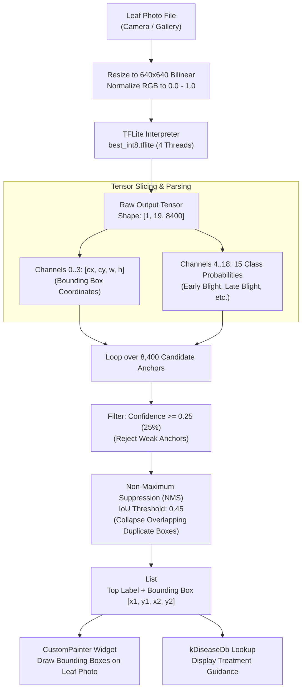

# Phase Four: Mobile Application Architecture & Edge AI Guide

**Document:** `docs/04_mobile_application.md`  
**System:** LeafScan Mobile Client  
**Target Audience:** Beginner to Intermediate Mobile & Flutter Developers  

---

## 1. Mobile Technology & Framework Identification

Based on direct inspection of `mobile-app/pubspec.yaml`, `mobile-app/lib/`, and native host directories:
- **Framework:** **Google Flutter 3.3+** (cross-platform UI toolkit).
- **Programming Language:** **Dart 3.x**.
- **Edge AI Runtime:** **`tflite_flutter` v0.12.1** (binding directly to Google's TensorFlow Lite / LiteRT native C++ library).
- **Image Manipulation:** **`image` v4.2.0** (pure Dart image encoding/decoding library).
- **Device Hardware Access:** **`image_picker` v1.1.2** (abstracts Android Camera Intent and iOS `UIImagePickerController`).
- **Typography:** **`google_fonts` v6.2.1** (with local offline asset bundling).
- **Remote Networking:** **`http` v1.2.2** (used exclusively for optional DeepSeek AI chat queries).
- **Target Platforms Supported in Codebase:** Android, iOS, Windows desktop, macOS, Linux, and Flutter Web.

---

## 2. Architectural Paradigm: Standalone Edge AI

A major discovery from reverse-engineering the codebase:
> **The LeafScan mobile application does NOT connect to the Flask server or the SQLite database.**
> It is an **offline-first edge AI application**.

### Web vs. Mobile Comparison

| Architectural Aspect | Web Application (`web-app/`) | Mobile Application (`mobile-app/`) |
|---|---|---|
| **Primary Framework** | Python Flask + Jinja2 + Vanilla JS | Google Flutter + Dart |
| **Execution Environment** | Client Browser + Server CPU | Smartphone CPU (ARM64 / x86_64) |
| **Model Architecture** | MobileNetV2 (`tomato_disease_model.h5`) | YOLOv8 Object Detector (`best_int8.tflite`) |
| **Number of Classes** | **3 Classes** (Early Blight, Late Blight, Healthy) | **15 Classes** (Blight, Molds, Viruses, Pests, Healthy) |
| **Inference Location** | Server-side (`127.0.0.1:5000`) | **100% On-Device (Edge)** |
| **Image Resolution** | $224 \times 224$ pixels | $640 \times 640$ pixels |
| **Detection Format** | Global image classification (Softmax) | Multi-scale bounding boxes with NMS |
| **Network Required?** | Yes (HTTP connection to Flask server) | **No** (Operates completely offline) |
| **Data Persistence** | Central SQLite database (`leafscan.db`) | In-memory ephemeral session state |
| **AI Agronomist Chat** | Not implemented on web | Implemented via DeepSeek API + offline fallback |

---

## 3. Screen Structure, Navigation, & State Management

### A. Navigation Architecture (`IndexedStack`)

Instead of using a traditional push/pop route stack (`Navigator.push`), the mobile application uses an [IndexedStack](file:///d:/projects/blight/Leafscan-main/mobile-app/lib/main.dart#L179-L208) controlled by an integer state variable `_page`:

```text
IndexedStack (Index: _page)
  ├── 0: _HomePage      -> Introduction, quick-start button, sample photos
  ├── 1: _ScanPage      -> Camera/Gallery trigger buttons, leaf preview, "Scan Leaf" button
  ├── 2: _ResultPage    -> Visual bounding box overlay, confidence score, treatment guide
  └── 3: _ChatPage      -> Interactive AI Agronomist conversation with DeepSeek / offline rules
```

#### Why `IndexedStack` is Used:
`IndexedStack` keeps all screen widgets mounted in the Flutter element tree while only rendering the active one. When a farmer transitions from the Scan screen to the Result screen and into the Chat screen, the loaded photograph and neural network predictions are preserved in memory without being reloaded or re-computed.

### B. State Management
The application relies on standard Flutter **`StatefulWidget` with `setState()`**. All central application state is held in `_RootPageState` in [main.dart](file:///d:/projects/blight/Leafscan-main/mobile-app/lib/main.dart#L43-L60):
- `File? _image`: The active leaf photo picked from camera or gallery.
- `List<Detection>? _detections`: The list of parsed bounding boxes and classes.
- `DiseaseInfo? _info`: The agronomic treatment record matched to the top detection.
- `double? _conf`: The highest confidence score percentage ($0..100\%$).
- `bool _modelReady`: Becomes `true` once TFLite finishes loading `best_int8.tflite`.
- `String? _modelError`: Populated if model loading fails.

---

## 4. Hardware Access: Camera, Gallery, & Image Processing

### A. Image Acquisition (`image_picker`)

In [main.dart:L96-L114](file:///d:/projects/blight/Leafscan-main/mobile-app/lib/main.dart#L96-L114):

```dart
Future<void> _pick(ImageSource src) async {
  try {
    final picked = await ImagePicker()
        .pickImage(source: src, imageQuality: 92, maxWidth: 1600);
    if (picked == null) return;
    setState(() {
      _image = File(picked.path);
      _detections = null;
      _info = null;
      _conf = null;
    });
  } catch (e) {
    ScaffoldMessenger.of(context).showSnackBar(
      SnackBar(content: Text('Could not open picker: $e')),
    );
  }
}
```

#### How Permissions Work:
- **Camera:** When `src == ImageSource.camera`, Flutter requests camera access. On Android, `android.permission.CAMERA` is triggered. On iOS, `NSCameraUsageDescription` in `Info.plist` is evaluated.
- **Gallery:** When `src == ImageSource.gallery`, `READ_EXTERNAL_STORAGE` (or `READ_MEDIA_IMAGES` on Android 13+) is used.
- **Hardware Optimization:** `maxWidth: 1600` and `imageQuality: 92` automatically downsample giant 48-megapixel phone images at acquisition time, preventing Out-Of-Memory (OOM) crashes on low-end budget smartphones.

---

### B. On-Device Image Resizing & Tensor Construction

In [detector.dart:L136-L186](file:///d:/projects/blight/Leafscan-main/mobile-app/lib/models/detector.dart#L136-L186), the raw image file is prepared for the neural network:

1. **Decoding:** `img.decodeImage(bytes)` decodes the JPEG/PNG into a pixel grid.
2. **Resizing:** `img.copyResize(decoded, width: 640, height: 640)` uses bilinear interpolation to resize the image to the exact $640 \times 640$ dimension required by YOLOv8.
3. **Channel Formatting & Normalization:**
   ```dart
   double norm(num v) => v / 255.0; // Normalizes [0..255] to [0.0..1.0]
   ```
   If the model requires NCHW layout (Channels-First), it generates a 4-dimensional nested list: `[1, 3, 640, 640]`.

---

## 5. On-Device Edge Inference: The YOLOv8 Pipeline

The detector in [detector.dart](file:///d:/projects/blight/Leafscan-main/mobile-app/lib/models/detector.dart) implements a complete object detection post-processing engine in pure Dart.



### The Mathematics Behind the Detection Engine:
1. **Multi-Scale Anchors (8,400):**
   YOLOv8 evaluates the image at three spatial grid scales:
   - $80 \times 80 = 6,400$ small feature anchors (detects tiny early spot lesions).
   - $40 \times 40 = 1,600$ medium feature anchors (detects medium leaf blotches).
   - $20 \times 20 = 400$ large feature anchors (detects large leaf collapse / whole leaf blight).
   - Total anchors = $6,400 + 1,600 + 400 = 8,400$.
2. **Channel Breakdown ($19$ Channels):**
   - Channels $0, 1, 2, 3$: Center X ($cx$), Center Y ($cy$), Width ($w$), Height ($h$).
   - Channels $4..18$: Probability scores for each of the 15 classes.
3. **Non-Maximum Suppression (NMS):**
   Multiple overlapping grid cells will often detect the same disease spot. NMS sorts candidates from highest to lowest confidence, calculates the **Intersection over Union (IoU)**:
   $$\text{IoU} = \frac{\text{Area of Overlap}}{\text{Area of Union}}$$
   If two candidate boxes for the same disease have an $\text{IoU} > 0.45$, the lower-scoring duplicate is suppressed, leaving only one sharp bounding box per disease symptom.

---

## 6. The AI Agronomist Chat Assistant (`chat.dart`)

The mobile client includes an interactive agronomic chatbot located in [mobile-app/lib/services/chat.dart](file:///d:/projects/blight/Leafscan-main/mobile-app/lib/services/chat.dart).

### A. Remote Cloud Mode (DeepSeek API)
When an API key is provided at compile time:
```bash
flutter build apk --dart-define=DEEPSEEK_API_KEY=sk-your-key-here
```
The app sends the chat history and the current scan diagnosis (`DiseaseInfo`) to `https://api.deepseek.com/chat/completions` using the `deepseek-chat` model. The system prompt instructs DeepSeek to act as a friendly agricultural extension officer, recommending low-cost organic and cultural practices for smallholder farmers.

### B. Offline Fallback Mode (Rule-Based Expert Engine)
If the farmer is offline in a rural field with no cellular signal (or if no API key was provided), the application does NOT crash. Instead, it falls back to `answerQuestion()` in [chat.dart:L114-L214](file:///d:/projects/blight/Leafscan-main/mobile-app/lib/services/chat.dart#L114-L214).

This offline rule engine performs keyword parsing on user queries:
- **"Can I eat this fruit?" / "safe":** Extracts harvest intervals and fruit safety guidance.
- **"Spray" / "chemical" / "dosage":** Extracts active ingredients, brand recommendations, and safety equipment reminders.
- **"Organic" / "natural" / "neem":** Extracts non-chemical bio-fungicide options.
- **"Spread" / "other plants":** Returns immediate containment guidelines.

---

## 7. Complete Mobile Trace: Opening App to Receiving Diagnosis

1. **Launch:** The farmer opens the app; `_detector.load()` loads `best_int8.tflite` into memory in under $1.5$ seconds.
2. **Select Image:** The user taps "Camera" on `_ScanPage` and photographs a diseased tomato leaf in the field.
3. **Trigger Scan:** The user taps "Scan Leaf".
4. **Dialog Display:** A modal loading spinner dialog (`_ScanningDialog`) appears on screen.
5. **Inference Execution:**
   - Image resized to $640 \times 640$.
   - TFLite evaluates the tensor across 4 CPU threads.
   - 8,400 anchors are scanned; anchors with confidence $< 0.25$ are discarded.
   - NMS collapses duplicate boxes.
6. **Lookup Knowledge:** The top detection (e.g. `Late Blight`, confidence $94.2\%$) is matched against `kDiseaseDb` in `disease_info.dart`.
7. **Navigate to Results:** The loading dialog pops, and `_go(2)` transitions `IndexedStack` to `_ResultPage`.
8. **Visual Feedback:** The leaf photograph is displayed with bounding boxes drawn around the necrotic lesions, accompanied by immediate containment instructions ("Bag and burn infected plants").
9. **Interactive Follow-Up:** The farmer taps "Ask AI Assistant" to ask whether nearby healthy tomato rows should be sprayed with copper fungicide.

---

## 8. Mobile Build & Installation Guide

To build and run the mobile application on a physical device or emulator:

### Prerequisites:
- Flutter SDK 3.3.0 or higher (`flutter --version`).
- Android Studio / Android SDK (API 34+).
- Java Development Kit (JDK 17).

### Commands:

```bash
# 1. Navigate to the mobile-app directory
cd d:\projects\blight\Leafscan-main\mobile-app

# 2. Fetch Flutter package dependencies
flutter pub get

# 3. Verify connected devices (USB-connected phone or emulator)
flutter devices

# 4. Run in Debug Mode (with Hot Reload)
flutter run

# 5. Build Standalone Android APK (Offline Mode)
flutter build apk --release

# 6. Build Standalone Android APK (With DeepSeek AI Chat Key)
flutter build apk --release --dart-define=DEEPSEEK_API_KEY=sk-your-actual-deepseek-key
```

The resulting release APK will be located at:
`mobile-app/build/app/outputs/flutter-apk/app-release.apk`
This file can be transferred to any Android smartphone via USB or WhatsApp and installed directly without the Google Play Store.
