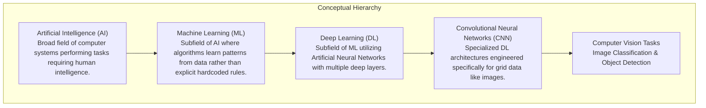
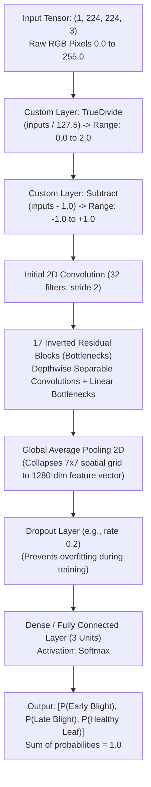

# Phase Five: Artificial Intelligence, Deep Learning & Computer Vision Guide

**Document:** `docs/05_ai_ml_model.md`  
**System:** LeafScan Dual AI Architecture  
**Target Audience:** Beginner to Intermediate Machine Learning Engineers  

---

## 1. Foundational Machine Learning Concepts (From First Principles)

Before analyzing the neural networks inside LeafScan, let us build an intuitive, crystal-clear mental model of the core concepts.



### 1. Artificial Intelligence (AI)
The broad engineering discipline of creating software capable of performing tasks that traditionally require human perception, reasoning, or decision-making.

### 2. Machine Learning (ML)
Instead of a programmer writing thousands of complex `if/else` statements describing what a blight spot looks like, a Machine Learning algorithm is fed thousands of examples of diseased and healthy leaves. The algorithm automatically discovers mathematical formulas to distinguish them.

### 3. Deep Learning (DL) & Artificial Neural Networks (ANN)
A specialized branch of machine learning inspired by the human brain. An Artificial Neural Network consists of layers of interconnected mathematical nodes ("neurons"). Each connection has a numerical weight. "Deep" learning simply refers to networks that stack many layers, allowing the computer to learn hierarchical representations (e.g., edges $\rightarrow$ textures $\rightarrow$ leaf veins $\rightarrow$ disease lesions).

### 4. Convolutional Neural Networks (CNNs)
Traditional neural networks fail on images because a single $640 \times 640$ photo contains over $1.2$ million numbers; connecting every pixel to every neuron would require billions of parameters. 

A **CNN** solves this using **Convolutions**: small mathematical filters (kernels, e.g., $3 \times 3$ matrices) that slide across the image, computing dot products to detect visual features like edges, corners, and circular blight halos regardless of where they appear on the leaf (**spatial translation invariance**).

### 5. Training vs. Inference
- **Training (The Learning Phase):** A computationally heavy process (usually performed on high-end GPUs over hours or days) where the model analyzes a labeled dataset, makes mistakes, calculates loss, and updates its internal weights via gradient descent and backpropagation.
- **Inference (The Application Phase):** The lightweight process of using the pre-trained weights to make a prediction on a brand new image. In LeafScan, **inference** runs in milliseconds on a standard CPU.

---

## 2. The Dual-Model Reality of LeafScan

An essential insight uncovered during reverse engineering: LeafScan contains **two distinct machine learning models** that serve different platforms:

```text
LeafScan AI Ecosystem
  ├── Web Application: tomato_disease_model.h5 (23.26 MB)
  │     ├── Architecture: MobileNetV2 (Classification)
  │     ├── Input Tensor: (1, 224, 224, 3) Float32 [0..255]
  │     ├── Output Tensor: (1, 3) Softmax Probabilities
  │     └── Classes (3): [0: Early Blight, 1: Late Blight, 2: Healthy Leaf]
  │
  └── Mobile Application: best_int8.tflite (26.5 MB)
        ├── Architecture: Ultralytics YOLOv8 (Object Detection)
        ├── Input Tensor: (1, 3, 640, 640) Float32 [0.0..1.0] NCHW
        ├── Output Tensor: (1, 19, 8400) Anchors
        └── Classes (15): Aphids, Early Blight, Healthy, Molds, Septoria, etc.
```

---

## 3. Web Model Deep Dive (`tomato_disease_model.h5`)

### A. Model Architecture & Layer Breakdown

The model at `web-app/backend/tomato_disease_model.h5` is a convolutional neural network built on Google's **MobileNetV2** architecture.



#### Layer Mechanics Explained:
1. **Custom Layers (`TrueDivide`, `Subtract`):** 
   In [app.py:L102-L125](file:///d:/projects/blight/Leafscan-main/web-app/backend/app.py#L102-L125), these custom layers perform mathematical scaling within the model graph itself:
   $$x_{normalized} = \frac{x}{127.5} - 1.0$$
   This scales raw RGB pixel values from $[0.0, 255.0]$ to $[-1.0, +1.0]$, which is the exact numerical domain required by MobileNetV2's initial convolutional kernels.
2. **Depthwise Separable Convolutions:**
   Traditional convolutions filter and combine features across all channels simultaneously. MobileNetV2 splits this into two steps:
   - A **depthwise convolution** that applies a single spatial filter per color channel.
   - A **pointwise convolution** ($1 \times 1$ filter) that computes linear combinations across channels.
   This reduces the number of mathematical multiplications by $8\times$ to $9\times$, allowing fast CPU execution.
3. **Inverted Residuals & Linear Bottlenecks:**
   The network expands the channel representation to higher dimensions, filters it, and squeezes it back down into a low-dimensional bottleneck without non-linear activations (preserving delicate spatial information).
4. **Global Average Pooling 2D (GAP):**
   Instead of flattening thousands of feature maps into a massive dense layer, GAP averages each feature map into a single number (e.g., $7 \times 7 \times 1280 \rightarrow 1 \times 1280$). This drastically reduces parameters and prevents overfitting.
5. **Dense Softmax Output Layer:**
   A fully connected layer with 3 units. Softmax transforms raw unbounded logits ($z_i$) into calibrated probabilities between $0.0$ and $1.0$:
   $$P(\text{Class } i) = \frac{e^{z_i}}{\sum_{j=0}^{2} e^{z_j}}$$

---

### B. Input Preprocessing Journey

How a raw smartphone JPEG photo transforms into an input tensor:

```text
[Original Image File (e.g. 4032 x 3024 JPG, 3.2 MB)]
        │
        ▼ (Image.open().convert('RGB'))
[Pillow RGB Image (Discards Alpha channels / EXIF rotations)]
        │
        ▼ (.resize((224, 224), Image.Resampling.BILINEAR))
[Resized RGB Image (224 x 224 x 3)]
        │
        ▼ (np.asarray(..., dtype=np.float32))
[NumPy Array: shape (224, 224, 3), values in range 0.0 - 255.0]
        │
        ▼ (np.expand_dims(arr, axis=0))
[Final Input Tensor: shape (1, 224, 224, 3)]
        │
        ▼ (TrueDivide and Subtract inside model)
[Internal Model Tensor: values scaled to -1.0 to +1.0]
```

#### Why Bilinear Resampling Matters:
Using `Image.Resampling.BILINEAR` in [app.py:L147](file:///d:/projects/blight/Leafscan-main/web-app/backend/app.py#L147) smoothly interpolates color values when downsampling high-resolution images, preserving fine edges and preventing jagged pixel artifacts that could confuse convolutional filters.

---

### C. Decision Logic, Probabilities, & Confidence Thresholding

In [app.py:L158-L189](file:///d:/projects/blight/Leafscan-main/web-app/backend/app.py#L158-L189):

```python
raw_output = model.predict(arr, verbose=0)
probabilities = raw_output[0] # Example: [0.186, 0.814, 0.00003]

predicted_index = int(np.argmax(probabilities))
confidence_score = float(probabilities[predicted_index]) # 0.814
predicted_label = CLASS_NAMES[predicted_index]           # 'Late Blight'
confidence_pct = round(confidence_score * 100.0, 2)      # 81.40%

uncertain = confidence_score < CONFIDENCE_THRESHOLD     # 0.50 threshold
is_healthy = (not uncertain) and (predicted_index == HEALTHY_INDEX)
```

#### Understanding the Output Concepts:
- **Raw Logits:** The unbounded numerical outputs ($-\infty$ to $+\infty$) produced by the final linear matrix multiplication before softmax.
- **Softmax Probabilities:** The normalized exponential outputs that sum to $1.0$.
- **Argmax (`np.argmax`):** The mathematical operation that selects the index of the highest probability.
- **Displayed Confidence Percentage:** `confidence_score * 100.0`.
- **Confidence Threshold ($0.50$):** If the model's highest probability is below $50\%$ (meaning it is guessing between multiple ambiguous possibilities), LeafScan rejects the prediction and returns `"No clear disease found"` rather than misleading the farmer with an uncertain diagnosis.

---

## 4. Mobile Model Deep Dive (`best_int8.tflite`)

### A. YOLOv8 Object Detection Architecture

The mobile client uses `ai-model/models/best_int8.tflite` (and bundled at `mobile-app/assets/models/best_int8.tflite`).

| Specification | Verifiable Value | Explanation |
|---|---|---|
| **Framework** | Ultralytics YOLOv8 | Single-stage anchor-free convolutional object detector |
| **Quantization** | INT8 Weights / Float32 I/O | Reduces 32-bit floating point weights to 8-bit integers, shrinking file size by $4\times$ ($106\text{ MB} \rightarrow 26.5\text{ MB}$) with minimal accuracy loss |
| **Input Shape** | `[1, 3, 640, 640]` | NCHW (Batch=1, Channels=3, Height=640, Width=640) |
| **Input Value Range** | `0.0` to `1.0` | Pixels divided by 255.0 |
| **Output Shape** | `[1, 19, 8400]` | 19 channels per candidate anchor across 8,400 anchors |
| **Target Classes** | **15 Classes** | 10 foliar diseases, 4 pest injuries, and healthy foliage |

---

### B. The 15 Detectable Foliar Classes

The 15 output channels map to the following foliar conditions:

| Channel Index | Model Raw Label | Clean Display Label | Pathology Category |
|:---:|---|---|:---:|
| 0 | `Aphids` | Aphids | Insect Pest |
| 1 | `Early Blight` | Early Blight (*Alternaria solani*) | Fungal Pathogen |
| 2 | `Healthy Leaf-` | Healthy Leaf | Symptom-Free |
| 3 | `Leaf Curl` | Leaf Curl | Viral Pathogen |
| 4 | `Leafhoppers and Jassids` | Leafhoppers and Jassids | Insect Pest |
| 5 | `Molds` | Leaf Mold (*Passalora fulva*) | Fungal Pathogen |
| 6 | `Mosaic Virus` | Tomato Mosaic Virus (ToMV) | Viral Pathogen |
| 7 | `Septoria` | Septoria Leaf Spot | Fungal Pathogen |
| 8 | `bactarial canker` | Bacterial Canker (*Clavibacter*) | Bacterial Pathogen |
| 9 | `bacterial spot` | Bacterial Spot (*Xanthomonas*) | Bacterial Pathogen |
| 10 | `flea beetle` | Flea Beetle | Insect Pest |
| 11 | `late_blight` | Late Blight (*Phytophthora infestans*) | Oomycete / Fungal |
| 12 | `leafminer` | Leafminer (*Liriomyza*) | Insect Pest |
| 13 | `powedry_mildew` | Powdery Mildew | Fungal Pathogen |
| 14 | `yellow curl virus` | Yellow Leaf Curl Virus (TYLCV) | Viral Pathogen |

*Note on Class Labels:* Notice the typographical artifacts (`bactarial canker`, `powedry_mildew`, `Healthy Leaf-`). These exact strings are present in `detector.dart`, `ai-model/README.md`, and the historical `app.py.bak_before_diagnosis`, confirming that both models share roots in common training experiments.

---

## 5. Dataset Architecture & Empirical Evaluation

### A. Ground-Truth Datasets Present in Repository

LeafScan includes automated scripts to download and evaluate against two public benchmark datasets:

1. **PlantVillage Benchmark (`ai-model/eval_data/` — 180 images):**
   - **Origin:** Pennsylvania State University / EPFL (Hughes & Salathé, 2015).
   - **Nature:** Laboratory photographs taken on uniform grey or black paper backgrounds under controlled artificial lighting.
   - **Distribution:** 60 Early Blight, 60 Late Blight, 60 Healthy Leaf.
2. **PlantDoc Field Benchmark (`ai-model/eval_data_field/` — 233 images):**
   - **Origin:** IIT Roorkee (Singh et al., 2020).
   - **Nature:** Real-world agricultural field photos scraped from the web, containing complex backgrounds, soil, sunlight glares, overlapping leaves, and varying zoom levels.
   - **Distribution:** 80 Early Blight, 92 Late Blight, 61 Healthy Leaf.

---

### B. The "Healthy Leaf Misclassified as Blight" Problem

A classic issue in agricultural AI (and documented in `web-app/tests/test_prediction.py:L18-L20`):

> **The Problem:** When models are trained exclusively on lab photos with plain backgrounds (like PlantVillage), they often learn to associate the presence of natural soil, sunlight shadows, or non-uniform green tones with disease. When a farmer photographs a completely healthy leaf outdoors, the model misclassifies it as Early or Late Blight with high confidence.

#### Systematic Investigation Protocol:
If a healthy leaf is misclassified as blight, follow these steps before changing code:
1. **Verify Class Index Mapping:** Check that the array indices in `CLASS_NAMES` match the exact folder sorting used during training. In Keras, `flow_from_directory()` sorts class folders in ASCII alphabetical order:
   - Folder `Early_blight` $\rightarrow$ Index 0
   - Folder `Healthy` $\rightarrow$ Index 1 or 2
   - Folder `Late_blight` $\rightarrow$ Index 1 or 2
   If folder names change, indices shift, causing healthy leaves to be mapped to blight labels.
2. **Verify Preprocessing Compatibility:** Ensure inference preprocessing exactly mirrors training preprocessing. If the model was trained with normalization $[-1.0, +1.0]$ but inference feeds $[0.0, 1.0]$, every prediction will be severely distorted.
3. **Check Background Distribution:** If the model has never seen outdoor field lighting during training, test it on a leaf placed against a neutral background. If it predicts correctly on neutral backgrounds but fails in the field, the problem is **domain shift / out-of-distribution background bias**.
4. **Inspect Raw Softmax Probabilities:** Observe the full probability distribution. If `Healthy` received $48\%$ and `Early Blight` received $52\%$, the model was borderline uncertain; raising the confidence threshold prevents a false alarm.

---

## 6. How to Reproduce Training from Scratch

While the training scripts are not present in this repository, here is the exact code required to train a replacement MobileNetV2 model using TensorFlow / Keras:

```python
import tensorflow as tf
from tensorflow.keras import layers, models

# 1. Dataset Parameters
IMG_SIZE = (224, 224)
BATCH_SIZE = 32
DATA_DIR = "dataset/tomato" # Subfolders: Early_Blight, Late_Blight, Healthy

# 2. Load and Split Dataset (80% Train, 20% Validation)
train_ds = tf.keras.utils.image_dataset_from_directory(
    DATA_DIR,
    validation_split=0.2,
    subset="training",
    seed=123,
    image_size=IMG_SIZE,
    batch_size=BATCH_SIZE
)

val_ds = tf.keras.utils.image_dataset_from_directory(
    DATA_DIR,
    validation_split=0.2,
    subset="validation",
    seed=123,
    image_size=IMG_SIZE,
    batch_size=BATCH_SIZE
)

# 3. Data Augmentation to prevent overfitting on field conditions
data_augmentation = tf.keras.Sequential([
    layers.RandomFlip("horizontal_and_vertical"),
    layers.RandomRotation(0.2),
    layers.RandomZoom(0.2),
    layers.RandomContrast(0.2),
])

# 4. Construct Transfer Learning Architecture
base_model = tf.keras.applications.MobileNetV2(
    input_shape=(224, 224, 3),
    include_top=False,
    weights='imagenet'
)
base_model.trainable = False # Freeze base weights during initial transfer

inputs = tf.keras.Input(shape=(224, 224, 3))
x = data_augmentation(inputs)
x = layers.Rescaling(1./127.5, offset=-1)(x) # Normalize to [-1, 1]
x = base_model(x, training=False)
x = layers.GlobalAveragePooling2D()(x)
x = layers.Dropout(0.2)(x)
outputs = layers.Dense(3, activation='softmax')(x)

model = models.Model(inputs, outputs)

# 5. Compile Model
model.compile(
    optimizer=tf.keras.optimizers.Adam(learning_rate=0.001),
    loss='sparse_categorical_crossentropy',
    metrics=['accuracy']
)

# 6. Train Initial Epochs
history = model.fit(train_ds, validation_data=val_ds, epochs=10)

# 7. Fine-Tuning Phase (Unfreeze top layers of MobileNetV2)
base_model.trainable = True
for layer in base_model.layers[:-20]:
    layer.trainable = False

model.compile(
    optimizer=tf.keras.optimizers.Adam(learning_rate=1e-5),
    loss='sparse_categorical_crossentropy',
    metrics=['accuracy']
)

model.fit(train_ds, validation_data=val_ds, epochs=10)

# 8. Save Model Weights for LeafScan
model.save("web-app/backend/tomato_disease_model.h5")
```
