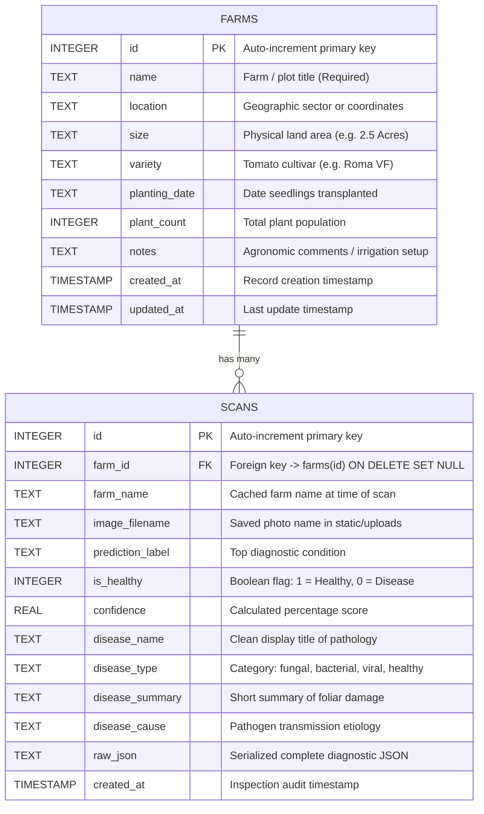

# Phase Six: Database Architecture, Relational Schema & Storage Guide

**Document:** `docs/06_database_and_storage.md`  
**System:** LeafScan Data Persistence Layer  
**Target Audience:** Beginner to Intermediate Database & Backend Developers  

---

## 1. Storage Verification: Does a Real Database Exist?

Yes. LeafScan utilizes a genuine, embedded **SQLite 3** relational database.
- **Database Engine:** SQLite 3 (interfaced via Python's standard library `sqlite3`).
- **Database File Location:** `web-app/database/leafscan.db`
- **Schema DDL Script:** `web-app/database/schema.sql`
- **Data Access Module:** `web-app/backend/db.py`

### Mobile Storage Note:
The Flutter mobile application (`mobile-app/`) does **not** use SQLite or Hive. Mobile scan records are held strictly in ephemeral RAM session state (`_RootPageState`). Once the mobile app is closed, previous scans on the phone disappear unless saved manually. Only the web application persists records permanently.

---

## 2. Entity-Relationship Data Model

The LeafScan relational schema consists of two tables linked by a one-to-many relationship:



---

## 3. Database Schema Definitions & SQL Architecture

The complete schema is declared in [web-app/backend/db.py:L45-L82](file:///d:/projects/blight/Leafscan-main/web-app/backend/db.py#L45-L82) and mirrored in `schema.sql`:

```sql
CREATE TABLE IF NOT EXISTS farms (
    id INTEGER PRIMARY KEY AUTOINCREMENT,
    name TEXT NOT NULL,
    location TEXT DEFAULT '',
    size TEXT DEFAULT '',
    variety TEXT DEFAULT '',
    planting_date TEXT DEFAULT '',
    plant_count INTEGER DEFAULT 0,
    notes TEXT DEFAULT '',
    created_at TIMESTAMP DEFAULT CURRENT_TIMESTAMP,
    updated_at TIMESTAMP DEFAULT CURRENT_TIMESTAMP
);

CREATE TABLE IF NOT EXISTS scans (
    id INTEGER PRIMARY KEY AUTOINCREMENT,
    farm_id INTEGER,
    farm_name TEXT DEFAULT 'General / Unassigned',
    image_filename TEXT NOT NULL,
    prediction_label TEXT NOT NULL,
    is_healthy INTEGER DEFAULT 0,
    confidence REAL DEFAULT 0.0,
    disease_name TEXT,
    disease_type TEXT,
    disease_summary TEXT,
    disease_cause TEXT,
    raw_json TEXT,
    created_at TIMESTAMP DEFAULT CURRENT_TIMESTAMP,
    FOREIGN KEY(farm_id) REFERENCES farms(id) ON DELETE SET NULL
);

-- Performance Indexes
CREATE INDEX IF NOT EXISTS idx_scans_farm_id ON scans(farm_id);
CREATE INDEX IF NOT EXISTS idx_scans_created_at ON scans(created_at);
CREATE INDEX IF NOT EXISTS idx_scans_is_healthy ON scans(is_healthy);
```

### Table Column Details:

#### 1. `farms` Table
- **`id` (INTEGER PRIMARY KEY AUTOINCREMENT):** Unique identifier for each plot.
- **`name` (TEXT NOT NULL):** Human-readable name (e.g., "North Valley Block 4"). Cannot be null.
- **`location`, `size`, `variety`, `planting_date`, `notes` (TEXT):** Agronomic attributes.
- **`plant_count` (INTEGER DEFAULT 0):** Estimated number of tomato plants under management.
- **`created_at`, `updated_at` (TIMESTAMP):** Automatically populated with SQLite `CURRENT_TIMESTAMP` in UTC.

#### 2. `scans` Table
- **`id` (INTEGER PRIMARY KEY AUTOINCREMENT):** Unique identifier for each inspection event.
- **`farm_id` (INTEGER):** Foreign key pointing to `farms(id)`.
- **`farm_name` (TEXT):** Denormalized copy of the farm's name. This ensures that even if a farm is deleted, the historical audit card still shows which farm the leaf came from.
- **`image_filename` (TEXT NOT NULL):** The relative filename of the photo stored in `web-app/frontend/static/uploads/`.
- **`prediction_label` (TEXT NOT NULL):** The top class name (`"Early Blight"`, `"Late Blight"`, or `"Healthy Leaf"`).
- **`is_healthy` (INTEGER DEFAULT 0):** Binary flag (`1` for symptom-free foliage, `0` for diseased or unclear).
- **`confidence` (REAL DEFAULT 0.0):** Model confidence percentage (e.g., `83.99`).
- **`disease_name`, `disease_type`, `disease_summary`, `disease_cause` (TEXT):** Pre-formatted agronomic advisory text.
- **`raw_json` (TEXT):** Full JSON payload string containing all class probabilities and actionable treatment arrays (`stopNow`, `preventSpread`, `preventFuture`, `treatments`).
- **`created_at` (TIMESTAMP):** Exact timestamp when the scan occurred.

---

## 4. Connection Pooling & Windows File-Lock Prevention

In Windows operating systems, opening an SQLite database file and forgetting to close it keeps an exclusive file handle open, causing `PermissionError: [WinError 32] The process cannot access the file because it is being used by another process`.

LeafScan prevents this using a Python **generator context manager** in [db.py:L17-L37](file:///d:/projects/blight/Leafscan-main/web-app/backend/db.py#L17-L37):

```python
@contextmanager
def get_db_connection() -> Iterator[sqlite3.Connection]:
    os.makedirs(DATABASE_DIR, exist_ok=True)
    conn = sqlite3.connect(DB_PATH)
    conn.row_factory = sqlite3.Row
    conn.execute("PRAGMA foreign_keys = ON")
    try:
        yield conn
        conn.commit()
    except Exception:
        conn.rollback()
        raise
    finally:
        conn.close()
```

### Key Engineering Features:
1. **`conn.row_factory = sqlite3.Row`:** Allows query results to be accessed both by column name (like a dictionary: `row['farm_name']`) and by index (`row[0]`), simplifying conversion to JSON via `dict(row)`.
2. **`PRAGMA foreign_keys = ON`:** By default, SQLite disables foreign key enforcement for backwards compatibility. This pragma ensures relational integrity.
3. **Automated Rollback:** If any SQL error occurs during a multi-statement transaction, `conn.rollback()` restores the database to its pre-transaction state.
4. **Guaranteed `finally: conn.close()`:** Even if an unhandled exception or server error occurs, the database connection is guaranteed to close, preventing Windows file-lock contention.

---

## 5. Foreign Key Integrity & Safe File Deletion

### A. Farm Deletion Behavior (`ON DELETE SET NULL`)
When a farmer deletes a registered plot via `DELETE /api/farms/<id>`, what happens to previous scan records?
In [db.py:delete_farm()](file:///d:/projects/blight/Leafscan-main/web-app/backend/db.py#L177-L185):

```python
def delete_farm(farm_id: int) -> bool:
    with get_db_connection() as conn:
        cursor = conn.cursor()
        # Mark historical farm_name label as archived
        cursor.execute("UPDATE scans SET farm_name = farm_name || ' (Archived)' WHERE farm_id = ?", (farm_id,))
        cursor.execute('DELETE FROM farms WHERE id = ?', (farm_id,))
        conn.commit()
        return cursor.rowcount > 0
```

1. The SQL constraint `FOREIGN KEY(farm_id) REFERENCES farms(id) ON DELETE SET NULL` automatically updates `scans.farm_id` to `NULL`.
2. Before deletion, the code appends `' (Archived)'` to `scans.farm_name`.
3. **Result:** Historical scans are never accidentally destroyed when a farm plot is removed.

---

### B. Safe Image Cleanup on Scan Deletion
When a scan is deleted via `DELETE /api/scans/<id>`, naive implementations delete the database row but leave the physical JPEG image on the hard drive, eventually filling the server's disk space.

In [db.py:delete_scan()](file:///d:/projects/blight/Leafscan-main/web-app/backend/db.py#L280-L302):

```python
def delete_scan(scan_id: int) -> bool:
    with get_db_connection() as conn:
        cursor = conn.cursor()
        scan = cursor.execute('SELECT image_filename FROM scans WHERE id = ?', (scan_id,)).fetchone()
        if not scan:
            return False

        image_filename = scan['image_filename']
        cursor.execute('DELETE FROM scans WHERE id = ?', (scan_id,))
        conn.commit()

        # Check if any other scan references this image filename
        other = cursor.execute('SELECT COUNT(*) as cnt FROM scans WHERE image_filename = ?', (image_filename,)).fetchone()
        if other and other['cnt'] == 0:
            file_path = os.path.join(UPLOADS_DIR, image_filename)
            if os.path.exists(file_path):
                try:
                    os.remove(file_path)
                except OSError:
                    pass

        return True
```

1. Retrieves the filename from the record.
2. Deletes the row from SQLite.
3. Checks whether any other record in `scans` references the same file.
4. If the count is zero, `os.remove()` permanently deletes the image file from `static/uploads/`.
5. **Verified in Tests:** Test case 42 of `web-app/tests/test_app.py` directly asserts `not file_still_exists`, proving this mechanism works.

---

## 6. End-to-End Data Lifecycle: Trace of One Scan Record

Let us trace scan record `#57` (currently in the live database):

```text
[1. User Upload]
User uploads photo of Early Blight leaf from Masaka farm plot.
        │
        ▼
[2. File System Storage]
Saved to: web-app/frontend/static/uploads/leaf_20261020_222147_0209f0.jpg
        │
        ▼
[3. AI Model Inference]
Inference calculates:
  - Prediction: 'Early Blight'
  - Probabilities: [0.9991, 0.0008, 0.0001]
  - Confidence: 99.9%
  - is_healthy: 0
        │
        ▼
[4. SQL INSERT Statement]
INSERT INTO scans (
    farm_id, farm_name, image_filename, prediction_label,
    is_healthy, confidence, disease_name, disease_type,
    disease_summary, disease_cause, raw_json, created_at
) VALUES (
    1, 'PETER', 'leaf_20261020_222147_0209f0.jpg', 'Early Blight',
    0, 99.9, 'Early blight', 'fungal',
    'Dark brown spots with concentric rings...',
    'Fungus surviving in debris and soil...',
    '{"status": "ok", "confidence": 99.9, "treatments": [...]}',
    '2026-10-20 19:21:47'
);
        │
        ▼
[5. Dashboard KPI Retrieval]
GET /api/dashboard/stats:
  - Included in total_scans (count = 5)
  - Included in disease_scans (count = 4)
  - Placed in top_diseases frequency grouping ('Early blight' count = 2)
  - Aggregated in timeline date '2026-10-20'
        │
        ▼
[6. History Archive Search]
GET /api/scans?status=disease:
  - Evaluates: WHERE is_healthy = 0
  - JSON decoded from raw_json column
  - Rendered as a card with photo thumbnail and treatment pop-up modal
```

---

## 7. Database Backups & Reset Utilities

In [db.py:reset_db()](file:///d:/projects/blight/Leafscan-main/web-app/backend/db.py#L85-L116):
- **Automated Backup:** When `reset_db(backup=True)` is called (or when setting `LEAFSCAN_RESET_DB=1`), it copies the current database to `web-app/database/leafscan_backup_YYYYMMDD_HHMMSS.db` using `shutil.copy2()`.
- **WAL Journal Cleanup:** Removes `-wal`, `-shm`, and `-journal` temporary SQLite lock files.
- **Uploads Purge:** If `clear_uploads=True`, it deletes saved inspection photos in `static/uploads/` so no orphaned images remain.
- **Reconstruction:** Calls `init_db()` to construct a brand new schema.
