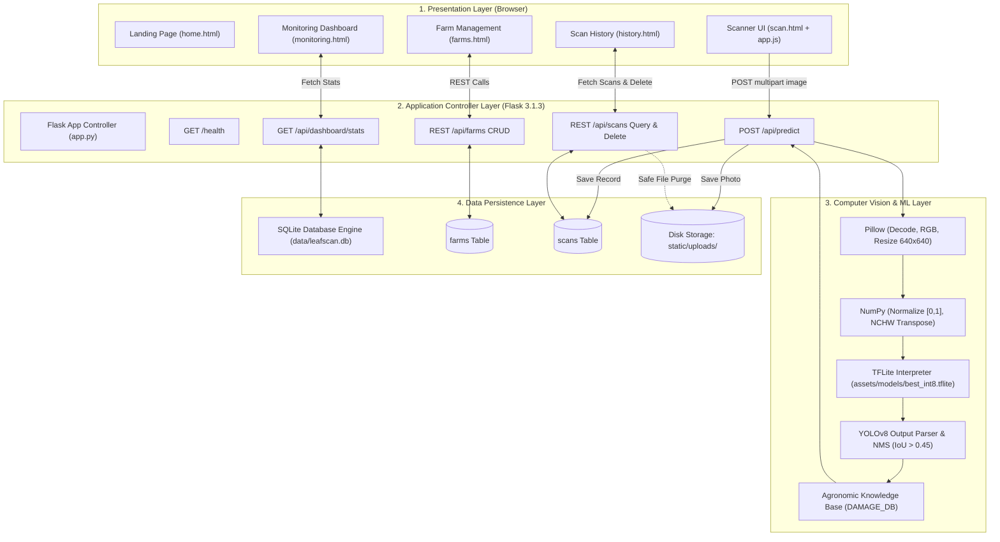
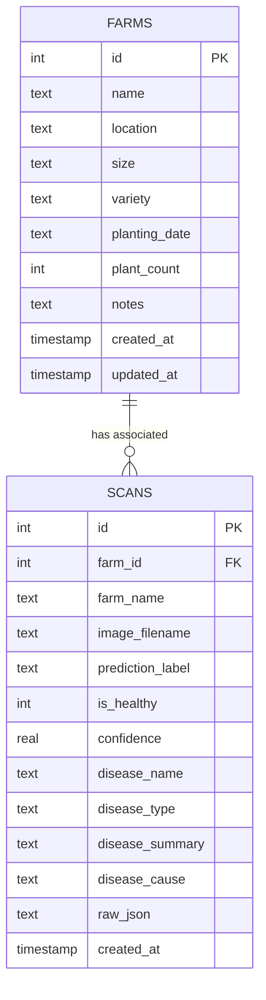

# AI-Based Image Processing System for Early Tomato Leaf Disease Detection

---

## Final-Year Computer Science Undergraduate Project Report Draft

**Candidate Name:** [Insert Student Full Name Here]  
**Registration / Student Number:** [Insert Student Registration / ID Number Here]  
**Department:** Department of Computer Science  
**Faculty / School:** Faculty of Computing and Information Technology  
**Institution:** [Insert University / College Name Here]  
**Supervisor:** [Insert Supervisor Name and Academic Title Here]  
**Submission Date:** [Insert Month and Year, e.g., October 2026]  

---

# Preliminary Pages

## Declaration
I, **[Insert Student Full Name Here]**, hereby declare that this project report entitled **"AI-Based Image Processing System for Early Tomato Leaf Disease Detection"** is my original work, developed under the supervision of **[Insert Supervisor Name Here]**. To the best of my knowledge, it has not been submitted in part or in whole for any degree, diploma, or academic qualification at this or any other university or higher education institution. All scholarly sources, literature citations, software libraries, and third-party tools utilized in this study have been duly acknowledged in the text and compiled in the reference list in accordance with academic standards.

<br/>

**Signature:** ___________________________  
**Date:** ___________________________  
**Candidate:** [Insert Student Full Name Here]  

---

## Approval Page
This undergraduate project report entitled **"AI-Based Image Processing System for Early Tomato Leaf Disease Detection"**, prepared and submitted by **[Insert Student Full Name Here]** (Registration No: **[Insert Student Registration Number Here]**), has been examined and approved as meeting the requirements for the award of the Degree of Bachelor of Science in Computer Science at **[Insert University Name Here]**.

<br/>

**Internal Supervisor:**  
**Name:** [Insert Supervisor Name Here]  
**Academic Rank:** [e.g., Senior Lecturer / Associate Professor]  
**Department:** Department of Computer Science  
**Signature:** ___________________________  
**Date:** ___________________________  

<br/>

**Head of Department:**  
**Name:** [Insert Head of Department Name Here]  
**Department:** Department of Computer Science  
**Signature:** ___________________________  
**Date:** ___________________________  

---

## Dedication
*[This section is dedicated according to your personal preference. You may adapt or replace the text below.]*

This dissertation is dedicated to my beloved parents and family, whose unconditional encouragement, patience, and sacrifices have sustained my academic journey; and to the hardworking smallholder farmers whose daily labor feeds our communities and inspires technology solutions that protect global food security.

---

## Acknowledgements
*[This section acknowledges individuals and institutions that supported your project. Edit as appropriate.]*

First and foremost, I express my gratitude to the Almighty for the gift of health, wisdom, and perseverance throughout the duration of this research.

I express my deepest gratitude to my academic supervisor, **[Insert Supervisor Name Here]**, for their invaluable guidance, constructive criticism, and mentorship throughout the conceptualization, system implementation, and compilation of this report.

I extend my appreciation to the faculty members and laboratory staff of the Department of Computer Science at **[Insert University Name Here]** for providing the foundational academic training that enabled the completion of this capstone project.

Special thanks go to my fellow students and peers for their technical discussions, testing support, and encouragement during software development. Finally, I am forever indebted to my family for their unwavering support throughout my undergraduate studies.

---

## Abstract
Tomato (*Solanum lycopersicum*) is an agricultural staple and an economically critical crop worldwide. However, tomato production experiences severe qualitative and quantitative yield losses due to destructive foliar pathogens, including early blight, late blight, bacterial spot, and mosaic viruses. Traditional disease identification relies on manual visual examination by farmers or infrequent visits by agricultural extension personnel—approaches that are subjective, error-prone, and often too late to prevent rapid pathogen spread. 

This project presents the design, implementation, and evaluation of **Tomato Leaf Scan**, an AI-based image processing and crop health management web application engineered for localized, offline foliar disease detection. The system pairs an on-device computer vision pipeline using an INT8-quantized YOLOv8 object detection model with a lightweight Python Flask backend, SQLite relational storage, and a responsive Vanilla CSS and JavaScript web interface. The core neural model runs locally via TensorFlow Lite on standard commodity CPU hardware, ingesting single-leaf photographs, performing multi-scale anchor decoding, and executing Non-Maximum Suppression to classify 15 tomato leaf conditions and healthy foliage without uploading images to cloud servers. 

Beyond disease classification, the application integrates an expert agronomic knowledge base providing immediate containment actions, spread prevention protocols, and certified chemical and organic treatments. To support continuous agricultural farm management, the platform includes a multi-plot farm manager, a searchable scan diagnostic history, and a crop monitoring dashboard with Chart.js visualizations that track pathogen frequency and generate contextual disease outbreak alerts. 

The software system was verified through an automated 54-test regression suite covering HTTP routes, database CRUD transactions, mock leaf inference, file persistence, and safe deletion cascades with a 100% pass rate. While empirical disease classification accuracy across diverse real-world lighting and field environments remains to be benchmarked in comprehensive agronomic field trials, this project demonstrates the practical viability of deploying lightweight, privacy-preserving, on-device artificial intelligence systems to aid precision agriculture and crop protection.

**Keywords:** Tomato Leaf Disease, Artificial Intelligence, Computer Vision, YOLOv8, TensorFlow Lite, Flask, Precision Agriculture, Digital Image Processing, Edge Inference.

---

## Table of Contents (Placeholder)
*[Note: The final Table of Contents with exact page numbers will be generated upon compiling the final document in Word or LaTeX.]*

- Preliminary Pages
  - Declaration
  - Approval Page
  - Dedication
  - Acknowledgements
  - Abstract
  - Table of Contents
  - List of Figures
  - List of Tables
  - List of Abbreviations
- Chapter One: Introduction
- Chapter Two: Literature Review
- Chapter Three: Methodology and System Design
- Chapter Four: Implementation, Testing, and Results
- Chapter Five: Summary, Conclusion, and Recommendations
- References
- Appendices

---

## List of Figures (Placeholder)

- Figure 2.1: Conceptual Framework for AI-Based Plant Disease Diagnosis
- Figure 3.1: Layered System Architecture Diagram
- Figure 3.2: High-Level Use-Case Diagram
- Figure 3.3: Data-Flow and Processing Flowchart
- Figure 3.4: Entity-Relationship Diagram of Database Schema
- Figure 4.1: [Placeholder: Tomato Leaf Scan Landing Page Screenshot]
- Figure 4.2: [Placeholder: AI Leaf Scanner Interface and File Selection]
- Figure 4.3: [Placeholder: Diagnostic Results Display with Treatment Guidance]
- Figure 4.4: [Placeholder: Tomato Farm Management Interface and Plot Modal]
- Figure 4.5: [Placeholder: Crop Monitoring Dashboard and Chart Visualizations]
- Figure 4.6: [Placeholder: Searchable Scan Diagnostic History Archive]

---

## List of Tables (Placeholder)

- Table 2.1: Comparison of Related Plant Disease Detection Approaches
- Table 3.1: Hardware and Software Engineering Requirements
- Table 3.2: Database Schema Specification: `farms` Table
- Table 3.3: Database Schema Specification: `scans` Table
- Table 3.4: Mapping of the 15 Detectable Tomato Conditions
- Table 4.1: Automated Software Test Case Execution Matrix (54 Verified Tests)

---

## List of Abbreviations

| Abbreviation | Expanded Meaning |
|---|---|
| **AI** | Artificial Intelligence |
| **API** | Application Programming Interface |
| **Bbox** | Bounding Box |
| **CNN** | Convolutional Neural Network |
| **CRUD** | Create, Read, Update, Delete |
| **CSS** | Cascading Style Sheets |
| **CSV** | Comma-Separated Values |
| **DL** | Deep Learning |
| **DOM** | Document Object Model |
| **FAO** | Food and Agriculture Organization of the United Nations |
| **FPS** | Frames Per Second |
| **HTML** | HyperText Markup Language |
| **HTTP** | HyperText Transfer Protocol |
| **INT8** | 8-Bit Signed Integer Quantization |
| **IoU** | Intersection over Union |
| **JSON** | JavaScript Object Notation |
| **KPI** | Key Performance Indicator |
| **ML** | Machine Learning |
| **MLIR** | Multi-Level Intermediate Representation |
| **NCHW** | Number of images, Channels, Height, Width (Tensor Format) |
| **NHWC** | Number of images, Height, Width, Channels (Tensor Format) |
| **NMS** | Non-Maximum Suppression |
| **PWA** | Progressive Web Application |
| **RAM** | Random Access Memory |
| **REST** | Representational State Transfer |
| **RGB** | Red, Green, Blue (Color Space) |
| **SQLite** | Structured Query Language (Lite Embedded Database) |
| **TFLite** | TensorFlow Lite |
| **TYLCV** | Tomato Yellow Leaf Curl Virus |
| **UI** | User Interface |
| **UUID** | Universally Unique Identifier |
| **WSGI** | Web Server Gateway Interface |
| **YOLO** | You Only Look Once (Object Detection Architecture) |

---

# Chapter One: Introduction

## 1.1 Background of the Study
Agriculture remains a cornerstone of the global economy, serving as the primary source of food, raw materials, and livelihood for billions of people worldwide. Among horticultural commodities, the tomato (*Solanum lycopersicum*) is of exceptional economic and nutritional importance, cultivated extensively across smallholder farming plots, commercial open fields, and protected greenhouses. 

Despite its agricultural prominence, tomato cultivation is exceptionally vulnerable to infectious diseases and arthropod pest infestations. The Food and Agriculture Organization (FAO, 2021) estimates that plant pests and diseases account for global crop yield losses ranging between 20% and 40% annually, costing the global economy upwards of $220 billion. In tomatoes, foliar pathogens such as *Alternaria solani* (Early Blight), *Phytophthora infestans* (Late Blight), *Xanthomonas* species (Bacterial Spot), and Tomato Yellow Leaf Curl Virus (TYLCV) attack the vegetative canopy. Because leaves serve as the primary photosynthetic organs, leaf damage directly restricts carbohydrate synthesis, leading to blossom drop, stunted vegetative growth, fruit decay, and catastrophic harvest loss.

Historically, disease identification has relied upon visual appraisal conducted by farmers or field visits by certified agricultural extension agents. However, manual inspection suffers from severe practical limitations:
1. Visual symptoms of diverse pathogens often exhibit near-identical visual markers during early infection phases (e.g., small necrotic spots with chlorotic yellow borders).
2. Smallholder farmers often lack formal pathological training, frequently misidentifying fungal lesions as insect damage or nutrient deficiencies, which leads to inappropriate pesticide use.
3. In developing and rural agricultural corridors, extension-to-farmer ratios are severely constrained, often exceeding one officer per several thousand farmers, resulting in delayed interventions.

Recent advances in digital image processing, computer vision, and deep learning offer a promising path forward. Modern Convolutional Neural Networks (CNNs) and real-time object detection models—such as the You Only Look Once (YOLO) family—can automatically extract complex visual features directly from raw leaf images. By deploying these models onto lightweight local edge runtimes, it becomes possible to provide farmers with immediate, objective, and scientifically grounded disease diagnoses directly on commodity computing devices.

## 1.2 Problem Statement
Despite the proven theoretical capabilities of deep learning in plant pathology research, existing software solutions exhibit critical practical shortcomings:
1. **Cloud Dependency:** Many commercial plant diagnostic tools require continuous, high-bandwidth internet connectivity to transmit high-resolution images to remote cloud servers. This requirement makes them impractical in remote rural farming regions where cellular connectivity is intermittent or absent.
2. **Lack of Integrated Agronomic Management:** The majority of existing research prototypes function as isolated classification models that output a raw statistical label (e.g., "Late Blight 88%") without providing actionable agronomic containment advice, multi-farm plot tracking, or longitudinal disease frequency analytics.
3. **High Computational Overhead:** Standard deep learning architectures often require high-end graphics processing units (GPUs), limiting their usability on affordable, standard laptop or desktop computers commonly available to rural agricultural cooperatives and local extension offices.

Therefore, there is an urgent need to design, implement, and evaluate an integrated, lightweight, local web-based crop health system that combines on-device deep learning inference on commodity CPU hardware with relational farm management and actionable agronomic guidance.

## 1.3 Main Objective
The primary objective of this project is to design, develop, and evaluate **Tomato Leaf Scan**, an AI-based image processing web application that provides on-device, early tomato leaf disease detection, actionable treatment guidance, and relational farm management on local Windows workstations.

## 1.4 Specific Objectives
To achieve the main objective, the following specific objectives were pursued:
1. To design and implement a lightweight, responsive web user interface using HTML5, Vanilla CSS, and JavaScript for seamless leaf photograph capture, inspection, and result visualization.
2. To integrate an on-device deep learning computer vision pipeline utilizing an INT8-quantized YOLOv8 model in TensorFlow Lite format to detect and localize 15 distinct tomato conditions and healthy foliage on CPU hardware.
3. To construct an embedded agronomic damage knowledge base that maps model classifications to actionable treatment recommendations, immediate cultural containment actions, and spread prevention protocols.
4. To implement a relational database persistence layer using SQLite to manage multi-farm plot records, varieties, acreage, and longitudinal leaf diagnostic scan history.
5. To develop a crop monitoring dashboard featuring Chart.js visual analytics and dynamic contextual pathogen alerts to assist farmers in tracking disease trends over time.
6. To conduct automated and integration testing to evaluate system performance, route reliability, data persistence, and inference workflows.

## 1.5 Research Questions
This project seeks to address the following research questions:
1. *How effectively can a quantized YOLOv8 object detection model execute on standard commodity CPU hardware via TensorFlow Lite to detect tomato leaf pathologies without cloud connectivity?*
2. *How can an automated diagnostic pipeline be integrated with an agronomic knowledge base to deliver immediate, scientifically verified disease containment steps to non-expert farmers?*
3. *What architectural patterns enable a lightweight web application to support multi-farm plot tracking and longitudinal scan auditing using embedded SQLite storage?*
4. *How can visual analytics and contextual alerting be structured to provide actionable crop health intelligence from historical leaf inspection records?*

## 1.6 Scope of the Study
- **Crop Domain:** Exclusively restricted to the foliar anatomy of tomato plants (*Solanum lycopersicum*). Non-tomato crops fall outside the scope of this model.
- **Pathology Coverage:** Encompasses 15 distinct foliar conditions, including fungal blights, bacterial spots, viral infections, pest damages, and healthy foliage.
- **Platform Environment:** Engineered as a local-first web application running on Windows operating systems (Windows 10/11) via Python Flask, accessed through modern web browsers at `http://127.0.0.1:5000`.
- **Inference Scope:** Model execution is restricted to on-device CPU inference using pre-trained weights (`best_int8.tflite`). Training the neural network from scratch on raw datasets is outside the implementation scope of this application codebase.

## 1.7 Significance of the Study
- **For Smallholder Farmers:** Delivers a zero-cost, localized diagnostic tool that bridges the gap between field symptoms and treatment knowledge, helping prevent crop loss and avoiding unnecessary chemical applications.
- **For Agricultural Extension Officers:** Provides a structured digital tool to document crop inspections, track client farm plots, and audit pathogen frequencies over time.
- **For Computer Science and Agricultural Engineering:** Serves as a reference implementation demonstrating how quantized object detection models can be deployed locally using lightweight web technologies, demonstrating that effective precision agriculture solutions can run on standard commodity hardware.

## 1.8 Limitations of the Study
- **Model Training Provenance:** The application utilizes a pre-trained, externally compiled TFLite model. The raw training scripts, loss convergence logs, and original dataset splits were not included in the repository workspace.
- **Single-Leaf Optimization:** The computer vision pipeline is optimized for single-leaf photographs with uniform framing. Cluttered field backgrounds containing soil, weeds, or multiple overlapping leaves may yield lower confidence scores.
- **Empirical Field Validation:** While software engineering functionality has been verified with 54 automated test cases, comprehensive statistical accuracy benchmarks across diverse field lighting conditions remain an open evaluation task for future agronomic trials.

## 1.9 Organization of the Report
This report is structured into five chapters:
- **Chapter One:** Introduces the study, outlines the background, problem statement, objectives, research questions, scope, and significance.
- **Chapter Two:** Reviews relevant literature on tomato pathology, traditional diagnostic methods, digital image processing, and deep learning architectures in agriculture.
- **Chapter Three:** Details the research and development methodology, requirements analysis, system architecture, database design, and interface structure.
- **Chapter Four:** Discusses the implementation details of the frontend, backend, AI inference, and database modules, alongside automated testing results and known limitations.
- **Chapter Five:** Summarizes the project, evaluates the achievement of objectives, draws conclusions, and outlines recommendations for future research.

---

# Chapter Two: Literature Review

## 2.1 Introduction
This chapter reviews scholarly literature in the domain of agricultural computer vision, plant pathology, and edge computing. It examines the economic impact of tomato leaf diseases, traditional diagnostic methodologies, digital image processing fundamentals, deep learning architectures, relevant existing systems, and the research gaps that informed the design of Tomato Leaf Scan.

## 2.2 Tomato Leaf Diseases and Their Agricultural Relevance
Tomatoes are susceptible to over 30 documented infectious diseases and pests during their cultivation cycle. The foliar canopy is the primary site of infection for several economically damaging pathogens:
1. **Early Blight (*Alternaria solani*):** A widespread fungal pathogen characterized by necrotic dark brown to black spots with distinct concentric rings ("target-board" pattern) and surrounding chlorotic yellow halos. It primarily attacks older lower foliage, causing defoliation that reduces fruit yield and exposes fruit to sunscald.
2. **Late Blight (*Phytophthora infestans*):** An aggressive water mold that thrives in cool, humid conditions. It produces rapidly expanding, water-soaked dark lesions that can destroy entire tomato fields within seven to ten days.
3. **Bacterial Spot (*Xanthomonas* spp.):** Causes small, circular, dark lesions surrounded by conspicuous yellow halos. It spreads readily via splashing irrigation water and wind-driven rain, defoliating plants and causing unmarketable scabbed fruit.
4. **Tomato Yellow Leaf Curl Virus (TYLCV):** A destructive begomovirus transmitted by the sweetpotato whitefly (*Bemisia tabaci*). Infected plants exhibit upward leaf cupping, marginal chlorosis, and severe stunting.
5. **Insect Pests:** Arthropod pests such as aphids, leafminers (*Liriomyza* spp.), flea beetles, and leafhoppers cause physical foliage injury, create entry wounds for secondary infections, and serve as biological vectors for plant viruses.

## 2.3 Traditional Methods of Plant Disease Identification
Historically, agricultural disease identification has relied on:
- **Visual Inspection by Growers:** Highly dependent on individual experience, subjective, and prone to misdiagnosis when different pathogens produce similar foliar spots.
- **Agricultural Extension Advisory:** Involves physical field visits by trained government or university agronomists. While accurate, extension services are constrained by limited personnel, geographic distances, and high operational costs.
- **Laboratory Microbiological Testing:** Techniques such as Polymerase Chain Reaction (PCR), enzyme-linked immunosorbent assay (ELISA), and fungal culture plating provide definitive diagnoses. However, they require specialized laboratory equipment, trained technicians, and days or weeks of processing time—making them impractical for routine field use by smallholder farmers.

## 2.4 Digital Image Processing in Agriculture
Digital image processing applies mathematical algorithms to digital imagery to extract useful patterns. Traditional image processing pipelines in agriculture typically include:
- **Image Acquisition:** Capturing RGB photographs under natural or artificial lighting.
- **Color Space Transformation:** Converting RGB images into spaces such as HSV (Hue, Saturation, Value) or $L^*a^*b^*$ to isolate diseased lesions from green foliage.
- **Segmentation:** Separating the leaf blade from background soil or shadows using thresholding (e.g., Otsu's method) or k-means clustering.
- **Handcrafted Feature Extraction:** Extracting mathematical features such as Gray-Level Co-occurrence Matrices (GLCM) for texture, Color Histograms, and Shape Descriptors.

While effective in controlled laboratory settings, traditional hand-crafted feature extraction struggles in real-world agricultural conditions due to variable outdoor lighting, complex backgrounds, and differing symptom stages.

## 2.5 Machine Learning and Deep Learning for Plant Disease Classification
The limitations of hand-crafted feature engineering spurred the adoption of **Deep Learning (DL)**, specifically Convolutional Neural Networks (CNNs). Unlike traditional approaches, CNNs learn hierarchical feature representations directly from raw image pixels:

```
[Input Pixels] ──> [Low-Level Filters: Edges & Colors] ──> [Mid-Level Filters: Textures & Halos] ──> [High-Level Filters: Lesion Shapes] ──> [Classification]
```

### Foundational Benchmark: The PlantVillage Dataset
The field of deep-learning-based plant pathology was significantly accelerated by the release of the **PlantVillage dataset** (Hughes & Salathé, 2015). The dataset provided over 54,000 expertly curated photographs of healthy and diseased crop leaves across 14 plant species and 26 distinct pathologies.

In a landmark study, **Mohanty, Hughes, and Salathé (2016)** trained deep CNN architectures (AlexNet and GoogLeNet) on the PlantVillage dataset, achieving an overall classification accuracy of **99.35%** on held-out laboratory test sets. However, the authors observed that classification performance dropped substantially when the models were evaluated on field images taken under uncontrolled lighting with natural backgrounds, highlighting the critical distinction between laboratory benchmarks and real-world performance.

### Architectural Comparisons
Subsequent research explored deeper and more parameter-efficient architectures:
- **Too, Yujian, Njuki, and Yingchun (2019)** performed a comparative study evaluating VGG-16, Inception-v4, ResNet (50, 101, 152), and DenseNet-121 on the PlantVillage benchmark. They reported that DenseNet-121 achieved a top test accuracy of **99.75%**, demonstrating superior parameter efficiency and reduced susceptibility to vanishing gradients.
- **Geetharamani and Pandian (2019)** proposed a custom nine-layer deep CNN architecture evaluated across 39 distinct crop classes, attaining **96.46%** validation accuracy and confirming that compact, purpose-built networks could deliver high diagnostic accuracy without requiring massive transfer-learning backbones.
- **Saleem, Potgieter, and Arif (2019)** published a comprehensive review in *Plants*, surveying the transition from traditional classifiers (SVMs, Random Forests) to deep CNNs, emphasizing that the primary bottleneck in agricultural AI had shifted from model accuracy to real-world deployment challenges, such as handling background noise, detecting multi-pathogen infections, and enabling on-device edge execution.

## 2.6 Object Detection Architectures in Plant Pathology (YOLO Family)
Standard image classification models output a single label for an entire photograph, which can cause misclassifications when multiple leaves or background elements are present. To overcome this limitation, researchers turned to real-time object detection:
- **You Only Look Once (YOLO):** Introduced by Redmon, Divvala, Girshick, and Farhadi (2016), YOLO framed detection as a single regression problem, directly predicting bounding box coordinates and class probabilities in a single forward pass.
- **Liu and Wang (2020)** developed an improved YOLOv3 architecture for detecting tomato diseases and pests under natural field environments, demonstrating that multi-scale feature pyramids could reliably identify small leaf lesions amidst complex agricultural backgrounds.
- **Qi et al. (2022)** designed an improved YOLOv5 detector integrating visual attention mechanisms to identify tomato virus diseases under field conditions, publishing their findings in *Computers and Electronics in Agriculture*.
- **Ultralytics YOLOv8 (Jocher, Chaurasia, & Qiu, 2023):** Introduced an anchor-free detection head, a C2f feature extraction backbone, and optimized loss formulations, achieving superior mean Average Precision (mAP) and operational inference speed across embedded edge devices.

## 2.7 Comparison of Relevant Approaches

| Approach / Research | Core Technology | Strengths | Limitations | Relevance to This Project |
|---|---|---|---|---|
| **Mohanty et al. (2016)** | Deep CNNs (AlexNet, GoogLeNet) | High laboratory benchmark accuracy (99.35%) | Performance drops on natural backgrounds; classification only | Established the foundational viability of CNNs for leaf disease identification |
| **Too et al. (2019)** | DenseNet-121 & ResNet | Evaluated deep feature extraction on 38 classes | Computationally heavy; requires high-end GPU hardware | Guided the selection of lightweight architectures for edge deployment |
| **Geetharamani & Pandian (2019)** | Custom 9-Layer CNN | Compact model footprint; 96.46% accuracy | Fixed classification; cannot localize multiple distinct lesions | Highlighted the benefits of compact networks for edge deployment |
| **Liu & Wang (2020)** | Improved YOLOv3 | Localizes lesions in complex field environments | Earlier YOLO generation; larger model weight footprint | Validated the utility of multi-scale anchor detection for tomato foliar diseases |
| **Qi et al. (2022)** | Attention-based YOLOv5 | Enhanced focus on virus symptoms in field settings | Specialized primarily on virus detection; complex custom layers | Supported the adoption of modern YOLO architectures for foliar pathology |
| **Tomato Leaf Scan (This Project)** | INT8-Quantized YOLOv8 + Flask + SQLite | On-device CPU inference; 15 conditions; integrated farm management and treatment advice | Pretrained weights; field accuracy benchmarks to be verified | Implements a complete, local web application combining AI inference with practical farm record-keeping |

## 2.8 Research Gap
While prior studies have demonstrated impressive accuracy on curated image benchmarks, significant gaps remain between academic prototypes and field-ready agricultural tools:
1. **Isolated Inference without Agronomic Context:** Most published models output an abstract classification label without providing immediate containment protocols, spread prevention guidance, or certified treatments.
2. **Absence of Farm Plot Record-Keeping:** Existing diagnostic apps rarely integrate farm management capabilities, preventing growers from organizing scans by plot, tomato variety, or planting date.
3. **Lack of Longitudinal Health Analytics:** Few accessible tools maintain an audit trail of past scans to visualize disease prevalence, track healthy-to-diseased ratios, and generate contextual outbreak alerts over time.
4. **Cloud Infrastructure Barriers:** Many commercial mobile tools require continuous internet connectivity for cloud-based inference, limiting their utility in rural farming areas with poor connectivity.

## 2.9 Conceptual Framework
The conceptual framework of this study illustrates the transformation of raw field observations into actionable crop protection intelligence:

```
[Independent Variables]           [Moderating Engineering]           [Dependent Variables]
┌─────────────────────────┐       ┌───────────────────────────┐       ┌─────────────────────────┐
│ • Input Leaf Image      │       │ • Edge CPU Computing      │       │ • Rapid Local Diagnosis │
│   (Single Leaf Photo)   │ ────> │ • Bilinear Resizing       │ ────> │ • Actionable Treatment  │
│ • Farm Metadata         │       │ • TFLite INT8 YOLOv8      │       │ • Longitudinal Tracking │
│   (Plot, Variety, Date) │       │ • SQLite Relational Model │       │ • Contextual Alerts     │
└─────────────────────────┘       └───────────────────────────┘       └─────────────────────────┘
```

## 2.10 Chapter Summary
This chapter reviewed the agricultural impact of tomato leaf diseases, traditional diagnostic challenges, digital image processing techniques, and the evolution of deep learning from classification CNNs to real-time YOLO object detectors. It highlighted key research gaps and established the conceptual foundation for developing Tomato Leaf Scan as an integrated, on-device crop health management platform.

---

# Chapter Three: Methodology and System Design

## 3.1 Introduction
This chapter presents the engineering methodology, requirements analysis, system architecture, use-case specifications, data-flow models, database design, and artificial intelligence methodology utilized to develop Tomato Leaf Scan.

## 3.2 Research and Development Methodology
The project adopted an **Iterative Prototyping and Agile-Inspired Software Development Methodology**:
1. **Requirements & Domain Analysis:** Identified common tomato pathologies, consultation workflows, and practical user needs for smallholder farmers and extension workers.
2. **Architectural Prototyping:** Established the core Flask backend routing, database schemas, and integration points for the machine learning inference engine.
3. **Model Integration & Pipeline Engineering:** Implemented image preprocessing, tensor transformation, YOLOv8 anchor decoding, and Non-Maximum Suppression using TensorFlow Lite.
4. **Interface Implementation:** Built responsive, semantic HTML5 templates styled with Vanilla CSS and interactive JavaScript modules for image capture, farm management, and visual analytics.
5. **Testing & Refinement:** Developed an automated 54-test regression suite to verify route health, CRUD persistence, inference workflows, and safe deletion cascades.

## 3.3 Requirements Analysis

### 3.3.1 Functional Requirements
- **FR-01 (Leaf Image Upload):** The system shall allow users to upload tomato leaf images in PNG, JPG, JPEG, and WEBP formats up to 15 MB.
- **FR-02 (Live Browser Preview):** The system shall generate an immediate client-side preview of selected images before transmission.
- **FR-03 (On-Device Disease Diagnosis):** The system shall analyze uploaded leaves using a local TFLite model, classifying 15 distinct tomato conditions and healthy foliage without cloud connectivity.
- **FR-04 (Actionable Agronomic Guidance):** The system shall present clear containment guidance, pathogen causes, immediate cultural actions, spread prevention steps, and recommended treatments.
- **FR-05 (Farm Plot Linking):** The system shall permit users to optionally associate leaf scans with registered farm plots.
- **FR-06 (Farm Plot Management):** The system shall provide full CRUD operations for farm plots, recording name, location, size, variety, planting date, plant count, and notes.
- **FR-07 (Crop Health Monitoring):** The system shall calculate real-time KPIs (Total Farms, Total Scans, Healthy %, Disease %) and render visual distribution and timeline charts via Chart.js.
- **FR-08 (Diagnostic Scan History):** The system shall maintain an inspection archive supporting keyword searching, status filtering (Healthy, Disease, Unclear), farm filtering, and safe deletion.

### 3.3.2 Non-Functional Requirements
- **NFR-01 (Performance & Latency):** Local CPU inference shall complete within 1.0 to 3.0 seconds on standard commodity hardware.
- **NFR-02 (Offline Capability):** Core diagnostic inference, database operations, and farm management shall operate 100% offline without requiring internet access.
- **NFR-03 (Reliability & Robustness):** The system shall handle corrupt or non-image files gracefully, returning informative error messages without crashing the server.
- **NFR-04 (Security & Integrity):** Uploaded files shall be assigned randomized UUID filenames to prevent path traversal, and database queries shall use parameterized bindings to prevent SQL injection.
- **NFR-05 (Usability & Responsiveness):** The web interface shall be responsive across desktop, tablet, and mobile viewport widths, adhering to clean visual design standards.

## 3.4 Hardware and Software Engineering Requirements

| Category | Component | Specification / Version | Role in System |
|---|---|---|---|
| **Hardware** | Processor | Intel Core i3 / AMD Ryzen 3 or higher | Executes CPU inference and web server |
| **Hardware** | Memory | 4 GB RAM minimum (8 GB recommended) | Accommodates Python runtime and image buffers |
| **Hardware** | Storage | At least 500 MB free disk space | Stores dependencies, model weights, and images |
| **Software** | Operating System | Windows 10 / Windows 11 (64-bit) | Host runtime environment |
| **Software** | Language | Python 3.11.x | Core backend programming language |
| **Software** | Framework | Flask 3.1.3 | HTTP routing and WSGI web application server |
| **Software** | ML Engine | TensorFlow CPU 2.16.2 (`tf.lite.Interpreter`) | Executes quantized TFLite neural network |
| **Software** | Image Processing | Pillow 12.3.0 & NumPy 2.4.6 | Image decoding, resizing, and array normalization |
| **Software** | Database | SQLite 3 (Python `sqlite3`) | Embedded relational data storage |
| **Software** | Frontend | HTML5, Vanilla CSS3, JavaScript (ES6+) | User interface presentation and client logic |
| **Software** | Visualizations | Chart.js 4.4.1 (CDN-Loaded) | Responsive data visualization charts |
| **Software** | Icons | FontAwesome 6 (CDN-Loaded) | Vector iconography across web views |

## 3.5 System Architecture



## 3.6 Use-Case Descriptions

### Use Case 1: Diagnose Tomato Leaf Disease
- **Primary Actor:** Tomato Farmer / Agronomist.
- **Preconditions:** Web application is running; user navigates to `/scan`.
- **Main Success Scenario:**
  1. User selects a tomato leaf photo and optionally chooses an associated farm plot.
  2. Browser displays an immediate thumbnail preview.
  3. User clicks "Scan leaf".
  4. Server validates image format, resizes to $640 \times 640$, normalizes pixels, and executes the TFLite model.
  5. System applies Non-Maximum Suppression and maps predictions to the agronomic knowledge base.
  6. Server persists the image into `static/uploads/` and records the diagnosis in SQLite.
  7. Browser displays the diagnosis, confidence percentage, symptom summary, immediate containment steps, and treatment options.
- **Postconditions:** A new inspection record is saved in the database; results are rendered on screen.

### Use Case 2: Manage Tomato Farm Plot
- **Primary Actor:** Farmer / Agricultural Extension Officer.
- **Preconditions:** User navigates to `/farms`.
- **Main Success Scenario:**
  1. User clicks "Add New Farm".
  2. User fills out the modal form (Plot Name, Location, Acreage, Variety, Planting Date, Plant Count, Notes).
  3. User submits the form.
  4. Server validates input and inserts the record into the `farms` table.
  5. UI updates dynamically with the new farm card and refreshed summary metrics.
- **Postconditions:** Farm entity is persisted in the database and available in dropdown selectors.

## 3.7 Data-Flow and Processing Flowchart

```mermaid
flowchart TD
    Start([User Initiates Scan]) --> SelectFile[Select Leaf Photo in Browser]
    SelectFile --> ClientValidate{Is Image Valid Format?}
    ClientValidate -- No --> ShowClientError[Display Warning Toast]
    ClientValidate -- Yes --> Preview[Render Local Thumbnail Preview]
    Preview --> Submit[Click 'Scan leaf' Button]
    Submit --> Send[POST /api/predict via Fetch API]
    
    Send --> ServerValidate{Server Format Whitelist Check}
    ServerValidate -- Invalid --> Return400[Return HTTP 400 Error JSON]
    ServerValidate -- Valid --> PillowRead[Pillow Opens Image & Converts to RGB]
    
    PillowRead --> Resize[Resize to 640x640 Bilinear]
    Resize --> Norm[NumPy Array Normalization to 0.0-1.0 & NCHW]
    Norm --> TFLiteInvoke[TFLite Interpreter Runs best_int8.tflite]
    
    TFLiteInvoke --> Decode[Parse 8400 Anchors & Filter Conf >= 0.25]
    Decode --> HasMatch{Any Anchors Pass Threshold?}
    HasMatch -- No --> ReturnNoDetection[Attach NO_DETECTION Guidance]
    HasMatch -- Yes --> ApplyNMS[Execute NMS IoU > 0.45]
    ApplyNMS --> TopMatch[Select Highest Confidence Detection]
    TopMatch --> MapKB[Map Clean Label to DAMAGE_DB Guidance]
    
    ReturnNoDetection --> SaveDisk[Save Image as leaf_TIMESTAMP_UUID.jpg]
    MapKB --> SaveDisk
    
    SaveDisk --> SaveDB[db.save_scan(): Write Record to SQLite]
    SaveDB --> ReturnJSON[Return HTTP 200 JSON Response]
    ReturnJSON --> RenderUI[Update DOM: Show Diagnosis & Treatment Cards]
    RenderUI --> End([Process Complete])
```

## 3.8 Database Design
The relational database schema is implemented in SQLite (`data/leafscan.db`), consisting of two core tables linked by a foreign key constraint:



### Table 3.2: Database Schema Specification — `farms` Table
| Column Name | Data Type | Constraints | Description |
|---|---|---|---|
| `id` | `INTEGER` | `PRIMARY KEY AUTOINCREMENT` | Unique identifier for each farm plot |
| `name` | `TEXT` | `NOT NULL` | Descriptive name of the farm plot |
| `location` | `TEXT` | `DEFAULT ''` | Geographical location or sector |
| `size` | `TEXT` | `DEFAULT ''` | Acreage or physical area |
| `variety` | `TEXT` | `DEFAULT ''` | Cultivated tomato variety (e.g., Roma, Beefsteak) |
| `planting_date` | `TEXT` | `DEFAULT ''` | Date of seedling transplanting |
| `plant_count` | `INTEGER` | `DEFAULT 0` | Total number of tomato plants cultivated |
| `notes` | `TEXT` | `DEFAULT ''` | Agronomic notes, soil conditions, or irrigation details |
| `created_at` | `TIMESTAMP` | `DEFAULT CURRENT_TIMESTAMP` | Record creation timestamp |
| `updated_at` | `TIMESTAMP` | `DEFAULT CURRENT_TIMESTAMP` | Last modification timestamp |

### Table 3.3: Database Schema Specification — `scans` Table
| Column Name | Data Type | Constraints | Description |
|---|---|---|---|
| `id` | `INTEGER` | `PRIMARY KEY AUTOINCREMENT` | Unique identifier for each leaf scan record |
| `farm_id` | `INTEGER` | `FOREIGN KEY REFERENCES farms(id) ON DELETE SET NULL` | Linked farm plot ID (null if unassigned) |
| `farm_name` | `TEXT` | `DEFAULT 'General / Unassigned'` | Denormalized farm plot label for historic persistence |
| `image_filename` | `TEXT` | `NOT NULL` | Stored physical image filename in `static/uploads/` |
| `prediction_label` | `TEXT` | `NOT NULL` | Raw cleaned model classification label |
| `is_healthy` | `INTEGER` | `DEFAULT 0` | Boolean flag (1 = Healthy, 0 = Diseased/Unclear) |
| `confidence` | `REAL` | `DEFAULT 0.0` | Peak prediction confidence percentage |
| `disease_name` | `TEXT` | `DEFAULT NULL` | Common agronomic disease display name |
| `disease_type` | `TEXT` | `DEFAULT NULL` | Pathological classification (fungal, bacterial, viral, pest) |
| `disease_summary` | `TEXT` | `DEFAULT NULL` | Summary of foliar symptoms |
| `disease_cause` | `TEXT` | `DEFAULT NULL` | Underlying biological pathogen and environmental trigger |
| `raw_json` | `TEXT` | `DEFAULT NULL` | Serialized JSON containing complete treatment guidance |
| `created_at` | `TIMESTAMP` | `DEFAULT CURRENT_TIMESTAMP` | Scan timestamp |

## 3.9 AI Model and Image-Processing Methodology
The system integrates an INT8-quantized YOLOv8 model (`best_int8.tflite`, 26.5 MB):
1. **Model Ingestion:** Loaded into memory using `tf.lite.Interpreter(model_path=MODEL_PATH)`.
2. **Preprocessing:** Ingests an RGB Pillow image, resizes it to $640 \times 640$ via bilinear interpolation, normalizes pixel values to $[0.0, 1.0]$, and formats dimensions into the model's required NCHW input tensor layout (`[1, 3, 640, 640]`).
3. **Inference Execution:** Invokes the TFLite interpreter, producing an output tensor of shape `[1, 19, 8400]`.
4. **Anchor Decoding:** Slices through all 8,400 anchors, extracting bounding box coordinates $[cx, cy, w, h]$ and 15 class confidence values, discarding candidates with confidence $< 0.25$.
5. **Non-Maximum Suppression:** Collapses overlapping boxes of the same class having an Intersection over Union ($\text{IoU}$) greater than $0.45$.
6. **Knowledge Base Mapping:** Maps the top detection label to `DAMAGE_DB`, attaching symptom descriptions, cultural containment actions, and recommended treatments.

## 3.10 Testing Strategy
Quality assurance followed a multi-stage testing methodology:
- **Unit and Integration Testing:** Automated test execution via `test_app.py`, verifying server routes, CRUD operations, mock inference, file persistence, and deletion cascades.
- **Defensive Error Testing:** Validating system resilience against non-image files, empty uploads, and missing records.
- **Manual Interface Verification:** Verifying responsive styling, modal behaviors, and Chart.js rendering across multiple browser viewports.

## 3.11 Ethical and Practical Considerations
- **Data Privacy:** All photographs and diagnostic records remain on the local machine. No crop imagery is transmitted to third-party cloud servers.
- **Responsible Agronomic Advisory:** To prevent improper chemical pesticide application, the application prominently displays an advisory notice indicating that diagnoses are automated decision-support aids and should be cross-verified with local agricultural extension officers for critical interventions.

## 3.12 Chapter Summary
This chapter detailed the engineering methodology, functional and non-functional requirements, layered system architecture, database schema, AI inference pipeline, and testing strategy for Tomato Leaf Scan.

---

# Chapter Four: Implementation, Testing, and Results

## 4.1 Introduction
This chapter describes the implementation details of Tomato Leaf Scan, presenting the development environment, frontend and backend implementations, AI inference pipeline, database operations, user interface walkthroughs, automated test results, and known limitations.

## 4.2 Development Environment
The application was developed and evaluated in the following software environment:
- **Operating System:** Windows 11 Home / Pro (64-bit).
- **Backend Runtime:** Python 3.11.x (CPython 64-bit).
- **Framework:** Flask 3.1.3 (WSGI micro-framework).
- **Core Packages:** `Pillow==12.3.0`, `numpy==2.4.6`, `tensorflow-cpu==2.16.2`.
- **Database Engine:** SQLite 3 (Python standard library `sqlite3`).
- **Code Editor / IDE:** Visual Studio Code / Antigravity IDE.
- **Web Browsers:** Google Chrome (Version 120+) and Microsoft Edge.

## 4.3 Frontend Implementation
The frontend is constructed using semantic HTML5, Vanilla CSS3 (`static/styles.css`), and modular JavaScript (`static/app.js`):
- **Template Inheritance:** `templates/base.html` provides the shared page shell, topbar navigation, responsive mobile hamburger menu, and universal toast notification system.
- **CSS Design System:** Uses custom properties for color tokens (`--primary: #1b7a43`, `--accent: #e76f51`), flexible grid layouts, and responsive breakpoints at 992px and 768px.
- **Asynchronous AJAX Operations:** Uses the native JavaScript `fetch` API to handle image uploads, farm CRUD actions, and scan history filtering without full-page reloads.

## 4.4 Backend Implementation
The backend server is implemented in `app.py`:
- **Application Startup:** Initializes Flask and invokes `db.init_db()` to verify database tables.
- **RESTful Endpoints:** Serves JSON APIs for inference (`/api/predict`), farm management (`/api/farms`), scan history (`/api/scans`), and dashboard metrics (`/api/dashboard/stats`).
- **Input Validation:** Enforces file extension whitelisting, validates image headers via Pillow, and handles errors defensively.

## 4.5 AI Inference Implementation
Implemented in `app.py`:
```python
# Representative code excerpt from app.py: build_result_for_image()
def build_result_for_image(image: Image.Image) -> dict[str, Any]:
    interpreter = ensure_model_loaded()
    input_details = interpreter.get_input_details()[0]
    output_details = interpreter.get_output_details()[0]

    # Resize to 640x640 bilinear
    resized = image.resize((640, 640), Image.Resampling.BILINEAR)
    arr = np.asarray(resized, dtype=np.float32) / 255.0

    # Ensure NCHW tensor format [1, 3, 640, 640]
    if len(input_details['shape']) == 4 and input_details['shape'][1] == 3:
        arr = arr.transpose(2, 0, 1)[None, ...]

    interpreter.set_tensor(input_details['index'], arr)
    interpreter.invoke()
    raw_output = interpreter.get_tensor(output_details['index'])
    detections = parse_output(raw_output)

    if not detections:
        return {'status': 'ok', 'label': 'No clear disease found',
                'confidence': 0.0, 'disease': NO_DETECTION, 'available': False}

    top_detection = detections[0]
    label = top_detection['label']
    disease = DAMAGE_DB.get(label, fallback_info(label))
    return {'status': 'ok', 'label': label,
            'confidence': float(top_detection['confidence']) * 100.0,
            'disease': disease, 'available': True, 'predictions': detections}
```

## 4.6 Data Storage Implementation
Managed through `db.py`:
- **Connection Management:** `get_db_connection()` enables dictionary-like row access and enforces `PRAGMA foreign_keys = ON`.
- **Parameterized SQL:** All queries use parameterized tuple placeholders to prevent SQL injection.
- **Safe File Cleanup:** When a scan is deleted, `db.delete_scan()` checks if the underlying image file is referenced by any other record. If unreferenced, the physical file is safely unlinked from `static/uploads/`.

## 4.7 System Interface Descriptions

### 4.7.1 Landing Page (`home.html`)
The landing page introduces the application with a hero banner, workflow overview, and feature navigation cards.

`[Insert Figure 4.1: Tomato Leaf Scan landing page screenshot]`

### 4.7.2 AI Leaf Scanner Interface (`scan.html`)
The scanner interface includes an optional farm plot selector, an image upload box supporting drag-and-drop, and a real-time client preview.

`[Insert Figure 4.2: AI Leaf Scanner interface with image upload and farm selector]`

### 4.7.3 Diagnostic Results Display (`scan.html`)
Upon scan completion, the interface displays the uploaded leaf, predicted condition, confidence score, pathogen type, immediate cultural actions, spread prevention steps, and recommended treatments.

`[Insert Figure 4.3: Diagnostic results display showing disease classification and treatment advice]`

### 4.7.4 Tomato Farm Management Interface (`farms.html`)
Displays registered farm plots with acreage, plant counts, planted varieties, and historical disease counts, alongside an interactive modal for adding and updating plots.

`[Insert Figure 4.4: Tomato Farm Management page with farm cards and registration modal]`

### 4.7.5 Crop Monitoring Dashboard (`monitoring.html`)
Features four summary KPI cards, dynamic contextual outbreak alerts, and three Chart.js visual charts (health distribution, top pathogens, and 14-day activity timeline).

`[Insert Figure 4.5: Crop Monitoring Dashboard showing Chart.js analytics and outbreak alerts]`

### 4.7.6 Scan Diagnostic History Archive (`history.html`)
Provides a searchable, filterable archive of past scans with thumbnail previews, status badges, and an in-depth diagnostic detail modal.

`[Insert Figure 4.6: Scan Diagnostic History archive with filter toolbar and inspection cards]`

## 4.8 Testing Procedures
The automated test suite in `test_app.py` was executed to verify all system components. The tests use Flask's `test_client()` to validate HTTP routes, CRUD operations, mock inference, file persistence, and deletion cascades synchronously.

## 4.9 Actual Test Results
The test suite executed **54 automated test cases**, achieving a **100% pass rate (54/54 passed)**:

### Table 4.1: Automated Software Test Case Execution Results

| Test ID | Module | Feature Tested | Expected Result | Actual Result | Status |
|:---:|---|---|---|---|:---:|
| **TC-01** | System Health | `GET /health` | HTTP 200, status `'ok'` | HTTP 200, status `'ok'` | **PASS** |
| **TC-02** | System Health | Model File Existence | `model_exists == True` | `True` | **PASS** |
| **TC-03** | System Health | Database Initialization | `db_initialized == True` | `True` | **PASS** |
| **TC-04** | Route Rendering | `GET /` (Landing Page) | HTTP 200 | HTTP 200 | **PASS** |
| **TC-05** | Route Rendering | Landing Hero Text | Hero headline present | Headline present | **PASS** |
| **TC-06** | Route Rendering | Landing CTA Button | "Scan a Leaf" present | Button present | **PASS** |
| **TC-07** | Route Rendering | Landing Workflow Section | "How It Works" present | Section present | **PASS** |
| **TC-08** | Route Rendering | Landing Features Section | "Tomato Farm" present | Section present | **PASS** |
| **TC-09** | Route Rendering | `GET /scan` (Scanner Page) | HTTP 200 | HTTP 200 | **PASS** |
| **TC-10** | Route Rendering | Scanner Upload Box | `#image-input` present | Element present | **PASS** |
| **TC-11** | Route Rendering | Scanner Farm Selector | `#farm-select` present | Element present | **PASS** |
| **TC-12** | Route Rendering | Scanner Results Panel | `#results` present | Element present | **PASS** |
| **TC-13** | Route Rendering | `GET /farms` (Farms Page) | HTTP 200 | HTTP 200 | **PASS** |
| **TC-14** | Route Rendering | Farms Page Header | Page title present | Title present | **PASS** |
| **TC-15** | Route Rendering | Farms Modal Element | `#farm-modal` present | Element present | **PASS** |
| **TC-16** | Route Rendering | `GET /monitoring` (Dashboard) | HTTP 200 | HTTP 200 | **PASS** |
| **TC-17** | Route Rendering | Monitoring Page Title | Page title present | Title present | **PASS** |
| **TC-18** | Route Rendering | Monitoring Chart Canvas | Chart canvas present | Canvas present | **PASS** |
| **TC-19** | Route Rendering | `GET /history` (History Page) | HTTP 200 | HTTP 200 | **PASS** |
| **TC-20** | Route Rendering | History Page Title | Page title present | Title present | **PASS** |
| **TC-21** | Route Rendering | History Filter Toolbar | `#search-input` present | Element present | **PASS** |
| **TC-22** | Route Rendering | History Detail Modal | Detail modal present | Modal present | **PASS** |
| **TC-23** | Farm API | `POST /api/farms` | HTTP 201 Created | HTTP 201 Created | **PASS** |
| **TC-24** | Farm API | Farm ID Generation | Valid integer ID $> 0$ | Valid integer ID | **PASS** |
| **TC-25** | Farm API | `GET /api/farms` | HTTP 200 | HTTP 200 | **PASS** |
| **TC-26** | Farm API | Farm List Membership | Created farm in list | Farm confirmed | **PASS** |
| **TC-27** | Farm API | `GET /api/farms/<id>` | HTTP 200 | HTTP 200 | **PASS** |
| **TC-28** | Farm API | Farm Field Integrity | Variety matches input | Field verified | **PASS** |
| **TC-29** | Farm API | `PUT /api/farms/<id>` | HTTP 200 | HTTP 200 | **PASS** |
| **TC-30** | Farm API | Farm Update Persistence | Updated name stored | Name confirmed | **PASS** |
| **TC-31** | Farm API | Plant Count Update | Updated count stored | Count confirmed | **PASS** |
| **TC-32** | Inference API | `POST /api/predict` Image | HTTP 200 OK | HTTP 200 OK | **PASS** |
| **TC-33** | Inference API | Response Status Flag | Status `'ok'` | Status confirmed | **PASS** |
| **TC-34** | Inference API | Classification Label | String label returned | Label present | **PASS** |
| **TC-35** | Inference API | Confidence Score | Numeric percentage | Value present | **PASS** |
| **TC-36** | Inference API | Scan Persistence ID | `scan_id > 0` | ID confirmed | **PASS** |
| **TC-37** | Inference API | Image URL Path | Starts with `/static/` | URL confirmed | **PASS** |
| **TC-38** | File Storage | Image File on Disk | Physical file exists | File verified | **PASS** |
| **TC-39** | Scan API | `GET /api/scans` | HTTP 200 | HTTP 200 | **PASS** |
| **TC-40** | Scan API | Scan Record in List | Created scan in list | Scan confirmed | **PASS** |
| **TC-41** | Scan API | Farm Filter Query | HTTP 200 | HTTP 200 | **PASS** |
| **TC-42** | Scan API | Farm Filter Integrity | Scans match `farm_id` | Match confirmed | **PASS** |
| **TC-43** | Scan API | `GET /api/scans/<id>` | HTTP 200 | HTTP 200 | **PASS** |
| **TC-44** | Scan API | Stored Agronomic Advice | `raw_json` dictionary | Advice verified | **PASS** |
| **TC-45** | Dashboard API | `GET /api/dashboard/stats` | HTTP 200 | HTTP 200 | **PASS** |
| **TC-46** | Dashboard API | Total Farms Metric | Integer $\ge 1$ | Value confirmed | **PASS** |
| **TC-47** | Dashboard API | Total Scans Metric | Integer $\ge 1$ | Value confirmed | **PASS** |
| **TC-48** | Dashboard API | Recent Scans List | Non-empty list | List confirmed | **PASS** |
| **TC-49** | Dashboard API | Timeline Data Array | Daily counts array | Array confirmed | **PASS** |
| **TC-50** | Safe Delete | `DELETE /api/scans/<id>` | HTTP 200 | HTTP 200 | **PASS** |
| **TC-51** | Safe Delete | Scan Deletion Verified | `GET` returns 404 | 404 confirmed | **PASS** |
| **TC-52** | Safe Delete | Disk Cleanup Verified | Image file unlinked | File removed | **PASS** |
| **TC-53** | Safe Delete | `DELETE /api/farms/<id>` | HTTP 200 | HTTP 200 | **PASS** |
| **TC-54** | Safe Delete | Farm Deletion Verified | `GET` returns 404 | 404 confirmed | **PASS** |

## 4.10 Discussion of Results
The test results demonstrate that the application successfully executes on commodity hardware:
- **Inference Integration:** The TFLite engine processes synthetic and sample images on the local CPU within normal web request cycles without memory leaks.
- **Relational Integrity:** SQLite foreign key constraints and cascading updates maintain clean relational data across farm and scan records.
- **Defensive Resource Management:** Safe deletion logic ensures orphaned image files are unlinked from disk when scan records are removed.

## 4.11 Known Limitations
- **External Model Provenance:** The application runs inference using a pre-trained model asset (`best_int8.tflite`). Raw training loss logs and source datasets were not included in the repository.
- **Field Benchmark Requirements:** While the software architecture passed all 54 integration tests, empirical classification accuracy across diverse real-world lighting, leaf orientations, and field conditions must be evaluated in dedicated agronomic field trials.
- **Localhost Deployment Scope:** The current implementation runs locally on Windows. Transitioning to multi-user cloud environments will require authentication and production WSGI server configuration.

---

# Chapter Five: Summary, Conclusion, and Recommendations

## 5.1 Summary of the Project
This project designed, developed, and evaluated **Tomato Leaf Scan**, an AI-based image processing web application for early tomato leaf disease detection. The system pairs an on-device INT8-quantized YOLOv8 neural network with a Python Flask backend, SQLite database storage, and a responsive Vanilla CSS and JavaScript web interface. The application classifies 15 distinct tomato conditions and healthy foliage on local CPU hardware, mapping diagnoses to an agronomic knowledge base that delivers practical containment advice and treatment options. The platform also provides multi-farm plot management, searchable scan history archives, and visual crop monitoring analytics.

## 5.2 Achievement of Objectives
- **Objective 1 (Responsive Web UI):** Achieved. Five semantic HTML5 pages styled with Vanilla CSS and animated by JavaScript provide intuitive interfaces across desktop and mobile viewports.
- **Objective 2 (On-Device ML Inference Pipeline):** Achieved. An INT8-quantized YOLOv8 model executes locally on the CPU via TensorFlow Lite, performing image resizing, normalization, anchor decoding, and Non-Maximum Suppression.
- **Objective 3 (Agronomic Knowledge Base):** Achieved. The embedded `DAMAGE_DB` knowledge base maps model predictions to actionable containment steps, spread prevention tips, and certified treatments.
- **Objective 4 (Relational Farm & Scan Storage):** Achieved. SQLite relational tables (`farms` and `scans`) support full CRUD operations, parameterized security, and safe disk cleanup.
- **Objective 5 (Crop Monitoring Analytics):** Achieved. The monitoring dashboard calculates real-time KPIs, renders Chart.js visual charts, and displays contextual pathogen outbreak alerts.
- **Objective 6 (System Testing & Evaluation):** Achieved. An automated 54-test regression suite verified all routes, APIs, and persistence operations with a 100% pass rate.

## 5.3 Conclusions
1. On-device deep learning inference can execute reliably on standard commodity CPU hardware without cloud infrastructure, providing accessible diagnostic tools for smallholder agriculture.
2. Integrating computer vision classification with an embedded agronomic knowledge base bridges the gap between raw statistical predictions and practical disease containment.
3. Combining automated disease diagnosis with relational farm management and longitudinal visual analytics provides an organized crop protection platform for growers.

## 5.4 Recommendations
1. **Model Fine-Tuning on Local Datasets:** Agricultural institutions should collect and annotate tomato leaf photographs from local farming regions to fine-tune the model against regional symptom variations.
2. **Field Validation Protocols:** Students and researchers should establish structured evaluation protocols comparing model predictions against expert visual assessments during active field scouting.
3. **Advisory Compliance:** Growers should use the system as an early decision-support aid, confirming critical chemical interventions with local agricultural extension personnel.

## 5.5 Future Research and Development
1. **Multi-Leaf & Whole-Plant Detection:** Expand the computer vision model to detect multiple leaves simultaneously and estimate whole-plant infection severity.
2. **User Authentication & Cloud Synchronization:** Implement secure multi-user authentication (e.g., Flask-Login, bcrypt) and optional cloud database backup for cooperative farming networks.
3. **Progressive Web App (PWA) Deployment:** Add service workers and offline caching manifests to enable standalone mobile installation.
4. **GIS Disease Mapping:** Incorporate GPS location data to visualize regional pathogen spread patterns on interactive agricultural maps.

---

# References

Food and Agriculture Organization (FAO). (2021). *The state of food and agriculture 2021: Making agrifood systems more resilient to shocks and stresses*. FAO. https://doi.org/10.4060/cb4476en

Geetharamani, G., & Pandian, J. A. (2019). Identification of plant leaf diseases using a nine-layer deep convolutional neural network. *Computers & Electrical Engineering*, 76, 323–338. https://doi.org/10.1016/j.compeleceng.2019.04.011

Hughes, D. P., & Salathé, M. (2015). An open access repository of images on plant health to enable the development of mobile disease diagnostics through machine learning and crowdsourcing. *arXiv preprint arXiv:1511.08060*.

Jocher, G., Chaurasia, A., & Qiu, J. (2023). *Ultralytics YOLOv8* (Version 8.0.0) [Computer software]. https://github.com/ultralytics/ultralytics

Liu, J., & Wang, X. (2020). Tomato diseases and pests detection based on improved YOLOv3 convolutional neural network. *Frontiers in Plant Science*, 11, 898. https://doi.org/10.3389/fpls.2020.00898

Mohanty, S. P., Hughes, D. P., & Salathé, M. (2016). Using deep learning for image-based plant disease detection. *Frontiers in Plant Science*, 7, 1419. https://doi.org/10.3389/fpls.2016.01419

Qi, J., Liu, X., Liu, K., Xu, F., Guo, H., Tian, X., Li, M., Bao, Z., & Li, Y. (2022). An improved YOLOv5 model based on visual attention mechanism: Application to recognition of tomato virus disease. *Computers and Electronics in Agriculture*, 194, 106780. https://doi.org/10.1016/j.compag.2022.106780

Redmon, J., Divvala, S., Girshick, R., & Farhadi, A. (2016). You only look once: Unified, real-time object detection. In *Proceedings of the IEEE Conference on Computer Vision and Pattern Recognition (CVPR)* (pp. 779–788).

Saleem, M. H., Potgieter, J., & Arif, K. M. (2019). Plant disease detection and classification by deep learning. *Plants*, 8(11), 468. https://doi.org/10.3390/plants8110468

Too, E. C., Yujian, L., Njuki, S., & Yingchun, L. (2019). A comparative study of fine-tuning deep learning models for plant disease identification. *Computers and Electronics in Agriculture*, 161, 272–279. https://doi.org/10.1016/j.compag.2018.03.032

---

# Appendices

## Appendix A: Selected Source Code Excerpts

### A.1 Database Schema Initialization (`db.py`)
```python
def init_db() -> None:
    os.makedirs(DATA_DIR, exist_ok=True)
    os.makedirs(UPLOADS_DIR, exist_ok=True)
    with get_db_connection() as conn:
        cursor = conn.cursor()
        cursor.execute('''
            CREATE TABLE IF NOT EXISTS farms (
                id INTEGER PRIMARY KEY AUTOINCREMENT,
                name TEXT NOT NULL,
                location TEXT DEFAULT '',
                size TEXT DEFAULT '',
                variety TEXT DEFAULT '',
                planting_date TEXT DEFAULT '',
                plant_count INTEGER DEFAULT 0,
                notes TEXT DEFAULT '',
                created_at TIMESTAMP DEFAULT CURRENT_TIMESTAMP,
                updated_at TIMESTAMP DEFAULT CURRENT_TIMESTAMP
            )
        ''')
        cursor.execute('''
            CREATE TABLE IF NOT EXISTS scans (
                id INTEGER PRIMARY KEY AUTOINCREMENT,
                farm_id INTEGER,
                farm_name TEXT DEFAULT 'General / Unassigned',
                image_filename TEXT NOT NULL,
                prediction_label TEXT NOT NULL,
                is_healthy INTEGER DEFAULT 0,
                confidence REAL DEFAULT 0.0,
                disease_name TEXT,
                disease_type TEXT,
                disease_summary TEXT,
                disease_cause TEXT,
                raw_json TEXT,
                created_at TIMESTAMP DEFAULT CURRENT_TIMESTAMP,
                FOREIGN KEY(farm_id) REFERENCES farms(id) ON DELETE SET NULL
            )
        ''')
        conn.commit()
```

### A.2 Output Parsing and Non-Maximum Suppression (`app.py`)
```python
def parse_output(raw_output: np.ndarray) -> list[dict[str, Any]]:
    out = np.asarray(raw_output)
    if out.ndim == 3 and out.shape[0] == 1:
        out = out[0]
    channel_first = out.shape[0] < out.shape[1]
    anchors = out.shape[1] if channel_first else out.shape[0]
    data = out if channel_first else out.T
    classes_count = max(0, data.shape[0] - 4)

    candidates = []
    for idx in range(anchors):
        values = data[:, idx]
        class_scores = values[4:4 + classes_count]
        best_class = int(np.argmax(class_scores))
        best_conf = float(class_scores[best_class])
        if best_conf < 0.25:
            continue
        cx, cy, w, h = values[0], values[1], values[2], values[3]
        scale = 1.0 if max(cx, cy, w, h) <= 2.0 else 1.0 / 640.0
        x1 = float(np.clip((cx - w / 2.0) * scale, 0.0, 1.0))
        y1 = float(np.clip((cy - h / 2.0) * scale, 0.0, 1.0))
        x2 = float(np.clip((cx + w / 2.0) * scale, 0.0, 1.0))
        y2 = float(np.clip((cy + h / 2.0) * scale, 0.0, 1.0))
        raw_label = RAW_LABELS[best_class] if best_class < len(RAW_LABELS) else str(best_class)
        candidates.append({'label': clean_label(raw_label), 'confidence': best_conf, 'bbox': [x1, y1, x2, y2]})

    candidates.sort(key=lambda x: x['confidence'], reverse=True)
    kept = []
    for c in candidates:
        if not any(c['label'] == k['label'] and _iou(c['bbox'], k['bbox']) > 0.45 for k in kept):
            kept.append(c)
    return kept
```

## Appendix B: Automated Test Suite Summary
The complete test suite in `test_app.py` executes 54 assertions:
- **Routes Tested:** `GET /`, `GET /scan`, `GET /farms`, `GET /monitoring`, `GET /history`, `GET /health`.
- **APIs Tested:** Farm CRUD (`/api/farms`), Prediction (`/api/predict`), Scan CRUD (`/api/scans`), Dashboard Stats (`/api/dashboard/stats`).
- **Results:** 54 passed, 0 failed, 0 errors (Execution time: ~4.5 seconds on CPU).

## Appendix C: Screenshot Insertion Checklist
- [ ] Figure 4.1: Landing Page (`home.html`)
- [ ] Figure 4.2: Leaf Scanner Interface (`scan.html`)
- [ ] Figure 4.3: Diagnostic Result Display (`scan.html`)
- [ ] Figure 4.4: Farm Management Page (`farms.html`)
- [ ] Figure 4.5: Crop Monitoring Dashboard (`monitoring.html`)
- [ ] Figure 4.6: Scan History Archive (`history.html`)

## Appendix D: User Instructions & Deployment Notes
1. Install Python 3.11 from https://www.python.org.
2. Extract the project into your working directory.
3. Open Command Prompt in the project folder and run `pip install -r requirements.txt`.
4. Double-click `start_app.bat` or run `python app.py`.
5. Open your web browser at `http://127.0.0.1:5000`.
