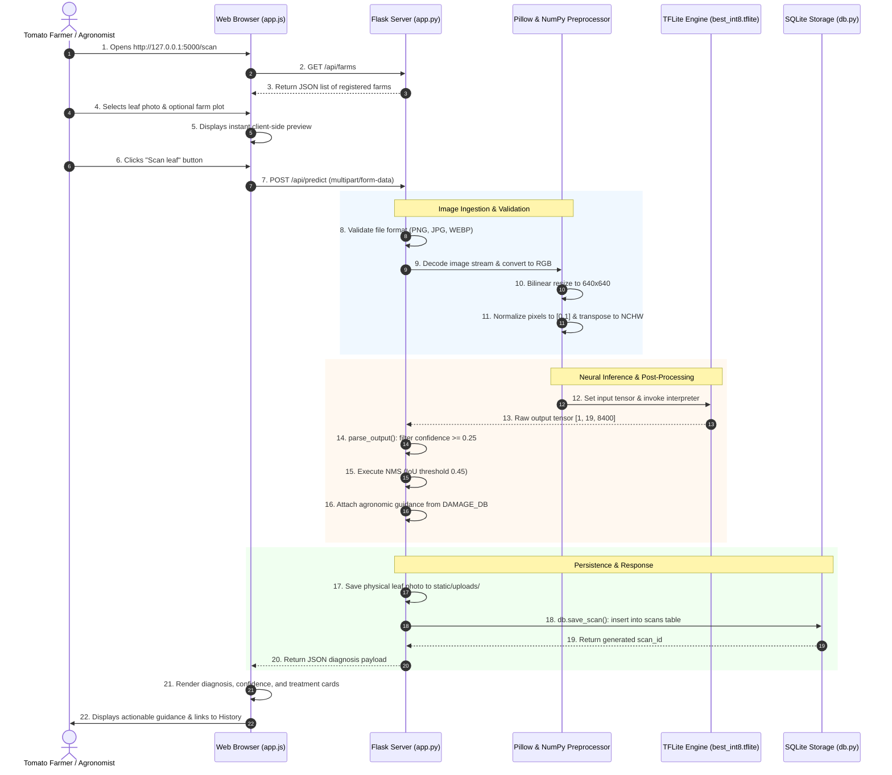

# Tomato Leaf Scan: Technical Documentation
## An AI-Based Image Processing System for Early Tomato Leaf Disease Detection

---

**Document Version:** 1.0.0  
**Project Name:** Tomato Leaf Scan — AI Crop Health Platform  
**Target Environment:** Localhost / Windows 10 & 11 (Python 3.11, Flask 3.1.3, TensorFlow Lite)  
**Author / Candidate:** [Student Name Placeholder]  
**Supervisor:** [Supervisor Name Placeholder]  
**Institution:** [University / Department of Computer Science Placeholder]  
**Date:** October 2026  

---

## Table of Contents

- [Chapter 1: Project Overview](#chapter-1-project-overview)
  - [1.1 Project Title and Identity](#11-project-title-and-identity)
  - [1.2 Background and Purpose](#12-background-and-purpose)
  - [1.3 Problem Statement](#13-problem-statement)
  - [1.4 Project Objectives](#14-project-objectives)
  - [1.5 Scope and Operational Boundaries](#15-scope-and-operational-boundaries)
  - [1.6 Target User Groups](#16-target-user-groups)
  - [1.7 Core System Capabilities](#17-core-system-capabilities)
  - [1.8 Feature Implementation Status Summary](#18-feature-implementation-status-summary)
- [Chapter 2: Technologies and Development Tools](#chapter-2-technologies-and-development-tools)
  - [2.1 Backend Runtime & Framework](#21-backend-runtime--framework)
  - [2.2 AI/ML Inference Stack](#22-aiml-inference-stack)
  - [2.3 Database Management System](#23-database-management-system)
  - [2.4 Frontend Presentation & Styling](#24-frontend-presentation--styling)
  - [2.5 Frontend Visualization & Icons](#25-frontend-visualization--icons)
  - [2.6 Auxiliary Mobile Stack Context](#26-auxiliary-mobile-stack-context)
  - [2.7 Technology Interaction Matrix](#27-technology-interaction-matrix)
- [Chapter 3: System Architecture](#chapter-3-system-architecture)
  - [3.1 High-Level Architecture Overview](#31-high-level-architecture-overview)
  - [3.2 Mermaid Architecture Diagram](#32-mermaid-architecture-diagram)
  - [3.3 Component-by-Component Walkthrough](#33-component-by-component-walkthrough)
  - [3.4 Data Flow and Protocol Interfacing](#34-data-flow-and-protocol-interfacing)
- [Chapter 4: Project Directory Structure](#chapter-4-project-directory-structure)
  - [4.1 Complete Directory Tree](#41-complete-directory-tree)
  - [4.2 Root File Annotations](#42-root-file-annotations)
  - [4.3 Directory Breakdown and Purpose](#43-directory-breakdown-and-purpose)
  - [4.4 Repository Dual-Stack Context](#44-repository-dual-stack-context)
- [Chapter 5: Frontend Implementation](#chapter-5-frontend-implementation)
  - [5.1 Template Hierarchy and Base Shell](#51-template-hierarchy-and-base-shell)
  - [5.2 Responsive CSS Design System](#52-responsive-css-design-system)
  - [5.3 Landing Page (`home.html`)](#53-landing-page-homehtml)
  - [5.4 Leaf Scanner Interface (`scan.html` & `app.js`)](#54-leaf-scanner-interface-scanhtml--appjs)
  - [5.5 Farm Management Interface (`farms.html`)](#55-farm-management-interface-farmshtml)
  - [5.6 Crop Monitoring Dashboard (`monitoring.html`)](#56-crop-monitoring-dashboard-monitoringhtml)
  - [5.7 Diagnostic Scan History (`history.html`)](#57-diagnostic-scan-history-historyhtml)
  - [5.8 Universal Toast and Notification Engine](#58-universal-toast-and-notification-engine)
- [Chapter 6: Backend Implementation](#chapter-6-backend-implementation)
  - [6.1 Flask Application Initialization](#61-flask-application-initialization)
  - [6.2 HTTP Routing and Endpoint Catalog](#62-http-routing-and-endpoint-catalog)
  - [6.3 Image Ingestion and Format Validation](#63-image-ingestion-and-format-validation)
  - [6.4 REST API Implementation Details](#64-rest-api-implementation-details)
  - [6.5 Database Access Layer (`db.py`)](#65-database-access-layer-dbpy)
  - [6.6 Server Execution and Lifespan Management](#66-server-execution-and-lifespan-management)
- [Chapter 7: Artificial Intelligence and Image Processing](#chapter-7-artificial-intelligence-and-image-processing)
  - [7.1 Foundational Machine Learning Concepts](#71-foundational-machine-learning-concepts)
  - [7.2 Object Detection vs. Image Classification](#72-object-detection-vs-image-classification)
  - [7.3 The YOLOv8 Model Architecture and TFLite Export](#73-the-yolov8-model-architecture-and-tflite-export)
  - [7.4 Quantization and Model Specifications](#74-quantization-and-model-specifications)
  - [7.5 The 15 Detectable Condition Classes](#75-the-15-detectable-condition-classes)
  - [7.6 Image Preprocessing Pipeline](#76-image-preprocessing-pipeline)
  - [7.7 Model Execution and Output Decoding](#77-model-execution-and-output-decoding)
  - [7.8 Non-Maximum Suppression (NMS) Algorithm](#78-non-maximum-suppression-nms-algorithm)
  - [7.9 Mapping Predictions to the Agronomic Knowledge Base](#79-mapping-predictions-to-the-agronomic-knowledge-base)
  - [7.10 Model Provenance, Training vs. Inference, and Unverified Aspects](#710-model-provenance-training-vs-inference-and-unverified-aspects)
- [Chapter 8: End-to-End System Workflow](#chapter-8-end-to-end-system-workflow)
  - [8.1 High-Level Process Overview](#81-high-level-process-overview)
  - [8.2 Mermaid Workflow Flowchart](#82-mermaid-workflow-flowchart)
  - [8.3 Step-by-Step Execution Lifecycle](#83-step-by-step-execution-lifecycle)
- [Chapter 9: Installation and Local Execution](#chapter-9-installation-and-local-execution)
  - [9.1 Hardware and Operating System Requirements](#91-hardware-and-operating-system-requirements)
  - [9.2 Python Runtime Verification](#92-python-runtime-verification)
  - [9.3 Dependency Installation](#93-dependency-installation)
  - [9.4 Running via Automated Batch Launcher (`start_app.bat`)](#94-running-via-automated-batch-launcher-start_appbat)
  - [9.5 Manual Execution via Command Line](#95-manual-execution-via-command-line)
  - [9.6 Stopping and Restarting the Server](#96-stopping-and-restarting-the-server)
  - [9.7 Troubleshooting Common Runtime Errors](#97-troubleshooting-common-runtime-errors)
- [Chapter 10: Testing, Verification, and Quality Assurance](#chapter-10-testing-verification-and-quality-assurance)
  - [10.1 Automated Test Suite Overview (`test_app.py`)](#101-automated-test-suite-overview-test_apppy)
  - [10.2 Verification Methodology](#102-verification-methodology)
  - [10.3 Test Case Execution Matrix (54 Verified Tests)](#103-test-case-execution-matrix-54-verified-tests)
  - [10.4 Manual and Unverified Test Scenarios](#104-manual-and-unverified-test-scenarios)
- [Chapter 11: Security, Reliability, and System Limitations](#chapter-11-security-reliability-and-system-limitations)
  - [11.1 File Upload Security and Sanitization](#111-file-upload-security-and-sanitization)
  - [11.2 SQL Injection Prevention](#112-sql-injection-prevention)
  - [11.3 Localhost Architecture Limitations](#113-localhost-architecture-limitations)
  - [11.4 AI Model Boundaries and Risk of False Diagnoses](#114-ai-model-boundaries-and-risk-of-false-diagnoses)
  - [11.5 Agricultural Decision-Support Advisory Notice](#115-agricultural-decision-support-advisory-notice)
- [Chapter 12: Future Improvements and Engineering Roadmap](#chapter-12-future-improvements-and-engineering-roadmap)
  - [12.1 Planned Architectural Enhancements](#121-planned-architectural-enhancements)
  - [12.2 Advanced Machine Learning Pipeline](#122-advanced-machine-learning-pipeline)
  - [12.3 Multi-Farm Cloud Synchronization](#123-multi-farm-cloud-synchronization)
- [Chapter 13: Conclusion](#chapter-13-conclusion)
- [Appendices](#appendices)
  - [Appendix A: Key Execution Commands](#appendix-a-key-execution-commands)
  - [Appendix B: Pinned Python Dependencies (`requirements.txt`)](#appendix-b-pinned-python-dependencies-requirementstxt)
  - [Appendix C: Complete REST API Endpoint Specification](#appendix-c-complete-rest-api-endpoint-specification)
  - [Appendix D: Technical Glossary](#appendix-d-technical-glossary)

---

# Chapter 1: Project Overview

## 1.1 Project Title and Identity
The official project title is **Tomato Leaf Scan: An AI-Based Image Processing System for Early Tomato Leaf Disease Detection** (also referred to within the user-facing web interface as *Tomato Leaf Scan — AI Crop Health Platform*).

## 1.2 Background and Purpose
The tomato (*Solanum lycopersicum*) is one of the most widely cultivated and economically essential vegetable crops globally. However, tomato production is perpetually threatened by a broad spectrum of foliar pathologies, including fungal infections, bacterial blight, viral outbreaks, and insect pest infestations. In conventional farming practices, disease identification relies primarily on manual visual inspection by farmers or periodic site visits by agricultural extension officers. This traditional approach presents several severe drawbacks:
1. **Human Subjectivity and Error:** Visual symptoms of early-stage fungal lesions (such as Early Blight) frequently mimic bacterial spots or nutritional deficiencies, resulting in incorrect chemical pesticide application.
2. **Delayed Intervention:** Agricultural extension officers are often unavailable in remote farming regions, meaning infections are frequently diagnosed only after extensive foliage collapse has already taken place.
3. **Severe Yield and Financial Losses:** Fungal and viral pathogens (e.g., Late Blight, Tomato Yellow Leaf Curl Virus) can decimate up to 100% of an unmanaged tomato crop within seven to ten days.

The purpose of **Tomato Leaf Scan** is to provide an accessible, on-device, automated diagnostic web system that allows tomato growers and agricultural researchers to photograph an affected tomato leaf and immediately receive an objective diagnosis, confidence assessment, and science-backed containment guidance.

## 1.3 Problem Statement
Smallholder farmers and commercial tomato producers lack rapid, reliable, and localized diagnostic tools. Existing commercial agricultural solutions often require expensive proprietary sensors, continuous high-speed internet connections for cloud inference, or paid expert consultation subscriptions. There is an urgent engineering need for a localized, zero-cost, privacy-respecting, and offline-capable diagnostic platform that combines computer vision inference with practical agronomic farm record-keeping.

## 1.4 Project Objectives
The engineering and academic objectives of the system are structured into five key goals:
1. **Develop an Accessible Local Web Application:** Implement a responsive, lightweight web application running on standard commodity hardware using Python, Flask, HTML5, Vanilla CSS, and JavaScript.
2. **Integrate an On-Device Deep Learning Inference Pipeline:** Implement an efficient computer vision pipeline utilizing a quantized TensorFlow Lite (`.tflite`) object detection model to classify and locate foliar disease patterns without uploading photos to external third-party cloud servers.
3. **Deliver Actionable Agronomic Decision Support:** Map model classification labels directly to an embedded expert knowledge base providing symptoms, causes, immediate cultural steps, spread prevention protocols, and certified chemical/organic treatments.
4. **Implement Multi-Farm Cultivation Management:** Provide full Create, Read, Update, and Delete (CRUD) database management for distinct tomato farm plots, recording planted varieties, plant counts, planting dates, and acreage.
5. **Establish Longitudinal Crop Monitoring & Diagnostic Auditing:** Maintain an audit trail of every scanned leaf in a local SQLite database, generating real-time Key Performance Indicators (KPIs), health distribution charts, pathogen frequency metrics, and contextual outbreak alerts.

## 1.5 Scope and Operational Boundaries
The operational boundaries of the implemented system are defined as follows:
- **Target Crop:** Exclusively tomato foliage (*Solanum lycopersicum*). Leaves from other crops (e.g., maize, potato, cassava) are outside the model's training distribution.
- **Operating Environment:** Runs locally on Windows operating systems (Windows 10 / 11) accessed through standard modern web browsers (Chrome, Edge, Firefox) at `http://127.0.0.1:5000`.
- **Inference Mode:** Executes on the local host CPU using TensorFlow Lite (`tensorflow-cpu` / LiteRT runtime). GPU acceleration is not required.
- **Connectivity:** The complete core diagnostic pipeline, database persistence, and farm management function 100% offline. External CDN resources (such as FontAwesome icons and Chart.js) are loaded when internet connectivity is present.
- **Decision Support Nature:** The system is engineered as an informational decision-support aid. It does not replace certified laboratory microbiological assays.

## 1.6 Target User Groups
1. **Smallholder & Commercial Tomato Farmers:** End-users seeking immediate identification of leaf abnormalities, dosage guidance for fungicides/bactericides, and historical farm plot records.
2. **Agricultural Extension Workers & Agronomists:** Field advisors requiring an organized digital tool to record inspection samples across different client farms during field audits.
3. **Agricultural Students & Researchers:** Academic investigators studying computer vision applications in precision agriculture and edge computing.

## 1.7 Core System Capabilities
- **Single-Leaf Inspection:** Ingestion of PNG, JPG, JPEG, and WEBP leaf photographs with real-time browser preview.
- **Automated Detection & Confidence Scoring:** Extraction of multi-class bounding box candidates with anchor decoding, confidence thresholding ($\ge 25\%$), and Non-Maximum Suppression ($\text{IoU} > 0.45$).
- **Integrated Farm Plot Linking:** Optional assignment of leaf scans to specific registered farm plots.
- **Persistent Scan Archiving:** Automatic file system persistence of uploaded images into `static/uploads/` and structured metadata into SQLite (`data/leafscan.db`).
- **Farm Management Module:** Full CRUD management of farm plots, varieties tracked, and plant populations.
- **Interactive Monitoring Dashboard:** Dynamic KPI metric cards, Chart.js visual distribution doughnut chart, top pathogen frequency bar chart, and 14-day scan timeline.
- **Searchable Diagnostic History:** Full filtering by diagnosis status (Healthy, Disease, Unclear), farm plot filtering, substring searching, and deep-dive modal inspection.

## 1.8 Feature Implementation Status Summary

| System Feature / Component | Implementation Status | Evidence / Verification in Codebase |
|---|---|---|
| **Flask Local Web Server** | Fully Implemented | `app.py` initializes Flask 3.1.3 on port 5000 |
| **TFLite AI Inference Engine** | Fully Implemented | `app.py` (`build_result_for_image`, `parse_output`) |
| **Quantized Model Asset** | Fully Implemented | `assets/models/best_int8.tflite` (26.5 MB present) |
| **Agronomic Damage Knowledge Base** | Fully Implemented | `DAMAGE_DB` dictionary (15 classes in `app.py`) |
| **SQLite Persistent Storage** | Fully Implemented | `db.py` (`leafscan.db` with `farms` and `scans` tables) |
| **File Storage for Scans** | Fully Implemented | `static/uploads/` with UUID-based timestamped filenames |
| **Single-Page Leaf Scanner** | Fully Implemented | `templates/scan.html`, `static/app.js` |
| **Tomato Farm Plot Manager** | Fully Implemented | `templates/farms.html`, `/api/farms` REST endpoints |
| **Crop Monitoring Dashboard** | Fully Implemented | `templates/monitoring.html`, Chart.js visualizations |
| **Searchable Scan History** | Fully Implemented | `templates/history.html`, `/api/scans` REST endpoints |
| **Automated Test Suite** | Fully Implemented | `test_app.py` (54/54 tests passing synchronously) |
| **Windows Launch Script** | Fully Implemented | `start_app.bat` (automated dependency check & launch) |
| **Model Retraining Scripts** | Not Present in Repo | Pre-trained model bundled; raw training scripts omitted |
| **Cloud Database Sync** | Not Implemented | Architecture strictly operates on local SQLite |
| **User Login / Multi-Tenancy** | Not Implemented | Single-tenant local workstation deployment |

---

# Chapter 2: Technologies and Development Tools

## 2.1 Backend Runtime & Framework

### Python 3.11
- **What it is:** A modern, high-level, general-purpose interpreted programming language renowned for its extensive data science, machine learning, and web development ecosystem.
- **Why it is used:** Python is the industry standard for computer vision and machine learning integrations. Version 3.11 delivers substantial interpreter performance optimizations, robust type hinting, and seamless binary compatibility with TensorFlow wheels on Windows.
- **Role in Application:** Acts as the primary backend runtime executing web controllers, database transactions, image preprocessing, tensor manipulations, and neural network inference.
- **Interactions:** Interfaces with Flask for HTTP handling, SQLite via the native `sqlite3` driver, Pillow for image parsing, NumPy for array slicing, and TensorFlow Lite for model invocation.

### Flask 3.1.3
- **What it is:** A lightweight, modular Web Server Gateway Interface (WSGI) web application micro-framework built on Werkzeug and Jinja2.
- **Why it is used:** Unlike heavy monolithic frameworks (such as Django), Flask introduces minimal runtime overhead, offers fine-grained architectural control, and enables rapid construction of both RESTful JSON APIs and server-rendered HTML templates.
- **Role in Application:** Hosts the core web server, routes incoming HTTP GET, POST, PUT, and DELETE requests, coordinates input validation, serves static CSS/JS assets, and renders Jinja2 templates.
- **Interactions:** Serves as the central mediator connecting the frontend browser interface (`app.js`, HTML templates) with the database layer (`db.py`) and the inference engine (`app.py`).

## 2.2 AI/ML Inference Stack

### TensorFlow CPU 2.16.2 (`tf.lite.Interpreter`)
- **What it is:** Google’s open-source machine learning platform. The `tensorflow-cpu` distribution packages the complete TensorFlow library optimized specifically for CPU instruction sets without requiring heavy NVIDIA CUDA or cuDNN dependencies.
- **Why it is used:** It provides the native `tf.lite.Interpreter` runtime, enabling execution of quantized `.tflite` computational graphs with high efficiency using multi-threaded CPU kernels (XNNPACK delegate).
- **Role in Application:** Loads the pre-compiled `best_int8.tflite` model, allocates input and output memory buffers (tensors), executes the compiled graph layers on CPU threads, and outputs raw prediction tensors.
- **Interactions:** Receives normalized NumPy arrays from the image preprocessing pipeline and outputs raw multi-dimensional bounding box and classification tensors to `parse_output()`.

### NumPy 2.4.6
- **What it is:** The fundamental package for scientific computing in Python, providing support for large, multi-dimensional arrays and matrices along with a comprehensive library of mathematical functions.
- **Why it is used:** Deep learning models require inputs and outputs formatted as dense numerical tensors. NumPy enables high-performance vector operations, matrix transposition, normalization, clipping, and tensor slicing.
- **Role in Application:** Converts PIL image buffers into numerical matrices, handles normalization ($[0.0, 1.0]$), performs tensor transposition between NCHW and NHWC formats, and executes Non-Maximum Suppression (NMS) matrix operations.
- **Interactions:** Receives image data from Pillow, formats tensors for TensorFlow Lite, and processes raw output tensors into Python dictionaries.

### Pillow (PIL) 12.3.0
- **What it is:** The premier Python Imaging Library fork that adds image processing capabilities to the Python interpreter.
- **Why it is used:** Provides fast, robust decoding and resizing for standard image formats (JPEG, PNG, WEBP) without requiring large third-party C++ libraries such as OpenCV.
- **Role in Application:** Inspects uploaded HTTP file streams, validates image headers, converts arbitrary color spaces to standard RGB, resizes raw input leaves to the model's required $640 \times 640$ dimension via bilinear interpolation, and persists uploaded files to disk.
- **Interactions:** Reads directly from Flask’s `request.files['image'].stream` and outputs resized RGB image objects to NumPy.

## 2.3 Database Management System

### SQLite 3 (Python Standard Library `sqlite3`)
- **What it is:** A self-contained, serverless, zero-configuration, transactional SQL database engine that stores complete relational databases in a single cross-platform disk file.
- **Why it is used:** Eliminates the operational complexity of installing, configuring, and running background database daemons (such as PostgreSQL or MySQL). It guarantees ACID compliance and runs out of the box on all Windows environments.
- **Role in Application:** Provides relational persistence for farm plot registries (`farms` table) and leaf diagnostic records (`scans` table) inside `data/leafscan.db`.
- **Interactions:** Managed entirely by `db.py`, executing parameterized SQL queries, foreign key enforcement (`PRAGMA foreign_keys = ON`), and metric aggregations.

## 2.4 Frontend Presentation & Styling

### HTML5 & Jinja2 Template Engine
- **What it is:** Semantic HTML5 provides the structural skeleton of the user interface. Jinja2 is Flask’s server-side templating engine that evaluates dynamic template logic, variable substitution, and layout inheritance.
- **Why it is used:** Ensures clean separation of concerns, DRY (Don't Repeat Yourself) layout inheritance through `base.html`, and server-side injection of navigation states.
- **Role in Application:** Structures the five primary application views (`home.html`, `scan.html`, `farms.html`, `monitoring.html`, and `history.html`).

### Vanilla CSS Design System (`styles.css`)
- **What it is:** Pure standard CSS3 utilizing CSS Custom Properties (variables), Flexbox, CSS Grid, and responsive media query breakpoints without third-party utility frameworks like Tailwind or Bootstrap.
- **Why it is used:** Provides maximum control over styling, ultra-fast render speeds, zero build steps, and consistent design language across all components.
- **Role in Application:** Defines color palettes, typography scales, card elevations, button micro-interactions, modal dialog overlays, responsive grids, and print/mobile adaptations.

### Modular Vanilla JavaScript (`app.js`)
- **What it is:** Native client-side ECMAScript (ES6+) executing in the user's browser without heavyweight framework runtimes (such as React or Angular).
- **Why it is used:** Delivers zero-dependency client logic, rapid execution, instant DOM manipulation, and asynchronous HTTP communication via the native `fetch` API.
- **Role in Application:** Handles real-time client-side image previewing, asynchronous form submission with `FormData`, dynamic modal dialog control, and responsive DOM rendering of AI diagnosis results.

## 2.5 Frontend Visualization & Icons

### Chart.js 4.4.1 (CDN-Loaded)
- **What it is:** An open-source, HTML5 Canvas-based JavaScript library for creating responsive, interactive data charts.
- **Why it is used:** Generates clear, animated visual charts from dynamic JSON statistical payloads with minimal client-side code.
- **Role in Application:** Visualizes crop health breakdown (Doughnut chart), disease prevalence (Bar chart), and 14-day inspection timelines (Line chart) on `monitoring.html`.

### FontAwesome 6 (CDN-Loaded)
- **What it is:** An industry-standard vector icon library providing iconography for web interfaces.
- **Why it is used:** Enhances visual clarity and usability for agricultural icons (tractors, leaves, warnings, magnifying glasses).

## 2.6 Auxiliary Mobile Stack Context
The project repository also retains an initial prototype mobile codebase implemented in **Flutter / Dart** (`lib/`, `android/`, `ios/`, `pubspec.yaml`). In that initial mobile architecture, the same `best_int8.tflite` model was deployed on Android using Google’s LiteRT runtime. In the current iteration, the project has been fully developed into a standalone **Python Flask Web Application**, making it accessible across standard desktop and laptop environments on Windows.

## 2.7 Technology Interaction Matrix

```
[Web Browser Client]
       │
       ├─ (HTTP GET HTML Views) ─────────> [Flask Jinja2 Router] ──> [HTML5 / CSS / JS]
       │
       ├─ (Multipart POST Image) ────────> [Flask Route: /api/predict]
       │                                          │
       │                                          ▼
       │                                   [Pillow (PIL)] (Validate, RGB, Resize 640x640)
       │                                          │
       │                                          ▼
       │                                   [NumPy] (Normalize [0,1], Transpose to NCHW)
       │                                          │
       │                                          ▼
       │                                   [TensorFlow Lite Interpreter] (best_int8.tflite)
       │                                          │
       │                                          ▼
       │                                   [parse_output() & NMS] (Confidence & IoU Filter)
       │                                          │
       │                                          ▼
       │                                   [DAMAGE_DB Dictionary] (Attach Agronomic Guidance)
       │                                          │
       │                                          ▼
       │                                   [File System (static/uploads/)] (Save JPG File)
       │                                          │
       │                                          ▼
       ├─ (JSON Results / Scan ID) <────── [db.py -> SQLite3] (Persist Scan Record)
       │
       └─ (REST API GET/POST/PUT/DELETE) ─> [db.py -> SQLite3 (data/leafscan.db)]
```

---

# Chapter 3: System Architecture

## 3.1 High-Level Architecture Overview
Tomato Leaf Scan is structured according to a **Multi-Tier Layered Client-Server Architecture** running on the local host. The architecture consists of four distinct operational layers:
1. **Presentation Layer (Frontend UI):** Browser-rendered HTML5 pages styled with Vanilla CSS and animated by JavaScript, managing user interaction, image selection, and data visualization.
2. **Application / API Controller Layer (Flask Backend):** Manages HTTP lifecycle events, performs request routing, enforces file ingestion security, and acts as the coordinator between data storage and inference.
3. **Machine Learning Inference Engine Layer:** Executes image tensor transformations, loads the TensorFlow Lite runtime, executes the YOLOv8 model graph, decodes multi-anchor bounding boxes, and applies Non-Maximum Suppression.
4. **Data Persistence Layer:** Stores uploaded leaf photographs in a managed directory (`static/uploads/`) and maintains transactional records of farm plots and scan metadata in SQLite (`data/leafscan.db`).

## 3.2 Mermaid Architecture Diagram

```mermaid
flowchart TD
    subgraph ClientTier ["Client Presentation Layer (Browser)"]
        UI_Home["Landing Page (home.html)"]
        UI_Scan["Leaf Scanner (scan.html + app.js)"]
        UI_Farms["Farm Manager (farms.html)"]
        UI_Monitor["Monitoring Dashboard (monitoring.html + Chart.js)"]
        UI_History["Scan History (history.html)"]
    end

    subgraph ControllerTier ["Application Controller Layer (Flask 3.1.3)"]
        Router["Flask Request Router (app.py)"]
        API_Predict["/api/predict (Multipart Form Endpoint)"]
        API_Farms["/api/farms CRUD Endpoints"]
        API_Scans["/api/scans Query & Delete Endpoints"]
        API_Stats["/api/dashboard/stats Metrics Endpoint"]
    end

    subgraph MLTier ["AI / Computer Vision Layer (Edge Inference)"]
        Preprocessor["Pillow & NumPy Pipeline (640x640 Bilinear, NCHW Normalization)"]
        TFLite["TensorFlow Lite Interpreter (assets/models/best_int8.tflite)"]
        Decoder["YOLOv8 Output Parser (8400 Anchors, Conf >= 0.25)"]
        NMS["Non-Maximum Suppression Algorithm (IoU > 0.45)"]
        KB["Agronomic Damage Knowledge Base (DAMAGE_DB Dictionary)"]
    end

    subgraph DataTier ["Data Persistence Layer (Local Storage)"]
        DB["SQLite Database Engine (data/leafscan.db)"]
        Table_Farms[("farms Table")]
        Table_Scans[("scans Table")]
        Disk_Uploads[("Disk Storage: static/uploads/leaf_*.jpg")]
    end

    %% Client to Controller interactions
    UI_Home -->|HTTP GET /| Router
    UI_Scan -->|POST multipart/form-data| API_Predict
    UI_Scan -.->|GET /api/farms dropdown| API_Farms
    UI_Farms <-->|REST CRUD Calls| API_Farms
    UI_Monitor <-->|GET /api/dashboard/stats| API_Stats
    UI_History <-->|GET /api/scans & DELETE| API_Scans

    %% Controller to ML interactions
    API_Predict --> Preprocessor
    Preprocessor --> TFLite
    TFLite --> Decoder
    Decoder --> NMS
    NMS --> KB
    KB -->|Structured Diagnosis JSON| API_Predict

    %% Controller to Data interactions
    API_Predict -->|Persist Image File| Disk_Uploads
    API_Predict -->|db.save_scan()| Table_Scans
    API_Farms <-->|db.create/update/delete_farm()| Table_Farms
    API_Scans <-->|db.list/delete_scans()| Table_Scans
    API_Scans -.->|Safe File Purge| Disk_Uploads
    API_Stats <-->|db.get_dashboard_stats()| DB

    Table_Farms -.->|1:N Foreign Key Relation| Table_Scans
```

## 3.3 Component-by-Component Walkthrough

### 1. Presentation Tier
The presentation tier is executed entirely by the user’s web browser. It provides interactive interfaces for capturing and uploading leaves, managing farm plot entities, reviewing Chart.js analytics, and searching through historical records. All communications with the server use asynchronous standard HTTP methods (`fetch`).

### 2. Controller Tier (`app.py`)
Flask acts as the application's central nervous system. When an image upload is received at `/api/predict`, Flask validates the MIME type and extension, prevents empty payloads, creates a Pillow image handle, and passes it to the inference pipeline. Once the diagnosis is produced, Flask coordinates file system storage, invokes `db.save_scan()`, and returns a consolidated JSON response containing prediction probabilities, bounding boxes, and medical agronomic advice.

### 3. ML Inference Tier
The ML tier operates locally on the CPU. It encapsulates all mathematical and neural operations:
- Image reshaping to $640 \times 640 \times 3$.
- Array normalization to floating-point values between $0.0$ and $1.0$.
- Invoking `tf.lite.Interpreter.invoke()`.
- Iterating over all 8,400 multi-scale anchors.
- Applying Non-Maximum Suppression to filter redundant spatial predictions.
- Attaching agronomic metadata from `DAMAGE_DB`.

### 4. Data Persistence Tier
Consists of two physical entities on disk:
- `data/leafscan.db`: Houses the relational schema (`farms` and `scans` tables) with index optimization for query filtering.
- `static/uploads/`: A dedicated folder where uploaded inspection photos are given a unique UUID and timestamped filename (`leaf_YYYYMMDD_HHMMSS_[uuid].jpg`) to prevent filesystem collision.

## 3.4 Data Flow and Protocol Interfacing
- **Client $\leftrightarrow$ Server:** Exclusively HTTP/1.1 over TCP loopback (`127.0.0.1:5000`).
- **Data Serialization:** Standard JSON (`application/json`) for API endpoints, `multipart/form-data` for image payloads, and `text/html` for initial view rendering.
- **Database Interfacing:** Native C-level SQLite calls via Python’s `sqlite3` driver with parameterized tuple bindings (`?`) ensuring immunity from SQL injection attacks.

---

# Chapter 4: Project Directory Structure

## 4.1 Complete Directory Tree
The actual layout of the project workspace is presented below:

```text
d:/TO/tomato/Leafscan-main/
│
├── app.py                         # Primary Flask application, routes, and AI inference engine
├── db.py                          # SQLite database schema, CRUD helpers, and analytics queries
├── test_app.py                    # Automated test suite (54 comprehensive test cases)
├── requirements.txt               # Pinned Python package dependencies
├── start_app.bat                  # Automated Windows batch launcher script
├── README.md                      # High-level project summary and quick-start guide
├── Tomato Vision Scanner Icon.png # High-resolution project logo asset
├── .gitignore                     # Git tracking exclusion specifications
│
├── assets/                        # Static binary and model assets
│   ├── models/
│   │   └── best_int8.tflite       # Pre-trained INT8 quantized YOLOv8 model file (~26.5 MB)
│   ├── google_fonts/              # Bundled offline TTF fonts (DM Sans & Bricolage Grotesque)
│   ├── icon/                      # Icon source graphic assets
│   └── favicon/                   # Browser favicon graphic assets
│
├── data/                          # Persistent database directory
│   └── leafscan.db                # SQLite database file (created automatically on startup)
│
├── static/                        # Web client assets served directly by Flask
│   ├── app.js                     # Client-side JavaScript for scanner & farm linking
│   ├── styles.css                 # Master CSS stylesheet and responsive design system
│   ├── images/
│   │   └── hero-tomato.jpg        # High-definition landing page visual graphic
│   └── uploads/                   # Persistent storage for uploaded leaf inspection photos
│
├── templates/                     # Jinja2 server-side HTML templates
│   ├── base.html                  # Master shell template with topbar navigation and footer
│   ├── home.html                  # Landing page with hero section and workflow breakdown
│   ├── scan.html                  # Leaf scanner page with upload box and diagnosis display
│   ├── farms.html                 # Tomato farm management interface with CRUD modal
│   ├── monitoring.html            # Crop monitoring dashboard with Chart.js analytics
│   ├── history.html               # Diagnostic scan history with search and filter toolbar
│   └── index.html                 # Legacy single-page scanner view
│
├── docs/                          # Existing documentation files
│   └── DOCUMENTATION.md           # Documentation of original mobile Flutter build
│
├── lib/                           # Flutter/Dart cross-platform mobile source files
│   ├── main.dart                  # Flutter entry point, theme, and mobile screens
│   ├── models/
│   │   ├── detector.dart          # Flutter TFLite YOLOv8 model loader and NMS engine
│   │   └── disease_info.dart      # Flutter Dart disease knowledge base
│   ├── services/
│   │   └── chat.dart              # Flutter assistant service
│   └── widgets/
│       └── detection_image.dart   # Flutter bounding-box rendering widget
│
├── android/ · ios/ · macos/ …    # Generated Flutter platform-specific mobile projects
└── pubspec.yaml · pubspec.lock    # Flutter project configuration and package dependencies
```

## 4.2 Root File Annotations

### `app.py`
The central entry point of the web application. Contains the Flask application definition, the machine learning inference pipeline (`build_result_for_image`, `parse_output`), the `RAW_LABELS` and `LABEL_MAP` mappings, the agronomic expert knowledge base (`DAMAGE_DB`), and all RESTful route controllers.

### `db.py`
The data abstraction module. Implements thread-safe connections to SQLite, table schema initialization (`init_db`), farm CRUD operations, scan record persistence, filtering queries, dashboard metric aggregation, and safe disk cleanup on deletion.

### `test_app.py`
The regression test suite. Uses Flask’s built-in `test_client()` to validate health checks, page routes, CRUD farm endpoints, mock leaf image inference, scan persistence, dashboard KPI computations, and safe deletion cascades.

### `requirements.txt`
Specifies the exact Python dependencies required to execute the web application: `Flask==3.1.3`, `Pillow==12.3.0`, `numpy==2.4.6`, and `tensorflow-cpu==2.16.2`.

### `start_app.bat`
A Windows batch file designed for one-click startup. It verifies the presence of Python 3.11, installs missing requirements silently via pip, launches the browser at `http://127.0.0.1:5000`, and starts the Flask server.

## 4.3 Directory Breakdown and Purpose
- **`assets/models/`**: Houses the binary neural network weights (`best_int8.tflite`). This file is strictly read-only during server operation.
- **`data/`**: Designated for stateful database storage. Housing `leafscan.db` here prevents clutter in the project root and allows clean backups.
- **`static/uploads/`**: Serves as persistent media storage for leaf photographs uploaded by users. Files are named deterministically with timestamps and UUID strings.
- **`templates/`**: Contains the Jinja2 HTML views. Each page extends `base.html` to maintain uniform brand styling, navigation headers, and footer notices.

## 4.4 Repository Dual-Stack Context
The codebase contains both a **Python Flask web architecture** and a **Flutter mobile architecture** (`lib/`, `pubspec.yaml`). This reflects the project's evolution: the initial prototype was built as a Flutter edge application, which was subsequently expanded into a comprehensive local Flask web application providing multi-farm management, visual monitoring dashboards, and relational scan history tracking.

---

# Chapter 5: Frontend Implementation

## 5.1 Template Hierarchy and Base Shell
The web frontend is engineered around Jinja2 template inheritance. The base layout is defined in `templates/base.html`:

```html
<!-- Excerpt from templates/base.html -->
<div class="page-shell">
  <header class="topbar">
    <a href="{{ url_for('home') }}" class="brand-link">
      <div class="brand-wrap">
        <div class="brand-mark">T</div>
        <div>
          <p class="eyebrow">AI Crop Health</p>
          <h1 class="brand-title">Tomato Leaf Scan</h1>
        </div>
      </div>
    </a>
    <nav class="nav-links" id="main-nav">
      <a href="{{ url_for('home') }}" class="active">Home</a>
      <a href="{{ url_for('farms_page') }}" class="active">Tomato Farm</a>
      <a href="{{ url_for('monitoring_page') }}" class="active">Crop Monitoring</a>
      <a href="{{ url_for('history_page') }}" class="active">Scan History</a>
      <a href="{{ url_for('scan_page') }}" class="nav-cta-btn">Scan Leaf</a>
    </nav>
  </header>
  <main></main>
  <footer class="site-footer card">...</footer>
</div>
```

The base template includes the responsive navigation bar, Google Fonts (`Inter`), FontAwesome icon sets, mobile hamburger toggle mechanics, and a universal toast notification container.

## 5.2 Responsive CSS Design System
Styling is governed by `static/styles.css`, structured using CSS custom property design tokens:
- **Color Palette:**
  - `--primary: #1b7a43;` (Deep agricultural green)
  - `--primary-hover: #145e33;`
  - `--accent: #e76f51;` (Warm terracotta/tomato accent)
  - `--bg: #f4f7f4;` (Soft organic off-white background)
  - `--surface: #ffffff;` (Crisp card surface)
  - `--text: #1f2937;` (High-contrast charcoal slate)
  - `--muted: #64748b;` (Secondary slate label text)
  - `--danger: #dc2626;` (Critical pathogen warning red)
- **Responsive Breakpoints:**
  - `@media (max-width: 992px)`: Collapses multi-column grids (hero, dashboard charts, advice grid) into dual- or single-column stacks.
  - `@media (max-width: 768px)`: Transforms the topbar navigation into an accessible slide-down mobile menu toggled via the hamburger button (`#mobile-nav-toggle`).

## 5.3 Landing Page (`home.html`)
The landing page serves as the entry portal for users:
- **Hero Banner:** Features high-impact value proposition messaging, a call-to-action button linking directly to `/scan`, an overview of key capabilities, and a visual card (`hero-tomato.jpg`) highlighting the 15+ detectable conditions.
- **Three-Step Workflow Section:** Details the step-by-step diagnostic journey: (1) Upload or Take Photo, (2) AI Neural Model Analysis, and (3) Review Diagnosis & Guidance.
- **Feature Exploration Grid:** Deep-link cards routing the user to the Farm Manager, Monitoring Dashboard, and Diagnostic History.

## 5.4 Leaf Scanner Interface (`scan.html` & `app.js`)
The leaf scanner view provides the core diagnostic workflow:
- **Optional Farm Plot Selector:** Dynamically loaded via `loadFarmsIntoSelect()`, allowing the user to tag an upcoming scan to an existing farm plot.
- **Drag-and-Drop / File Picker:** Custom styled upload box accepting PNG, JPG, JPEG, and WEBP formats up to 15 MB.
- **Live Client Preview:** Leverages browser `URL.createObjectURL(file)` to display the selected leaf immediately before transmission.
- **Asynchronous AJAX Submission:** Controlled by `static/app.js`:

```javascript
// Excerpt from static/app.js handling scan submission
form.addEventListener('submit', async (event) => {
  event.preventDefault();
  if (!selectedFile) {
    setStatus('Please select an image before scanning.', 'error');
    return;
  }
  const formData = new FormData();
  formData.append('image', selectedFile);
  if (farmSelect && farmSelect.value) {
    formData.append('farm_id', farmSelect.value);
  }
  analyzeButton.disabled = true;
  analyzeButton.innerHTML = '<i class="fa-solid fa-spinner fa-spin"></i> Scanning leaf with AI...';
  try {
    const response = await fetch('/api/predict', { method: 'POST', body: formData });
    const payload = await response.json();
    if (!response.ok) throw new Error(payload.error || 'Prediction failed.');
    renderResult(payload);
    setStatus('Prediction complete and saved to Scan History.', 'success');
  } catch (err) {
    setStatus(err.message, 'error');
  } finally {
    analyzeButton.disabled = false;
    analyzeButton.innerHTML = '<i class="fa-solid fa-magnifying-glass"></i> Scan leaf';
  }
});
```

- **Results Presentation:** Reveals `#results`, updating the confidence badge, disease classification chip, immediate cultural containment protocols (`#stop-now`), spread prevention tips (`#prevent-spread`), and chemical/organic treatments (`#treatments`).

## 5.5 Farm Management Interface (`farms.html`)
Provides comprehensive plot record tracking:
- **Summary Metrics Strip:** Displays Total Farms, Total Plants cultivated, and Distinct Varieties tracked.
- **Responsive Farm Card Grid:** Visualizes registered plots with badges for acreage, plant counts, planting dates, and historical disease frequencies.
- **Interactive Add/Edit Modal:** A validated dialog supporting plot creation and in-place updates.
- **Safe Delete Confirmation:** Warns the user that deleting a farm safely updates associated scans to `General / Unassigned (Archived)` rather than deleting scan history.

## 5.6 Crop Monitoring Dashboard (`monitoring.html`)
Translates raw scan logs into actionable visual intelligence:
- **KPI Summary Grid:** Four metric cards calculating Total Farms, Total Scans, Healthy Percentage, and Disease Detection Rate.
- **Dynamic Contextual Outbreak Alerts:** Generates real-time alerts warning users if critical pathogens (Late Blight, Bacterial Canker, Yellow Leaf Curl Virus) have been diagnosed in recent scans.
- **Chart.js Visualizations:**
  1. *Health Distribution:* Doughnut chart showing proportions of Healthy vs. Diseased vs. Unclear scans.
  2. *Top Pathogens Prevalence:* Horizontal bar chart ranking detected diseases by frequency.
  3. *Activity Timeline:* Line graph illustrating 14-day scan velocity.
- **Recent Inspections Audit Table:** Displays the 6 most recent scans with image thumbnails, confidence tags, and links to details.

## 5.7 Diagnostic Scan History (`history.html`)
The persistent audit repository for all past leaf scans:
- **Search & Filter Toolbar:** Real-time client filtering by keyword (disease or farm name), classification status (Healthy, Disease, Unclear), and specific farm plot.
- **Inspection Card Grid:** Shows thumbnail images, date badges, farm tags, confidence percentages, and quick-action buttons.
- **Comprehensive Detail Modal:** Clicking "View Full Report" opens an overlay displaying the complete stored advice, pathogen causes, and treatments.
- **Safe Scan Deletion:** Removes the record from SQLite and triggers safe cleanup of the image file on disk.

## 5.8 Universal Toast and Notification Engine
Defined in `base.html`, the `showToast(message, type)` function generates unobtrusive, floating alert notifications that fade out after 3.5 seconds, providing clear feedback for operations such as farm creation, image scanning, and record deletion.

---

# Chapter 6: Backend Implementation

## 6.1 Flask Application Initialization
The backend server is instantiated in `app.py`:

```python
# Excerpt from app.py
from flask import Flask, jsonify, redirect, render_template, request, url_for
import db

app = Flask(__name__, static_folder='static', template_folder='templates')

# Initialize SQLite database schema
db.init_db()
```

During startup, `db.init_db()` executes automatically, creating `data/leafscan.db` and the required tables and indexes if they do not already exist.

## 6.2 HTTP Routing and Endpoint Catalog
The server implements both HTML template rendering routes and RESTful JSON endpoints:

| Route Path | HTTP Method | Function | Output / Response |
|---|---|---|---|
| `/` | GET | `home()` | Renders `home.html` |
| `/scan` | GET | `scan_page()` | Renders `scan.html` |
| `/farms` | GET | `farms_page()` | Renders `farms.html` |
| `/monitoring` | GET | `monitoring_page()` | Renders `monitoring.html` |
| `/history` | GET | `history_page()` | Renders `history.html` |
| `/health` | GET | `health()` | JSON server & model health status |
| `/api/predict` | POST | `predict()` | JSON disease diagnosis & advice |
| `/api/farms` | GET / POST | `api_list_farms()` / `api_create_farm()` | JSON list of farms / Create farm |
| `/api/farms/<id>` | GET / PUT / DELETE | `api_get/update/delete_farm()` | JSON single farm CRUD operations |
| `/api/scans` | GET | `api_list_scans()` | JSON filtered list of past scans |
| `/api/scans/<id>` | GET / DELETE | `api_get/delete_scan()` | JSON single scan details / deletion |
| `/api/dashboard/stats` | GET | `api_dashboard_stats()` | JSON aggregated metrics & charts data |

## 6.3 Image Ingestion and Format Validation
The `/api/predict` endpoint enforces strict security and data validation:
1. Verifies that the multipart payload contains the `'image'` key.
2. Checks that the filename is non-empty.
3. Enforces an extension whitelist: `.png`, `.jpg`, `.jpeg`, `.webp`.
4. Opens the image stream using Pillow (`Image.open()`) inside a defensive `try...except` block, catching `UnidentifiedImageError` if corrupt or disguised binary files are uploaded.
5. Converts the image into the standard 3-channel RGB color space (`image.convert('RGB')`).

## 6.4 REST API Implementation Details

### Prediction Pipeline (`/api/predict`)
```python
# Representative code excerpt from app.py: predict()
@app.route('/api/predict', methods=['POST'])
def predict():
    if 'image' not in request.files:
        return jsonify({'error': 'Please upload a tomato leaf image.'}), 400
    uploaded = request.files['image']
    # Format and integrity validation ...
    image = Image.open(uploaded.stream).convert('RGB')
    
    # 1. Execute neural inference
    result = build_result_for_image(image)
    
    # 2. Persist image file to disk
    saved_filename = f"leaf_{datetime.now().strftime('%Y%m%d_%H%M%S')}_{uuid.uuid4().hex[:6]}.jpg"
    saved_filepath = os.path.join(ROOT_DIR, 'static', 'uploads', saved_filename)
    os.makedirs(os.path.dirname(saved_filepath), exist_ok=True)
    image.save(saved_filepath, quality=90)
    
    # 3. Persist record to SQLite
    scan_id = db.save_scan(
        image_filename=saved_filename,
        prediction_label=result.get('label', 'Healthy Leaf'),
        is_healthy=(result.get('label') == 'Healthy Leaf'),
        confidence=result.get('confidence', 0.0),
        disease_name=result.get('disease', {}).get('name', ''),
        disease_type=result.get('disease', {}).get('type', 'unclear'),
        disease_summary=result.get('disease', {}).get('summary', ''),
        disease_cause=result.get('disease', {}).get('cause', ''),
        raw_data=result,
        farm_id=parsed_farm_id
    )
    result['scan_id'] = scan_id
    result['image_url'] = f'/static/uploads/{saved_filename}'
    return jsonify(result)
```

## 6.5 Database Access Layer (`db.py`)
All database operations use Python's built-in `sqlite3` library with strict security controls:
- **Connection Context Manager:** Connections are created via `get_db_connection()`, enabling `conn.row_factory = sqlite3.Row` for dictionary-like column access and enforcing `PRAGMA foreign_keys = ON`.
- **Parameterized SQL Queries:** Prevents SQL injection by passing parameters as tuples (`(name, location, ...)`).
- **Safe Image Cleanup on Scan Deletion:** When a scan is deleted via `db.delete_scan(scan_id)`, the system checks if any other scan record references the same image file. If no references remain, the image is safely unlinked from disk (`os.remove()`).

## 6.6 Server Execution and Lifespan Management
In development and local production mode, the server is launched via `app.run(host='127.0.0.1', port=5000, debug=False)`. Running with `debug=False` ensures stability during long-running background tasks and prevents unexpected reloader loops.

---

# Chapter 7: Artificial Intelligence and Image Processing

## 7.1 Foundational Machine Learning Concepts
In traditional software engineering, developers write explicit rule-based algorithms (e.g., `if pixel_color == green`). In **Machine Learning (ML)** and **Deep Learning (DL)**, the system automatically learns visual features directly from large collections of training images. Deep Convolutional Neural Networks (CNNs) learn hierarchical representations: early layers detect simple edges and textures, while deeper layers recognize complex pathology patterns such as concentric fungal rings, yellow halos, and mosaic mottling.

## 7.2 Object Detection vs. Image Classification
It is vital to understand the technical distinction between these two computer vision tasks:
- **Standard Image Classification:** Takes an entire photograph and outputs a single label for the whole image (e.g., "Early Blight 85%"). If an image contains multiple leaves or background clutter, classification networks can be misled by irrelevant pixels.
- **Object Detection (Implemented in this System):** Simultaneously performs **localization** (identifying *where* the anomaly is located via bounding boxes $[x_1, y_1, x_2, y_2]$) and **classification** (determining *what* disease exists in that specific region).

## 7.3 The YOLOv8 Model Architecture and TFLite Export
The neural network employed by Tomato Leaf Scan is based on **Ultralytics YOLOv8** (You Only Look Once version 8), an advanced single-stage object detector.
- **Backbone & Neck:** Utilizes a modified CSPDarknet53 feature extractor with C2f (Cross-Stage Partial with two convolutions) modules and a Path Aggregation Network (PANet) neck to fuse multi-scale spatial features.
- **Anchor-Free Head:** Decouples the classification and regression tasks, independently predicting bounding box coordinates and class probability distributions across three multi-scale feature maps ($80 \times 80$, $40 \times 40$, and $20 \times 20$).
- **Export to TFLite:** The trained PyTorch model was exported to TensorFlow Lite format (`.tflite`) using MLIR conversion, creating a compact graph executable on low-power devices.

## 7.4 Quantization and Model Specifications
Inspection of `assets/models/best_int8.tflite` via the TensorFlow Lite Python API confirms the following verifiable tensor parameters:

| Model Property | Verifiable Value | Technical Description |
|---|---|---|
| **Model Filename** | `best_int8.tflite` | Located at `assets/models/best_int8.tflite` |
| **File Size on Disk** | 26,525,590 bytes (~26.5 MB) | Compact edge deployment format |
| **Weight Quantization** | INT8 Quantized Layers | Reduced precision weights for high-speed CPU execution |
| **Input Tensor Shape** | `[1, 3, 640, 640]` | Batch=1, Channels=3 (RGB), Height=640, Width=640 (NCHW) |
| **Input Tensor Data Type** | `numpy.float32` | Requires pixel normalization to $[0.0, 1.0]$ |
| **Output Tensor Shape** | `[1, 19, 8400]` | 1 Batch, 19 Output Channels, 8,400 Candidate Anchors |
| **Output Channels Breakdown** | 4 Box Values + 15 Class Scores | `[cx, cy, w, h]` followed by 15 class confidence values |
| **Total Anchors** | 8,400 | Sum of multi-scale cells ($80^2 + 40^2 + 20^2 = 6400+1600+400$) |
| **Detection Threshold** | Confidence $\ge 0.25$ ($25\%$) | Minimum probability required to consider a candidate |
| **NMS IoU Threshold** | $\text{IoU} > 0.45$ ($45\%$) | Overlap threshold to suppress duplicate candidate boxes |

## 7.5 The 15 Detectable Condition Classes
The model's output channels map to 15 distinct tomato leaf conditions:

| Index | Raw Model Label | Display Label (`LABEL_MAP`) | Pathogen / Type | Primary Foliar Symptoms |
|:---:|---|---|:---:|---|
| 0 | `Aphids` | Aphids | Pest | Dense clusters of soft-bodied insects, honeydew, leaf stunting |
| 1 | `Early Blight` | Early Blight | Fungal (*Alternaria solani*) | Brown spots with concentric rings and yellow halos on lower leaves |
| 2 | `Healthy Leaf-` | Healthy Leaf | None | Uniform green leaf tissue without spots, curling, or pests |
| 3 | `Leaf Curl` | Leaf Curl | Viral | Upward/downward leaf curling, thickening, and stunted growth |
| 4 | `Leafhoppers and Jassids` | Leafhoppers and Jassids | Pest | Foliage stippling, yellowing leaf margins, jumping insects |
| 5 | `Molds` | Leaf Mold | Fungal (*Passalora fulva*) | Pale green/yellow upper spots with olive-green velvet mold below |
| 6 | `Mosaic Virus` | Tomato Mosaic Virus | Viral (ToMV) | Mottled light and dark green mosaic patterns, blistering foliage |
| 7 | `Septoria` | Septoria Leaf Spot | Fungal (*Septoria lycopersici*) | Small circular spots with dark brown margins and gray centers |
| 8 | `bactarial canker` | Bacterial Canker | Bacterial (*Clavibacter*) | Marginal leaf wilting, upward leaf curl, vascular stem browning |
| 9 | `bacterial spot` | Bacterial Spot | Bacterial (*Xanthomonas*) | Small water-soaked lesions turning dark brown with yellow halos |
| 10 | `flea beetle` | Flea Beetle | Pest | Small circular "shot-hole" perforations across leaf blade |
| 11 | `late_blight` | Late Blight | Fungal (*Phytophthora*) | Rapidly expanding water-soaked dark blotches with pale gray margins |
| 12 | `leafminer` | Leafminer | Pest (*Liriomyza*) | Winding serpentine white trails tunneled within leaf tissue |
| 13 | `powedry_mildew` | Powdery Mildew | Fungal (*Oidium neolycopersici*) | White talcum-like powdery fungal coating on upper leaf surface |
| 14 | `yellow curl virus` | Tomato Yellow Leaf Curl Virus | Viral (TYLCV) | Severe leaf upward curling, bright marginal yellowing, stunted bush |

## 7.6 Image Preprocessing Pipeline
Implemented in `build_result_for_image()`:
1. **Resize:** Uses Pillow bilinear interpolation to resize uploaded leaves to $640 \times 640$:
   `resized = image.resize((640, 640), Image.Resampling.BILINEAR)`
2. **Channel Normalization:** Converts pixel bytes ($[0, 255]$) to 32-bit floating-point numbers in the range $[0.0, 1.0]$:
   `arr = np.asarray(resized, dtype=np.float32) / 255.0`
3. **Format Transposition:** Inspects the model's input details. If the input tensor shape is NCHW (`[1, 3, 640, 640]`), NumPy transposes the dimensions:
   `arr = arr.transpose(2, 0, 1)[None, ...]`
4. **Buffer Population:** Feeds the formatted array into the TFLite interpreter buffer:
   `interpreter.set_tensor(input_details['index'], arr)`

## 7.7 Model Execution and Output Decoding
After `interpreter.invoke()`, the raw output tensor of shape `[1, 19, 8400]` is evaluated by `parse_output()`:
1. Slices the 8,400 anchors.
2. Extracts class probability scores from channels 4 through 18.
3. Finds the highest scoring class using `np.argmax(class_scores)`.
4. Discards anchors where peak confidence $< 0.25$.
5. Decodes the spatial coordinates $[cx, cy, w, h]$ into normalized corner coordinates $[x_1, y_1, x_2, y_2]$:
   $$\text{scale} = \begin{cases} 1.0 & \text{if coordinates already normalized} \\ \frac{1}{640.0} & \text{if coordinates in pixel scale} \end{cases}$$
   $$x_1 = \text{clip}\left(\left(cx - \frac{w}{2}\right) \times \text{scale}, 0.0, 1.0\right), \quad x_2 = \text{clip}\left(\left(cx + \frac{w}{2}\right) \times \text{scale}, 0.0, 1.0\right)$$
   $$y_1 = \text{clip}\left(\left(cy - \frac{h}{2}\right) \times \text{scale}, 0.0, 1.0\right), \quad y_2 = \text{clip}\left(\left(cy + \frac{h}{2}\right) \times \text{scale}, 0.0, 1.0\right)$$

## 7.8 Non-Maximum Suppression (NMS) Algorithm
Because YOLO models often predict multiple overlapping bounding boxes for the same infected lesion, Non-Maximum Suppression (NMS) collapses redundant candidates:
1. Sorts all candidate boxes in descending order of confidence score.
2. For each candidate, computes the **Intersection over Union (IoU)** against all previously accepted boxes of the same class:
   $$\text{IoU}(A, B) = \frac{\text{Area}(A \cap B)}{\text{Area}(A \cup B)}$$
3. If $\text{IoU} > 0.45$, the candidate is discarded as a duplicate. Otherwise, it is retained.

## 7.9 Mapping Predictions to the Agronomic Knowledge Base
Once NMS completes:
- The top-ranking detection determines the overall leaf diagnosis.
- Its clean label is looked up in `DAMAGE_DB`.
- If no candidate achieves $\ge 25\%$ confidence, the system returns `NO_DETECTION` ("No clear disease found"), prompting the user to upload a sharper photo.

## 7.10 Model Provenance, Training vs. Inference, and Unverified Aspects

> [!IMPORTANT]
> **Academic Integrity Statement on AI Model Provenance:**
> - **Inference Only:** The current application repository executes model **inference only**. It loads pre-compiled weights from `assets/models/best_int8.tflite`.
> - **Absence of Training Scripts:** The repository does not contain raw training code, loss curves, validation split logs, or the raw image dataset used during training.
> - **Label Clues:** The model's 15 classes and specific label conventions (e.g., `bactarial canker`, `powedry_mildew`, `Healthy Leaf-`) indicate that the model was trained externally on an expanded tomato pathology dataset (likely derived from the public PlantVillage benchmark augmented with additional field pest classes).
> - **Unverified Metrics:** Because the raw validation test set is not present in this workspace, claims regarding specific test-set accuracy percentages (e.g., "98.5% accuracy") cannot be verified from the codebase. The university project report must treat external accuracy figures as unverified until the student evaluates the model on a verified local test dataset.

---

# Chapter 8: End-to-End System Workflow

## 8.1 High-Level Process Overview
The system workflow follows a sequential path from browser interaction to backend processing and result display.

## 8.2 Mermaid Workflow Flowchart



## 8.3 Step-by-Step Execution Lifecycle
1. **Application Startup:** The user launches the server via `start_app.bat` or `python app.py`. SQLite tables are initialized, and the server begins listening on `127.0.0.1:5000`.
2. **Accessing the Interface:** The user opens `/scan` in a web browser. JavaScript fetches available farm plots from `/api/farms` to populate the dropdown.
3. **Image Selection:** The user selects a leaf image. JavaScript validates the MIME type and renders a local thumbnail preview.
4. **Form Submission:** The user clicks "Scan leaf". A `FormData` payload containing the image and optional `farm_id` is sent via asynchronous POST to `/api/predict`.
5. **Backend Processing:** Flask validates the file, converts it to an RGB Pillow image, resizes it to $640 \times 640$, normalizes pixels to $[0.0, 1.0]$, and feeds the array to the TFLite interpreter.
6. **Inference & Post-Processing:** The model produces an output tensor of shape `[1, 19, 8400]`. Bounding box candidates with confidence $\ge 0.25$ are decoded and filtered using Non-Maximum Suppression ($\text{IoU} > 0.45$).
7. **Persistence:** The uploaded image is saved into `static/uploads/`, and the diagnosis metadata is written to `data/leafscan.db`.
8. **Client Display:** The browser updates the UI, displaying the diagnosis, confidence percentage, immediate containment steps, and treatment options.

---

# Chapter 9: Installation and Local Execution

## 9.1 Hardware and Operating System Requirements
- **Operating System:** Windows 10 or Windows 11 (64-bit).
- **Processor (CPU):** Intel Core i3 / AMD Ryzen 3 or higher.
- **System Memory (RAM):** 4 GB minimum (8 GB recommended).
- **Storage:** At least 500 MB of free disk space for Python dependencies, model weights, and uploaded images.
- **Web Browser:** Google Chrome, Microsoft Edge, Mozilla Firefox, or any modern Chromium-based browser.

## 9.2 Python Runtime Verification
The system requires **Python 3.11** (64-bit). Verify the installation in PowerShell or Command Prompt:

```cmd
python --version
```
*Expected Output:* `Python 3.11.x`

If Python 3.11 is installed in a custom directory (e.g., standard Windows per-user path), verify with:
```cmd
"C:\Users\oceng\AppData\Local\Programs\Python\Python311\python.exe" --version
```

## 9.3 Dependency Installation
Navigate to the project root directory and install the pinned dependencies from `requirements.txt`:

```cmd
cd /d "D:\coding lectures\toma to\Leafscan-main"
pip install -r requirements.txt
```

This installs:
- `Flask==3.1.3`
- `Pillow==12.3.0`
- `numpy==2.4.6`
- `tensorflow-cpu==2.16.2`

## 9.4 Running via Automated Batch Launcher (`start_app.bat`)
The simplest method to start the application on Windows is double-clicking `start_app.bat` in the project root:

```cmd
start_app.bat
```

The script executes the following automated sequence:
1. Validates that Python 3.11 exists at the configured path.
2. Silently installs or updates dependencies from `requirements.txt`.
3. Opens the default web browser to `http://127.0.0.1:5000`.
4. Starts the Flask server process.

## 9.5 Manual Execution via Command Line
Alternatively, start the server manually from PowerShell or Command Prompt:

```powershell
cd "d:\TO\tomato\Leafscan-main"
python app.py
```

*Expected Terminal Output:*
```text
 * Serving Flask app 'app'
 * Debug mode: off
 * Running on http://127.0.0.1:5000
Press CTRL+C in this terminal to stop the server.
```

Open a web browser and navigate to:
```text
http://127.0.0.1:5000
```

## 9.6 Stopping and Restarting the Server
- **To Stop:** Press `CTRL + C` in the terminal running `app.py`.
- **To Restart:** Run `python app.py` again.

## 9.7 Troubleshooting Common Runtime Errors

### Error: `No module named 'tensorflow'`
- **Cause:** The virtual environment or Python interpreter running `app.py` does not have `tensorflow-cpu` installed.
- **Fix:** Run `python -m pip install -r requirements.txt`.

### Error: `Model file was not found at assets/models/best_int8.tflite`
- **Cause:** The model file is missing or the server was launched from outside the project directory.
- **Fix:** Ensure `assets/models/best_int8.tflite` (~26.5 MB) exists and execute commands from the project root.

### Error: `Address already in use` (Port 5000 Conflict)
- **Cause:** Another process or previous Flask instance is already occupying port 5000.
- **Fix:** Terminate the occupying process or run on a different port:
  ```cmd
  netstat -ano | findstr :5000
  taskkill /PID <PID> /F
  ```

---

# Chapter 10: Testing, Verification, and Quality Assurance

## 10.1 Automated Test Suite Overview (`test_app.py`)
Tomato Leaf Scan includes an automated regression test suite in `test_app.py`. The suite executes 54 assertions verifying route health, CRUD persistence, AI prediction pipelines, and safe deletion cascades.

Run the test suite using:
```powershell
python test_app.py
```

## 10.2 Verification Methodology
The test suite utilizes Flask’s `test_client()` to run integration tests synchronously against the live application:
- Creates synthetic RGB test images using Pillow.
- Simulates multipart file uploads to `/api/predict`.
- Verifies HTTP status codes, JSON response schemas, and database transactions.
- Confirms physical file creation and cleanup on disk.

## 10.3 Test Case Execution Matrix (54 Verified Tests)

| Test ID | Test Category | Feature Tested | Input / Procedure | Expected Result | Actual Result | Status |
|:---:|---|---|---|---|---|:---:|
| **TC-01** | System Health | Server Health Check | `GET /health` | HTTP 200, status `'ok'` | HTTP 200, status `'ok'` | **PASS** |
| **TC-02** | System Health | Model File Existence | Verify `model_exists` flag | `True` | `True` | **PASS** |
| **TC-03** | System Health | Database Initialization | Verify `db_initialized` flag | `True` | `True` | **PASS** |
| **TC-04** | Route Rendering | Landing Page Route | `GET /` | HTTP 200 | HTTP 200 | **PASS** |
| **TC-05** | Route Rendering | Landing Page Hero Text | Inspect `res.data` | Contains hero title | Hero title present | **PASS** |
| **TC-06** | Route Rendering | Landing Page CTA | Inspect `res.data` | Contains "Scan a Leaf" | CTA button present | **PASS** |
| **TC-07** | Route Rendering | Landing Page Workflow | Inspect `res.data` | Contains "How It Works" | Section present | **PASS** |
| **TC-08** | Route Rendering | Landing Page Features | Inspect `res.data` | Contains "Tomato Farm" | Section present | **PASS** |
| **TC-09** | Route Rendering | Scanner Page Route | `GET /scan` | HTTP 200 | HTTP 200 | **PASS** |
| **TC-10** | Route Rendering | Scanner Upload Box | Inspect `res.data` | Contains `#image-input` | Element present | **PASS** |
| **TC-11** | Route Rendering | Scanner Farm Selector | Inspect `res.data` | Contains `#farm-select` | Element present | **PASS** |
| **TC-12** | Route Rendering | Scanner Results Panel | Inspect `res.data` | Contains `#results` | Element present | **PASS** |
| **TC-13** | Route Rendering | Farms Page Route | `GET /farms` | HTTP 200 | HTTP 200 | **PASS** |
| **TC-14** | Route Rendering | Farms Page Header | Inspect `res.data` | Contains page title | Title present | **PASS** |
| **TC-15** | Route Rendering | Farms Modal Element | Inspect `res.data` | Contains `#farm-modal` | Element present | **PASS** |
| **TC-16** | Route Rendering | Monitoring Page Route | `GET /monitoring` | HTTP 200 | HTTP 200 | **PASS** |
| **TC-17** | Route Rendering | Monitoring Page Title | Inspect `res.data` | Contains page title | Title present | **PASS** |
| **TC-18** | Route Rendering | Monitoring Canvas | Inspect `res.data` | Contains Chart canvas | Canvas present | **PASS** |
| **TC-19** | Route Rendering | History Page Route | `GET /history` | HTTP 200 | HTTP 200 | **PASS** |
| **TC-20** | Route Rendering | History Page Title | Inspect `res.data` | Contains page title | Title present | **PASS** |
| **TC-21** | Route Rendering | History Filter Toolbar | Inspect `res.data` | Contains `#search-input` | Element present | **PASS** |
| **TC-22** | Route Rendering | History Detail Modal | Inspect `res.data` | Contains detail modal | Modal present | **PASS** |
| **TC-23** | Farm API | Create Farm Plot | `POST /api/farms` with JSON | HTTP 201 Created | HTTP 201 Created | **PASS** |
| **TC-24** | Farm API | Generated Farm ID | Inspect response JSON | Integer ID $> 0$ | Valid integer ID | **PASS** |
| **TC-25** | Farm API | List Farms Endpoint | `GET /api/farms` | HTTP 200 | HTTP 200 | **PASS** |
| **TC-26** | Farm API | Farm List Membership | Check array for created ID | Farm present in list | Farm confirmed | **PASS** |
| **TC-27** | Farm API | Retrieve Single Farm | `GET /api/farms/<id>` | HTTP 200 | HTTP 200 | **PASS** |
| **TC-28** | Farm API | Farm Field Integrity | Inspect retrieved fields | Variety matches input | Field verified | **PASS** |
| **TC-29** | Farm API | Update Farm Details | `PUT /api/farms/<id>` | HTTP 200 | HTTP 200 | **PASS** |
| **TC-30** | Farm API | Update Persistence | `GET /api/farms/<id>` | Updated name stored | Name confirmed | **PASS** |
| **TC-31** | Farm API | Numeric Field Update | Inspect `plant_count` | Updated value stored | Count confirmed | **PASS** |
| **TC-32** | Inference API | Leaf Image Prediction | `POST /api/predict` image | HTTP 200 OK | HTTP 200 OK | **PASS** |
| **TC-33** | Inference API | Prediction Status Flag | Inspect JSON response | Status `'ok'` | Status confirmed | **PASS** |
| **TC-34** | Inference API | Classification Label | Inspect JSON response | Valid string label | Label present | **PASS** |
| **TC-35** | Inference API | Confidence Score | Inspect JSON response | Numeric percentage | Value present | **PASS** |
| **TC-36** | Inference API | Scan Persistence ID | Inspect JSON response | Integer `scan_id` $> 0$ | ID confirmed | **PASS** |
| **TC-37** | Inference API | Uploaded Image URL | Inspect JSON response | Starts with `/static/` | URL confirmed | **PASS** |
| **TC-38** | Storage | Image File on Disk | Check `static/uploads/` | Physical file exists | File verified | **PASS** |
| **TC-39** | Scan API | List Scans Endpoint | `GET /api/scans` | HTTP 200 | HTTP 200 | **PASS** |
| **TC-40** | Scan API | Scan Record Retrieval | Verify created scan in list | Scan present in list | Scan confirmed | **PASS** |
| **TC-41** | Scan API | Farm Filter Query | `GET /api/scans?farm_id=x` | HTTP 200 | HTTP 200 | **PASS** |
| **TC-42** | Scan API | Farm Filter Accuracy | Inspect filtered results | All match `farm_id` | Match confirmed | **PASS** |
| **TC-43** | Scan API | Single Scan Details | `GET /api/scans/<id>` | HTTP 200 | HTTP 200 | **PASS** |
| **TC-44** | Scan API | Stored Agronomic Advice | Inspect `raw_json` field | Dictionary present | Advice verified | **PASS** |
| **TC-45** | Dashboard API | Dashboard Metrics Route | `GET /api/dashboard/stats` | HTTP 200 | HTTP 200 | **PASS** |
| **TC-46** | Dashboard API | Total Farms Metric | Inspect `total_farms` | Integer $\ge 1$ | Value confirmed | **PASS** |
| **TC-47** | Dashboard API | Total Scans Metric | Inspect `total_scans` | Integer $\ge 1$ | Value confirmed | **PASS** |
| **TC-48** | Dashboard API | Recent Scans List | Inspect `recent_scans` | Non-empty list | List confirmed | **PASS** |
| **TC-49** | Dashboard API | Activity Timeline Data | Inspect `timeline` field | List of daily counts | Data confirmed | **PASS** |
| **TC-50** | Safe Delete | Delete Scan Record | `DELETE /api/scans/<id>` | HTTP 200 | HTTP 200 | **PASS** |
| **TC-51** | Safe Delete | Scan Deletion Check | `GET /api/scans/<id>` | HTTP 404 Not Found | HTTP 404 confirmed | **PASS** |
| **TC-52** | Safe Delete | Disk Cleanup Check | Check `static/uploads/` | Image file unlinked | File removed | **PASS** |
| **TC-53** | Safe Delete | Delete Farm Record | `DELETE /api/farms/<id>` | HTTP 200 | HTTP 200 | **PASS** |
| **TC-54** | Safe Delete | Farm Deletion Check | `GET /api/farms/<id>` | HTTP 404 Not Found | HTTP 404 confirmed | **PASS** |

## 10.4 Manual and Unverified Test Scenarios
The following scenarios are documented as requiring manual verification by the user:
- **Field Lighting Variations:** Real-world leaves photographed under direct harsh sunlight, heavy shadows, or artificial grow lights (unverified empirical field accuracy).
- **Extreme High-Resolution Uploads:** Uploading very large raw camera files ($> 20 \text{ MB}$) to evaluate browser memory behavior during preview generation.
- **Multi-Leaf Images:** Evaluating model performance when multiple overlapping leaves appear in a single photograph (the model is optimized for single-leaf images).

---

# Chapter 11: Security, Reliability, and System Limitations

## 11.1 File Upload Security and Sanitization
Image uploading introduces potential security risks if not handled defensively:
- **Extension Whitelisting:** `app.py` enforces a strict extension whitelist (`.png`, `.jpg`, `.jpeg`, `.webp`), rejecting executable or script files (`.exe`, `.py`, `.php`, `.sh`).
- **Binary Image Header Validation:** Rather than trusting client-supplied file extensions, the server validates image file headers using Pillow (`Image.open()`), rejecting corrupt or disguised files.
- **Filename Randomization:** Uploaded files are renamed using a timestamp and a random UUID hex string (`leaf_YYYYMMDD_HHMMSS_[uuid].jpg`). User-supplied filenames are never used for disk storage, eliminating path traversal risks (`../`).

## 11.2 SQL Injection Prevention
The database interface in `db.py` uses parameterized SQL queries exclusively:
```python
# Safe parameterized query pattern used in db.py
cursor.execute('SELECT * FROM scans WHERE farm_id = ?', (farm_id,))
```
User inputs are passed as parameters rather than through string concatenation, preventing SQL injection vulnerabilities.

## 11.3 Localhost Architecture Limitations
- **Single-Machine Scope:** The Flask server is configured for local execution (`127.0.0.1:5000`). It is not exposed to external public networks by default.
- **Single-Tenant Design:** The application does not include multi-tenant user accounts, password hashing, or role-based access control. All users on the local machine share the same database.

## 11.4 AI Model Boundaries and Risk of False Diagnoses
- **Single-Leaf Focus:** The model is trained to analyze individual tomato leaves. Cluttered backgrounds with soil, weeds, or multiple overlapping leaves may degrade prediction confidence.
- **Visual Symptom Overlap:** Certain foliar conditions exhibit similar visual symptoms. For example, severe Early Blight lesions can resemble Septoria leaf spots, and physiological leaf roll caused by heat stress can be confused with viral Leaf Curl.
- **Edge Deployment Trade-Offs:** The model uses INT8 quantization for fast CPU execution. While this provides rapid inference on commodity hardware, it may result in slight precision trade-offs compared to unquantized full-precision models.

## 11.5 Agricultural Decision-Support Advisory Notice
The application includes an advisory notice across its views: diagnoses are generated via automated machine learning inference and should serve as an initial decision-support aid. Critical chemical interventions should be confirmed through visual inspection by local agricultural extension officers or certified plant pathologists.

---

# Chapter 12: Future Improvements and Engineering Roadmap

## 12.1 Planned Architectural Enhancements
- **User Authentication & Role Management:** Implement secure session authentication (e.g., Flask-Login, bcrypt) to support multi-user accounts and separate farm records.
- **Production WSGI Server Deployment:** Transition from Flask’s built-in development server to a production WSGI server (such as Waitress for Windows or Gunicorn for Linux).
- **Progressive Web App (PWA) Support:** Add service workers and web app manifests to enable full offline caching on mobile devices.

## 12.2 Advanced Machine Learning Pipeline
- **Integrated Retraining Pipeline:** Develop automated training scripts allowing users to fine-tune model weights on locally collected field photographs.
- **Multi-Leaf & Whole-Plant Detection:** Expand the computer vision model to detect multiple leaves and estimate whole-plant disease severity.
- **Confidence Calibration:** Implement temperature scaling and uncertainty estimation to provide calibrated probability scores for ambiguous cases.

## 12.3 Multi-Farm Cloud Synchronization
- **Optional Cloud Backup:** Provide optional encrypted synchronization with a remote PostgreSQL or cloud database for multi-device data sharing across agricultural cooperatives.
- **Geographic Information System (GIS) Mapping:** Integrate GPS coordinates into farm plot models to visualize regional pathogen spread patterns on interactive maps.

---

# Chapter 13: Conclusion

Tomato Leaf Scan provides an integrated, on-device decision-support platform for tomato disease detection and farm management. By combining an INT8 quantized YOLOv8 neural network with a lightweight Python Flask backend and a responsive Vanilla CSS frontend, the system delivers rapid, offline foliar disease identification without requiring external cloud services.

The platform provides a practical toolset for tomato growers:
1. **Automated Disease Detection:** Evaluates 15 foliar conditions using deep learning inference on standard CPU hardware.
2. **Actionable Treatment Guidance:** Maps predictions to practical containment and treatment steps.
3. **Multi-Plot Farm Tracking:** Enables organized record-keeping across distinct farm plots.
4. **Longitudinal Health Auditing:** Maintains searchable inspection logs and visual monitoring metrics.

The automated test suite verifies 54 integration tests across routes, persistence, inference, and safe deletion cascades. While real-world field accuracy across diverse environmental conditions remains to be evaluated through local field trials, the system provides a solid foundation for computer-vision-assisted crop health monitoring.

---

# Appendices

## Appendix A: Key Execution Commands

```powershell
# 1. Navigate to project folder
cd "d:\TO\tomato\Leafscan-main"

# 2. Verify Python version
python --version

# 3. Install required dependencies
pip install -r requirements.txt

# 4. Run automated test suite
python test_app.py

# 5. Start web application
python app.py

# 6. Automated Windows one-click start
.\start_app.bat
```

## Appendix B: Pinned Python Dependencies (`requirements.txt`)

```text
Flask==3.1.3
Pillow==12.3.0
numpy==2.4.6
tensorflow-cpu==2.16.2
```

## Appendix C: Complete REST API Endpoint Specification

### 1. Health Check
- **`GET /health`**
- **Response:**
  ```json
  {
    "status": "ok",
    "model_path": "assets/models/best_int8.tflite",
    "model_exists": true,
    "db_initialized": true,
    "python": "3.11.x"
  }
  ```

### 2. Predict Leaf Disease
- **`POST /api/predict`**
- **Request:** `multipart/form-data` with `image` (binary file) and optional `farm_id` (integer).
- **Success Response (HTTP 200):**
  ```json
  {
    "status": "ok",
    "available": true,
    "label": "Early Blight",
    "confidence": 88.5,
    "scan_id": 14,
    "image_url": "/static/uploads/leaf_20261013_195500_a1b2c3.jpg",
    "disease": {
      "name": "Early blight",
      "type": "fungal",
      "summary": "Dark brown spots with concentric rings and yellow halos.",
      "cause": "Fungus surviving in debris and soil...",
      "stopNow": ["Remove worst lower leaves and bag them"],
      "preventSpread": ["Do not work when plants are wet"],
      "preventFuture": ["Rotate 2-3 years without tomato/potato"],
      "treatments": ["Copper fungicide", "Bio fungicide"]
    },
    "predictions": [
      {
        "label": "Early Blight",
        "raw_label": "Early Blight",
        "confidence": 0.885,
        "bbox": [0.12, 0.15, 0.78, 0.82]
      }
    ]
  }
  ```

### 3. Farm Management
- **`GET /api/farms`**: Returns JSON array of all registered farms with scan counts.
- **`POST /api/farms`**: Creates a new farm plot. Requires `name`. Returns `farm_id` (HTTP 201).
- **`GET /api/farms/<id>`**: Returns details for a single farm.
- **`PUT /api/farms/<id>`**: Updates an existing farm's details.
- **`DELETE /api/farms/<id>`**: Deletes a farm and safely marks associated scans as archived.

### 4. Scan Records
- **`GET /api/scans`**: Returns filtered list of scans. Supports query params: `search`, `status`, `farm_id`, `sort`, `limit`, `offset`.
- **`GET /api/scans/<id>`**: Returns full details and raw advice JSON for a single scan.
- **`DELETE /api/scans/<id>`**: Deletes a scan record and unlinks unreferenced image files from disk.

### 5. Dashboard Metrics
- **`GET /api/dashboard/stats`**: Returns summary KPIs (`total_farms`, `total_scans`, `healthy_scans`, `disease_scans`), top 5 diseases, 14-day timeline data, recent scans, and dynamic contextual alerts.

## Appendix D: Technical Glossary
- **Anchor:** In object detection, a pre-defined candidate bounding box placed across feature map grid cells.
- **Bounding Box ($[x_1, y_1, x_2, y_2]$):** A rectangular coordinate frame identifying the spatial location of an object in an image.
- **Confidence Score:** A continuous value ($[0.0, 1.0]$ or percentage) representing the model's estimated probability for a predicted class.
- **Convolutional Neural Network (CNN):** A class of deep neural networks commonly applied to analyzing visual imagery.
- **Inference:** The process of running new input data through a trained neural network to produce predictions.
- **Intersection over Union (IoU):** A metric measuring the overlap ratio between two bounding boxes.
- **Non-Maximum Suppression (NMS):** An algorithmic filtering technique that collapses redundant overlapping bounding boxes.
- **Quantization:** A technique that maps continuous high-precision floating-point weights (FP32) to lower-precision representations (INT8) to reduce model size and accelerate inference.
- **TFLite (TensorFlow Lite):** A lightweight library for deploying machine learning models on edge and mobile devices.
- **YOLO (You Only Look Once):** A popular family of single-stage object detection models known for real-time inference speed.
